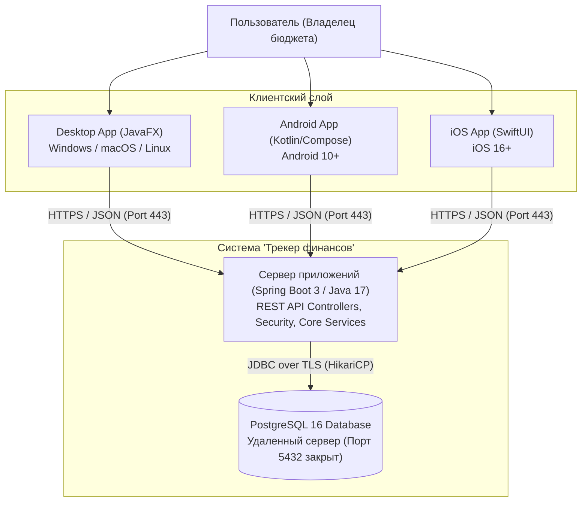
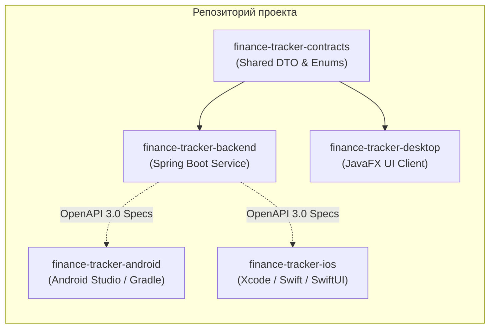
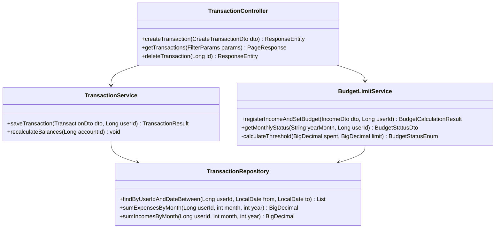
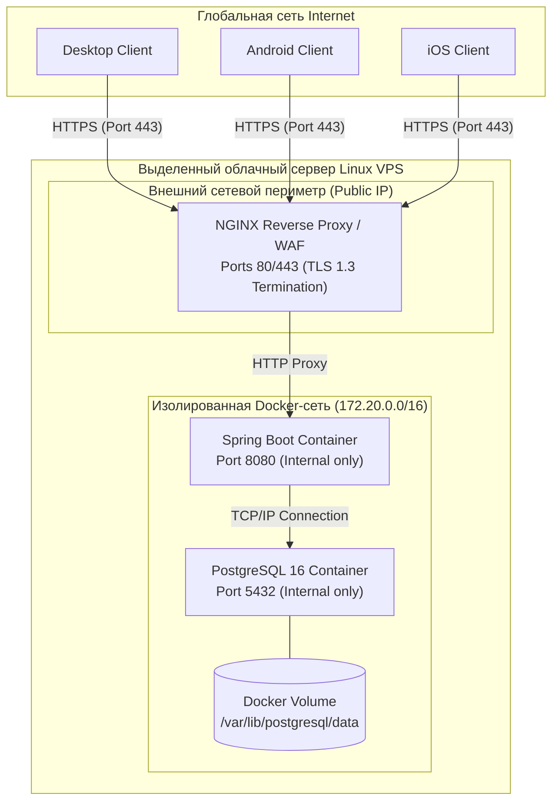
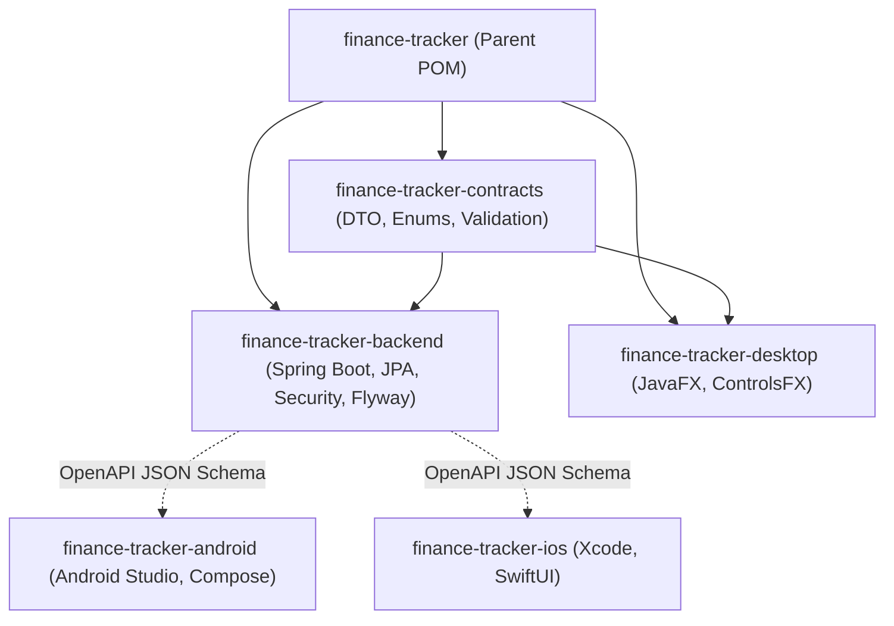
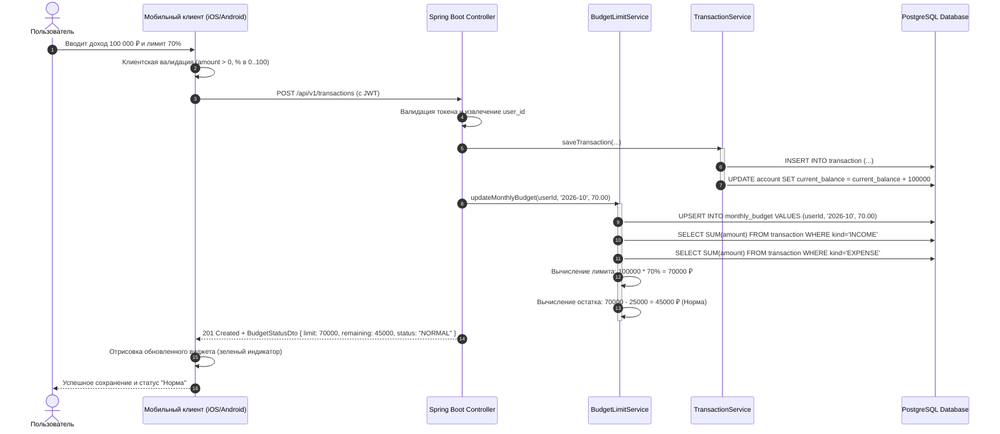
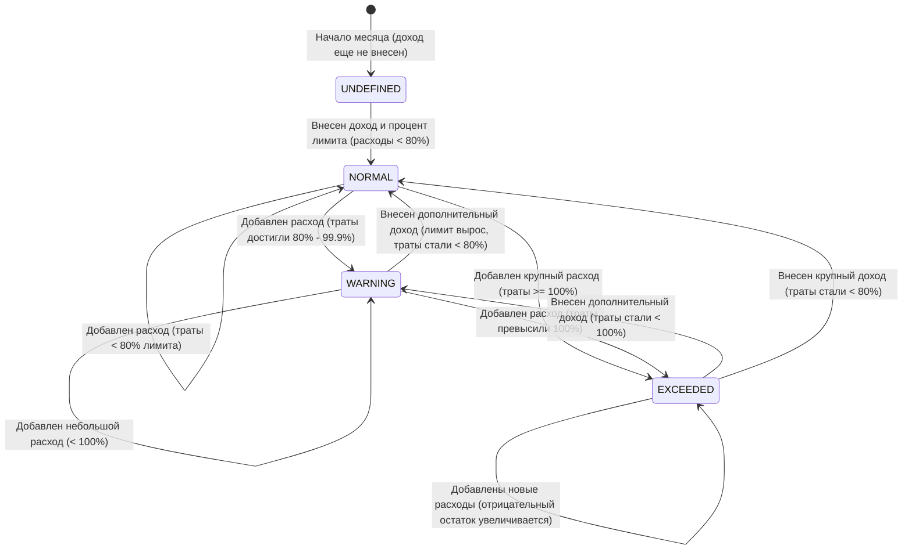

# Описание дизайна программного обеспечения (SDD)

Для системы «Трекер финансов» (Desktop, Android и iOS)

Версия 1.0 (Лабораторная работа №4)

Подготовил(а): Архитектор системы Романчук Георгий Александрович

Организация: Кафедра ЭВМ, БГУИР

Дата: 27.10.2026

Стандарт: IEEE 1016-2009 / ISO/IEC/IEEE 42010:2011

---

## Оглавление

* [1. Введение](#1-introduction)
  * [1.1 Назначение документа](#11-document-purpose)
  * [1.2 Область применения](#12-subject-scope)
  * [1.3 Определения, акронимы и сокращения](#13-definitions-acronyms-and-abbreviations)
  * [1.4 Ссылки](#14-references)
  * [1.5 Обзор документа](#15-document-overview)
* [2. Обзор дизайна](#2-design-overview)
  * [2.1 Задачи стейкхолдеров](#21-stakeholder-concerns)
  * [2.2 Выбранные точки зрения (15 Viewpoints)](#22-selected-viewpoints)
* [3. Проектные представления (Design Views)](#3-design-views)
  * [3.1 VIEW-CTX: Контекстное представление](#31-view-ctx)
  * [3.2 VIEW-COMP: Композиция подсистем](#32-view-comp)
  * [3.3 VIEW-LOG: Логическая структура классов](#33-view-log)
  * [3.4 VIEW-PHY: Физическая топология](#34-view-phy)
  * [3.5 VIEW-DEP: Граф зависимостей](#35-view-dep)
  * [3.6 VIEW-INF: Информационная модель данных](#36-view-inf)
  * [3.7 VIEW-INTF: Спецификация контрактов REST API](#37-view-intf)
  * [3.8 VIEW-SEQ: Взаимодействие в рантайме](#38-view-seq)
  * [3.9 VIEW-ALG: Алгоритм расчета лимита и статуса](#39-view-alg)
  * [3.10 VIEW-STAT: Динамика состояний бюджета](#310-view-stat)
  * [3.11 VIEW-CONC: Параллелизм и синхронизация](#311-view-conc)
  * [3.12 VIEW-PAT: Архитектурные паттерны](#312-view-pat)
  * [3.13 VIEW-DPL: Развертывание в Docker/Cloud](#313-view-dpl)
  * [3.14 VIEW-RES: Управление ресурсами](#314-view-res)
* [4. Архитектурные решения (ADR Summary)](#4-decisions)
* [5. Приложения](#5-appendixes)

---

## 1. Введение {#1-introduction}

### 1.1 Назначение документа {#11-document-purpose}
Настоящий документ Software Design Description (SDD) представляет архитектурное и детальное проектное описание программного продукта «Трекер финансов». Документ разработан в соответствии со стандартом IEEE 1016-2009 и определяет **КАК** реализуются требования, зафиксированные в согласованном документе SRS v0.5.
Целевая аудитория: разработчики Backend (Java/Spring Boot), Desktop (JavaFX), Mobile (Android / Kotlin, iOS / Swift), инженеры по качеству (QA), системные администраторы и Заказчик проекта.

### 1.2 Область применения {#12-subject-scope}
Дизайн охватывает полную реализацию версии 1.0 системы «Трекер финансов»:
- **Сервер приложений:** монолитный сервис на Java 17+ (Spring Boot 3.x), реализующий бизнес-правила, управление сессиями, авторизацию, расчет лимитов и транзакционность;
- **База данных:** удаленный инстанс PostgreSQL 16+ с пулом соединений HikariCP и миграциями Flyway;
- **Клиентские приложения:**
  - Настольное приложение на JavaFX 21+ для Windows/macOS/Linux;
  - Нативное мобильное приложение для Android (Kotlin / Jetpack Compose);
  - Нативное мобильное приложение для Apple iOS (SwiftUI / iOS 16+);
  - Общая библиотека контрактов и DTO.

### 1.3 Определения, акронимы и сокращения {#13-definitions-acronyms-and-abbreviations}

| Термин | Определение |
|--------|-------------|
| SDD | Software Design Description — описание проектирования ПО по стандарту IEEE 1016 |
| ADR | Architecture Decision Record — протокол архитектурного решения по шаблону MADR |
| DTO | Data Transfer Object — объект передачи данных между слоями и сервисами |
| REST | Representational State Transfer — стиль архитектуры сетевого взаимодействия |
| JWT | JSON Web Token — цифровой токен авторизации стандарта RFC 7519 |
| ORM | Object-Relational Mapping (Hibernate / Spring Data JPA) |
| ACID | Набор свойств транзакции: Atomicity, Consistency, Isolation, Durability |

### 1.4 Ссылки {#14-references}
1. IEEE Std 1016-2009: IEEE Standard for Information Technology — Systems Design — Software Design Descriptions.
2. ISO/IEC/IEEE 42010:2011: Systems and software engineering — Architecture description.
3. SRS: «Трекер финансов», Спецификация требований к ПО v0.5 (`/srs/srs.md`).
4. ADR: Протоколы архитектурных решений (`/docs/decisions/`).

### 1.5 Обзор документа {#15-document-overview}
Раздел 2 описывает ключевые задачи стейкхолдеров и перечень выбранных точек зрения. Раздел 3 содержит детальные проектные представления (Views) с диаграммами и спецификациями. Раздел 4 содержит сводку архитектурных решений MADR. Раздел 5 содержит матрицы трассируемости к требованиям SRS.

---

## 2. Обзор дизайна {#2-design-overview}

### 2.1 Задачи стейкхолдеров {#21-stakeholder-concerns}

| Стейкхолдер | Ключевые интересы и задачи | Адресующие проектные представления (Views) |
|-------------|----------------------------|---------------------------------------------|
| **Заказчик (Product Owner)** | Поддержка Android и iOS, соблюдение дедлайна, точность бюджетирования в % от дохода, сохранение бюджета разработки | VIEW-CTX, VIEW-COMP, VIEW-ALG, VIEW-INTF |
| **Пользователи (Desktop & Mobile)** | Скорость работы (<2 сек), идентичность данных на телефоне и ПК, наглядный статус бюджета | VIEW-INTF, VIEW-SEQ, VIEW-STAT, VIEW-RES |
| **Команда разработки (Senior + Junior)** | Модульность, разделение ответственности, четкие контракты API, простота параллельной работы | VIEW-COMP, VIEW-LOG, VIEW-DEP, VIEW-PAT |
| **DevOps / Системный инженер** | Простота деплоя в Docker, изоляция PostgreSQL, мониторинг `/health`, резервное копирование | VIEW-PHY, VIEW-DPL, VIEW-CONC |

### 2.2 Выбранные точки зрения (15 Viewpoints) {#22-selected-viewpoints}
Для всестороннего описания системы выбраны точки зрения стандарта ISO/IEC/IEEE 42010:
1. **Context** — внешние границы и акторы.
2. **Composition** — подсистемы и модули.
3. **Logical** — классы, доменная модель и слои.
4. **Physical** — серверное оборудование и сетевая топология.
5. **Structure & Dependency** — связи времени компиляции и сборки.
6. **Information** — ERD и реляционная схема PostgreSQL.
7. **Interface** — OpenAPI контракты эндпоинтов.
8. **Interaction** — диаграммы последовательности (Sequence).
9. **Algorithm** — логика вычисления лимитов и округления.
10. **State Dynamics** — конечный автомат статуса месячного бюджета.
11. **Concurrency** — потоки, блокировки и транзакции.
12. **Patterns** — слоистая архитектура, DTO, Repository, Strategy.
13. **Deployment** — контейнеризация Docker Compose.
14. **Resources** — память JVM, пул соединений БД, квоты.

---

## 3. Проектные представления (Design Views) {#3-design-views}

### 3.1 VIEW-CTX: Контекстное представление {#31-view-ctx}
- **ID:** VIEW-CTX-001
- **Viewpoint:** Context
- **Адресуемые требования SRS:** REQ-INT-001-3, REQ-INT-008-3, REQ-FUNC-026-2, REQ-FUNC-031-2, REQ-DIST-002
- **Описание:** Пользователь взаимодействует с тремя клиентскими приложениями. Все клиенты общаются с единым сервером приложений Spring Boot исключительно через HTTPS REST API. База данных PostgreSQL закрыта от внешнего мира и доступна только бэкенду.



---

### 3.2 VIEW-COMP: Композиция подсистем {#32-view-comp}
- **ID:** VIEW-COMP-001
- **Viewpoint:** Composition
- **Адресуемые требования SRS:** REQ-MAINT-001-3, REQ-REUSE-001-2, CON-06, CON-10
- **Описание:** Модульная организация кодовой базы. Модуль `core-dto` шарится между бэкендом и десктопом, а также используется для автогенерации TypeScript/Swift/Kotlin моделей через OpenAPI Generator.



---

### 3.3 VIEW-LOG: Логическая структура классов и слоев {#33-view-log}
- **ID:** VIEW-LOG-001
- **Viewpoint:** Logical
- **Адресуемые требования SRS:** REQ-MAINT-001-3, REQ-INT-006-3, CON-06
- **Описание:** Бэкенд строго разделен на три слоя:
  1. **Presentation / Web Layer:** REST Контроллеры (`AuthController`, `AccountController`, `TransactionController`, `BudgetController`, `ReportController`). Принимают DTO, валидируют входные параметры (`@Valid`), возвращают `ResponseEntity<ApiResponse<T>>`.
  2. **Service / Domain Layer:** Сервисы с бизнес-логикой (`AccountService`, `TransactionService`, `BudgetLimitService`, `CategoryService`, `ReportService`). Выполняют расчеты в `BigDecimal`, управляют транзакциями (`@Transactional`).
  3. **Data Access / Persistence Layer:** Интерфейсы `JpaRepository` (`AccountRepository`, `TransactionRepository`, `MonthlyBudgetRepository`).



---

### 3.4 VIEW-PHY: Физическая топология {#34-view-phy}
- **ID:** VIEW-PHY-001
- **Viewpoint:** Physical
- **Адресуемые требования SRS:** REQ-DIST-002, REQ-SEC-008, REQ-AVAIL-002, CON-03
- **Описание:** Серверная часть развернута на защищенном узле Linux VPS (Ubuntu 24.04 LTS). Сервер приложений и PostgreSQL изолированы во внутренней виртуальной подсети Docker (`172.20.0.0/16`). Порт 5432 СУБД закрыт во внешнюю сеть. Входящий веб-трафик поступает через Reverse Proxy NGINX по портам 80/443 с сертификатом Let's Encrypt TLS 1.3.



---

### 3.5 VIEW-DEP: Граф зависимостей компиляции и сборки {#35-view-dep}
- **ID:** VIEW-DEP-001
- **Viewpoint:** Dependency
- **Адресуемые требования SRS:** REQ-BUILD-001-3, REQ-COMP-001
- **Описание:** Проект организован по многомодульной схеме. Общие контракты (`finance-tracker-contracts`) не содержат платформенно-зависимых библиотек и собираются первыми.



---

### 3.6 VIEW-INF: Информационная модель данных (PostgreSQL) {#36-view-inf}
- **ID:** VIEW-INF-001
- **Viewpoint:** Information
- **Адресуемые требования SRS:** REQ-REL-001-3, REQ-REL-003-2, REQ-SEC-007-2, CON-05
- **Описание:** Реляционная структура данных нормализована до 3NF. Все денежные поля типизированы как `NUMERIC(19, 2)`. Таблицы снабжены внешними ключами с каскадными ограничениями и индексами по `(user_id, date)`.

```sql
-- Таблица пользователей
CREATE TABLE app_user (
    id BIGSERIAL PRIMARY KEY,
    email VARCHAR(255) NOT NULL UNIQUE,
    password_hash VARCHAR(255) NOT NULL,
    created_at TIMESTAMP WITH TIME ZONE DEFAULT CURRENT_TIMESTAMP,
    consent_given BOOLEAN NOT NULL DEFAULT FALSE
);

-- Таблица счетов
CREATE TABLE account (
    id BIGSERIAL PRIMARY KEY,
    user_id BIGINT NOT NULL REFERENCES app_user(id) ON DELETE CASCADE,
    name VARCHAR(100) NOT NULL,
    kind VARCHAR(50) NOT NULL, -- CASH, CARD, DEPOSIT
    currency VARCHAR(3) NOT NULL DEFAULT 'RUB',
    initial_balance NUMERIC(19, 2) NOT NULL DEFAULT 0.00,
    current_balance NUMERIC(19, 2) NOT NULL DEFAULT 0.00,
    archived BOOLEAN NOT NULL DEFAULT FALSE
);

-- Таблица категорий
CREATE TABLE category (
    id BIGSERIAL PRIMARY KEY,
    user_id BIGINT REFERENCES app_user(id) ON DELETE CASCADE, -- NULL для системного каталога
    name VARCHAR(100) NOT NULL,
    kind VARCHAR(50) NOT NULL, -- INCOME, EXPENSE
    icon_name VARCHAR(50),
    archived BOOLEAN NOT NULL DEFAULT FALSE
);

-- Таблица транзакций
CREATE TABLE transaction (
    id BIGSERIAL PRIMARY KEY,
    user_id BIGINT NOT NULL REFERENCES app_user(id) ON DELETE CASCADE,
    account_id BIGINT NOT NULL REFERENCES account(id),
    target_account_id BIGINT REFERENCES account(id), -- для TRANSFER
    category_id BIGINT REFERENCES category(id),
    amount NUMERIC(19, 2) NOT NULL,
    kind VARCHAR(50) NOT NULL, -- INCOME, EXPENSE, TRANSFER
    date DATE NOT NULL,
    description TEXT,
    version INT NOT NULL DEFAULT 1 -- Оптимистическая блокировка
);

-- Таблица месячных бюджетов (% от дохода)
CREATE TABLE monthly_budget (
    id BIGSERIAL PRIMARY KEY,
    user_id BIGINT NOT NULL REFERENCES app_user(id) ON DELETE CASCADE,
    year_month VARCHAR(7) NOT NULL, -- 'YYYY-MM'
    limit_percent NUMERIC(5, 2) NOT NULL, -- например 70.00
    UNIQUE(user_id, year_month)
);

CREATE INDEX idx_transaction_user_date ON transaction(user_id, date);
CREATE INDEX idx_account_user ON account(user_id);
```

---

### 3.7 VIEW-INTF: Спецификация контрактов REST API {#37-view-intf}
- **ID:** VIEW-INTF-001
- **Viewpoint:** Interface
- **Адресуемые требования SRS:** REQ-INT-008-3, REQ-FUNC-012-3, REQ-FUNC-013-3
- **Описание:** Контракты сетевого интерфейса между всеми клиентами и сервером приложений.

| Метод | Путь эндпоинта | Описание | Формат тела запроса / ответа |
|-------|----------------|----------|------------------------------|
| `POST` | `/api/v1/auth/register` | Регистрация нового аккаунта | `{ email, password, consent }` -> `{ token, userId }` |
| `POST` | `/api/v1/auth/login` | Вход и получение JWT | `{ email, password }` -> `{ accessToken, refreshToken }` |
| `GET` | `/api/v1/accounts` | Список активных счетов пользователя | `Bearer JWT` -> `[{ id, name, balance, currency, kind }]` |
| `POST` | `/api/v1/transactions` | Создание операции (доход/расход) | `{ accountId, categoryId, amount, date, kind, budgetPercent }` |
| `GET` | `/api/v1/budgets/current` | Получение статуса месячного лимита | `Bearer JWT` -> `{ month, totalIncome, limitPercent, absoluteLimit, totalExpenses, remainingLimit, status }` |
| `GET` | `/api/v1/reports/categories` | Агрегированные данные для круговой диаграммы | `?from=YYYY-MM-DD&to=YYYY-MM-DD` -> `[{ category, amount, percent }]` |
| `GET` | `/health` | Проверка состояния бэкенда и БД | Открытый -> `{ status: "UP", database: "CONNECTED" }` |

---

### 3.8 VIEW-SEQ: Взаимодействие в рантайме (Внесение дохода с лимитом %) {#38-view-seq}
- **ID:** VIEW-SEQ-001
- **Viewpoint:** Interaction
- **Адресуемые требования SRS:** REQ-FUNC-012-3, REQ-FUNC-013-3, REQ-FUNC-026-2
- **Описание:** Сценарий внесения дохода со смартфона (iOS/Android), пересчет абсолютного лимита и синхронизация дашборда.



---

### 3.9 VIEW-ALG: Алгоритм расчета месячного лимита и индикации {#39-view-alg}
- **ID:** VIEW-ALG-001
- **Viewpoint:** Algorithm
- **Адресуемые требования SRS:** REQ-FUNC-012-3, REQ-FUNC-013-3, REQ-FUNC-014-3, REQ-REL-003-2
- **Псевдокод алгоритма:**

```java
public BudgetStatusDto calculateBudgetStatus(Long userId, YearMonth month) {
    BigDecimal totalIncome = transactionRepository.sumIncomeByMonth(userId, month);
    BigDecimal totalExpense = transactionRepository.sumExpenseByMonth(userId, month);
    
    MonthlyBudget budget = budgetRepository.findByUserIdAndYearMonth(userId, month)
        .orElse(null);
        
    if (budget == null || totalIncome.compareTo(BigDecimal.ZERO) <= 0) {
        return BudgetStatusDto.undefined("Укажите доход и процент лимита");
    }
    
    // Абсолютный лимит = Доход * (Процент / 100)
    BigDecimal percentFactor = budget.getLimitPercent()
        .divide(new BigDecimal("100"), 4, RoundingMode.HALF_UP);
    BigDecimal absoluteLimit = totalIncome.multiply(percentFactor)
        .setScale(2, RoundingMode.HALF_UP);
        
    // Остаток лимита = Абсолютный лимит - Расходы
    BigDecimal remainingLimit = absoluteLimit.subtract(totalExpense)
        .setScale(2, RoundingMode.HALF_UP);
        
    // Процент освоения лимита
    BigDecimal spentPercent = BigDecimal.ZERO;
    if (absoluteLimit.compareTo(BigDecimal.ZERO) > 0) {
        spentPercent = totalExpense.divide(absoluteLimit, 4, RoundingMode.HALF_UP)
            .multiply(new BigDecimal("100"))
            .setScale(1, RoundingMode.HALF_UP);
    }
    
    // Определение статуса светофора
    BudgetStatusEnum status;
    if (spentPercent.compareTo(new BigDecimal("80.0")) < 0) {
        status = BudgetStatusEnum.NORMAL;       // < 80%: Зеленый + Галочка
    } else if (spentPercent.compareTo(new BigDecimal("100.0")) < 0) {
        status = BudgetStatusEnum.WARNING;      // 80% - 99.9%: Желтый + Треугольник
    } else {
        status = BudgetStatusEnum.EXCEEDED;     // >= 100%: Красный + Стоп
    }
    
    return new BudgetStatusDto(month, totalIncome, budget.getLimitPercent(),
                               absoluteLimit, totalExpense, remainingLimit, spentPercent, status);
}
```

---

### 3.10 VIEW-STAT: Динамика состояний бюджета {#310-view-stat}
- **ID:** VIEW-STAT-001
- **Viewpoint:** State Dynamics
- **Адресуемые требования SRS:** REQ-FUNC-013-3
- **Описание:** Конечный автомат статуса месячного бюджета пользователя.



---

### 3.11 VIEW-CONC: Параллелизм, транзакции и синхронизация {#311-view-conc}
- **ID:** VIEW-CONC-001
- **Viewpoint:** Concurrency
- **Адресуемые требования SRS:** REQ-FUNC-026-2, REQ-REL-001-3, REQ-PERF-005-2
- **Описание:** Управление конкурентным доступом на уровне базы данных и сервера:
  1. **Оптимистическая блокировка (`@Version`):** Каждая сущность `Transaction` и `Account` содержит целочисленное поле версии. При конфликте параллельного обновления с Desktop и iOS сервер выбрасывает `OptimisticLockException` и возвращает HTTP 409 Conflict с предложением обновить снимок.
  2. **Изоляция транзакций:** Уровень `READ COMMITTED` по умолчанию в PostgreSQL предотвращает Dirty Reads. Операция межсчетного перевода выполняется в блоке `@Transactional(isolation = Isolation.REPEATABLE_READ)`.
  3. **Пул потоков Tomcat / HikariCP:** Пул Tomcat настроен на 200 рабочих потоков, HikariCP выделяет до 30 активных соединений с базой данных, гарантируя отсутствие исчерпания ресурсов при пиковых нагрузках (150 rps).

---

### 3.12 VIEW-PAT: Архитектурные и проектные паттерны {#312-view-pat}
- **ID:** VIEW-PAT-001
- **Viewpoint:** Patterns
- **Адресуемые требования SRS:** REQ-MAINT-001-3, REQ-REUSE-001-2
- **Описание:** 
  - **Clean Architecture / Layered Architecture:** Строгое разделение ответственности Presentation -> Domain -> Data.
  - **DTO Pattern:** Инкапсуляция входящих и исходящих данных без утечки JPA-сущностей во внешний API.
  - **Strategy Pattern:** Подсистема аналитических отчетов (`ReportGeneratorStrategy`: `PieChartStrategy`, `BarChartStrategy`, `TrendStrategy`).
  - **Repository Pattern:** Абстракция хранилища данных через Spring Data JPA.
  - **MVVM / MVI в мобильных клиентах:** В Android (Jetpack Compose) и iOS (SwiftUI) применен шаблон MVVM с однонаправленным потоком данных (Unidirectional Data Flow).

---

### 3.13 VIEW-DPL: Развёртывание в Docker {#313-view-dpl}
- **ID:** VIEW-DPL-001
- **Viewpoint:** Deployment
- **Адресуемые требования SRS:** REQ-INST-002, REQ-SEC-008
- **Описание:** Декларативная спецификация `docker-compose.yml` для автоматизированного запуска серверного стека:

```yaml
version: '3.8'

services:
  postgres:
    image: postgres:16-alpine
    container_name: finance-postgres
    restart: always
    environment:
      POSTGRES_DB: financetracker
      POSTGRES_USER: ${DB_USER}
      POSTGRES_PASSWORD: ${DB_PASSWORD}
    volumes:
      - pgdata:/var/lib/postgresql/data
    networks:
      - internal-net

  backend:
    image: finance-tracker-backend:1.0.0
    container_name: finance-backend
    restart: always
    depends_on:
      - postgres
    environment:
      SPRING_DATASOURCE_URL: jdbc:postgresql://postgres:5432/financetracker
      SPRING_DATASOURCE_USERNAME: ${DB_USER}
      SPRING_DATASOURCE_PASSWORD: ${DB_PASSWORD}
      JWT_SECRET: ${JWT_SECRET}
    ports:
      - "127.0.0.1:8080:8080"
    networks:
      - internal-net

networks:
  internal-net:
    driver: bridge

volumes:
  pgdata:
```

---

### 3.14 VIEW-RES: Управление системными ресурсами {#314-view-res}
- **ID:** VIEW-RES-001
- **Viewpoint:** Resources
- **Адресуемые требования SRS:** REQ-PERF-004-2, REQ-PERF-005-2
- **Описание:** 
  - **Сервер:** Ограничение памяти JVM `-Xms256m -Xmx512m` в контейнере Docker. Утилизация CPU бэкенда в пике не превышает 35% от 2-ядерного vCPU.
  - **Desktop Client:** Пиковое потребление памяти JavaFX — до 250 МБ.
  - **Mobile Clients (Android / iOS):** Использование памяти процессами мобильных приложений не превышает 120 МБ. Сетевой пейлоад одной страницы транзакций — менее 25 КБ благодаря сжатию GZIP.

---

## 4. Архитектурные решения (ADR Summary) {#4-decisions}

В проекте зафиксированы архитектурные решения по шаблону MADR:

| Номер | Заголовок решения | Статус | Адресуемые требования SRS |
|---|---|---|---|
| **ADR-001** | Выбор графического фреймворка JavaFX для настольного клиента | proposed | REQ-PORT-001, CON-02, REQ-FUNC-015..017 |
| **ADR-002** | Трёхзвенная архитектура и хранение данных в удалённой СУБД PostgreSQL | proposed | REQ-DIST-002, REQ-INT-006, CON-03, REQ-SEC-008 |
| **ADR-003** | Модель месячного лимита расходов в процентах от дохода | proposed | REQ-FUNC-012..014, CON-08, REQ-INT-004 |

Полные тексты протоколов решений приведены в каталоге `/docs/decisions/`.

---

## 5. Приложения {#5-appendixes}

### Матрица трассируемости «Требования SRS -> Проектные представления SDD»

| ID требования SRS | Наименование требования | Реализующее проектное представление SDD |
|-------------------|-------------------------|------------------------------------------|
| REQ-INT-001-3 | Навигация Desktop/Android/iOS | VIEW-CTX-001, VIEW-COMP-001 |
| REQ-INT-006-3 | Безопасность PostgreSQL | VIEW-PHY-001, VIEW-INF-001 |
| REQ-INT-008-3 | Единый REST API v1 | VIEW-INTF-001, VIEW-SEQ-001 |
| REQ-FUNC-002 | Расчет балансов в BigDecimal | VIEW-LOG-001, VIEW-INF-001 |
| REQ-FUNC-012-3 | Лимит в % от дохода | VIEW-ALG-001, VIEW-SEQ-001, VIEW-INF-001 |
| REQ-FUNC-013-3 | Светофорная индикация лимита | VIEW-ALG-001, VIEW-STAT-001 |
| REQ-FUNC-026-2 | Синхронизация между устройствами| VIEW-CTX-001, VIEW-CONC-001 |
| REQ-DIST-002 | Трёхзвенная архитектура | VIEW-CTX-001, VIEW-PHY-001 |
| REQ-PORT-001-3 | Поддержка Desktop, Android, iOS | VIEW-CTX-001, VIEW-COMP-001, VIEW-DEP-001 |
