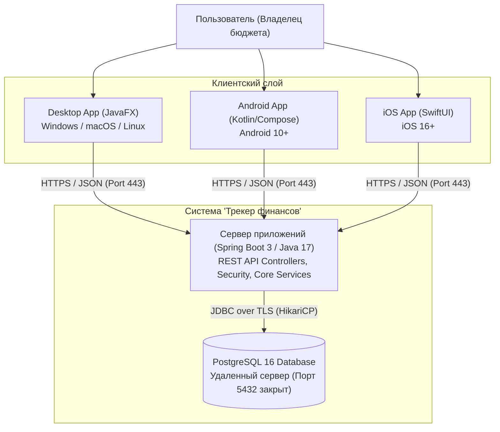
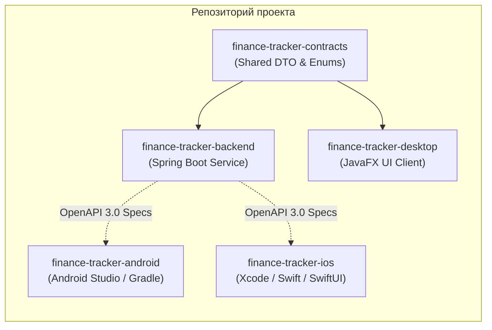
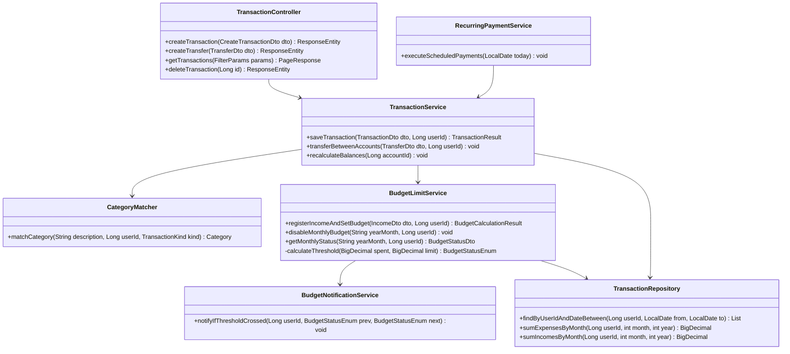
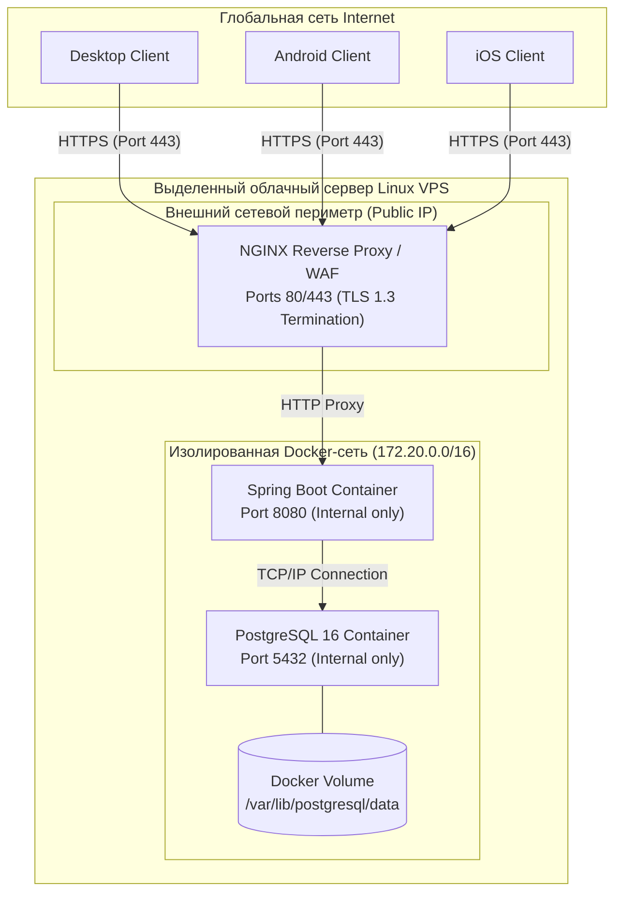
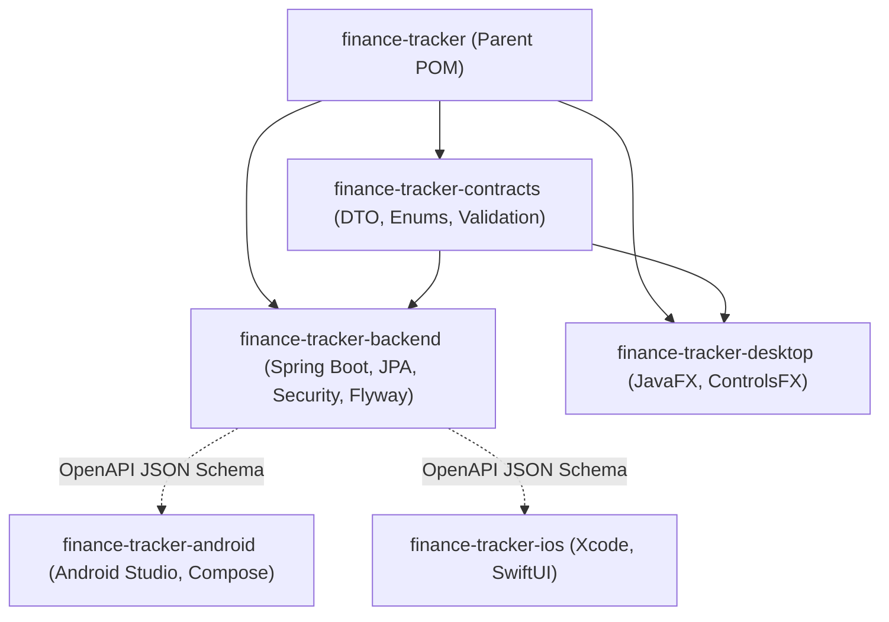
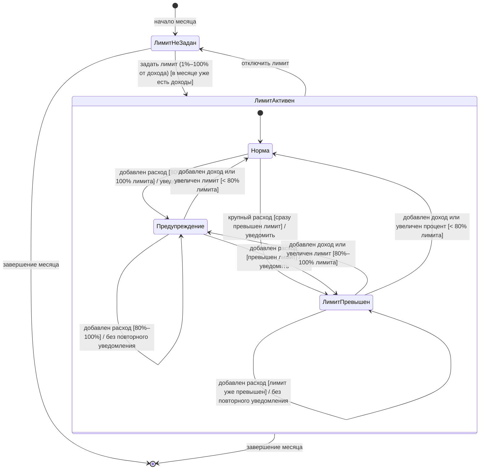

# Описание дизайна программного обеспечения (SDD)

Для системы «Трекер финансов» (Desktop, Android и iOS)

Версия 1.1 

Подготовил(а): Архитектор системы Романчук Георгий Александрович

Организация: Кафедра ЭВМ, БГУИР

Дата: 25.11.2026

Стандарт: IEEE 1016-2009 / ISO/IEC/IEEE 42010:2011 / OMG UML 2.5

---

## Оглавление

* [1. Введение](#1-introduction)
  * [1.1 Назначение документа](#11-document-purpose)
  * [1.2 Область применения](#12-subject-scope)
  * [1.3 Определения, акронимы и сокращения](#13-definitions-acronyms-and-abbreviations)
  * [1.4 Ссылки](#14-references)
  * [1.5 Обзор документа](#15-document-overview)
* [2. Обзор дизайна](#2-design-overview)
  * [2.1 Задачи стейкхолдеров](#21-stakeholder-concerns)
  * [2.2 Выбранные точки зрения (15 Viewpoints)](#22-selected-viewpoints)
* [3. Проектные представления (Design Views)](#3-design-views)
  * [3.1 VIEW-CTX: Контекстное представление](#31-view-ctx)
  * [3.2 VIEW-COMP: Композиция подсистем](#32-view-comp)
  * [3.3 VIEW-LOG: Логическая структура классов](#33-view-log)
  * [3.4 VIEW-PHY: Физическая топология](#34-view-phy)
  * [3.5 VIEW-DEP: Граф зависимостей](#35-view-dep)
  * [3.6 VIEW-INF: Информационная модель данных](#36-view-inf)
  * [3.7 VIEW-INTF: Спецификация контрактов REST API](#37-view-intf)
  * [3.8 VIEW-SEQ: Взаимодействие в рантайме](#38-view-seq)
  * [3.9 VIEW-ALG: Алгоритм расчета лимита и статуса](#39-view-alg)
  * [3.10 VIEW-STAT: Динамика состояний бюджета](#310-view-stat)
  * [3.11 VIEW-CONC: Параллелизм и синхронизация](#311-view-conc)
  * [3.12 VIEW-PAT: Архитектурные паттерны](#312-view-pat)
  * [3.13 VIEW-DPL: Развертывание в Docker/Cloud](#313-view-dpl)
  * [3.14 VIEW-RES: Управление ресурсами](#314-view-res)
  * [3.15 VIEW-BHV: Динамическое поведение и модели UML 2.5](#315-view-bhv)
* [4. Архитектурные решения (ADR Summary)](#4-decisions)
* [5. Приложения](#5-appendixes)

---

## 1. Введение {#1-introduction}

### 1.1 Назначение документа {#11-document-purpose}
Настоящий документ Software Design Description (SDD) представляет архитектурное и детальное проектное описание программного продукта «Трекер финансов». Документ разработан в соответствии со стандартом IEEE 1016-2009 и определяет **КАК** реализуются требования, зафиксированные в спецификации требований SRS (`srs/srs.md`), модели вариантов использования (`docs/lab5/use-cases.md`) и дополнительных спецификациях FURPS+ (`docs/lab5/supplementary-specifications.md`).
Целевая аудитория: разработчики Backend (Java/Spring Boot), Desktop (JavaFX), Mobile (Android / Kotlin, iOS / Swift), инженеры по качеству (QA), системные администраторы и Заказчик проекта.

### 1.2 Область применения {#12-subject-scope}
Дизайн охватывает полную реализацию версии 1.0 системы «Трекер финансов»:
- **Сервер приложений:** монолитный сервис на Java 17+ (Spring Boot 3.x), реализующий бизнес-правила, управление сессиями, авторизацию, расчет лимитов и транзакционность;
- **База данных:** удаленный инстанс PostgreSQL 16+ с пулом соединений HikariCP и миграциями Flyway;
- **Клиентские приложения:**
  - Настольное приложение на JavaFX 21+ для Windows/macOS/Linux;
  - Нативное мобильное приложение для Android (Kotlin / Jetpack Compose);
  - Нативное мобильное приложение для Apple iOS (SwiftUI / iOS 16+);
  - Общая библиотека контрактов и DTO.

### 1.3 Определения, акронимы и сокращения {#13-definitions-acronyms-and-abbreviations}

| Термин | Определение |
|--------|-------------|
| SDD | Software Design Description — описание проектирования ПО по стандарту IEEE 1016 |
| ADR | Architecture Decision Record — протокол архитектурного решения по шаблону MADR |
| DTO | Data Transfer Object — объект передачи данных между слоями и сервисами |
| REST | Representational State Transfer — стиль архитектуры сетевого взаимодействия |
| JWT | JSON Web Token — цифровой токен авторизации стандарта RFC 7519 |
| ORM | Object-Relational Mapping (Hibernate / Spring Data JPA) |
| ACID | Набор свойств транзакции: Atomicity, Consistency, Isolation, Durability |

### 1.4 Ссылки {#14-references}
1. IEEE Std 1016-2009: IEEE Standard for Information Technology — Systems Design — Software Design Descriptions.
2. ISO/IEC/IEEE 42010:2011: Systems and software engineering — Architecture description.
3. ISO/IEC 19505 (OMG UML 2.5): Unified Modeling Language Specification.
4. SRS: «Трекер финансов», Спецификация требований к ПО (`/srs/srs.md`).
5. ADR: Протоколы архитектурных решений (`/docs/decisions/`).
6. Артефакты динамического моделирования (ЛР5): Глоссарий (`/docs/lab5/glossary.md`), Дополнительные спецификации (`/docs/lab5/supplementary-specifications.md`), Модель вариантов использования (`/docs/lab5/use-cases.md`), UML-схемы (`/docs/lab5/uml/`).

### 1.5 Обзор документа {#15-document-overview}
Раздел 2 описывает ключевые задачи стейкхолдеров и перечень выбранных точек зрения. Раздел 3 содержит детальные проектные представления (Views 3.1–3.15) с диаграммами и спецификациями, включая поведенческие UML-модели из лабораторной работы №5. Раздел 4 содержит сводку архитектурных решений MADR. Раздел 5 содержит матрицы трассируемости к требованиям SRS и прецедентам `UC-01`–`UC-10`.

---

## 2. Обзор дизайна {#2-design-overview}

### 2.1 Задачи стейкхолдеров {#21-stakeholder-concerns}

| Стейкхолдер | Ключевые интересы и задачи | Адресующие проектные представления (Views) |
|-------------|----------------------------|---------------------------------------------|
| **Заказчик (Product Owner)** | Поддержка Android и iOS, соблюдение дедлайна, точность бюджетирования в % от дохода, сохранение бюджета разработки | VIEW-CTX, VIEW-COMP, VIEW-ALG, VIEW-INTF |
| **Пользователи (Desktop & Mobile)** | Скорость работы (<2 сек), идентичность данных на телефоне и ПК, наглядный статус бюджета | VIEW-INTF, VIEW-SEQ, VIEW-STAT, VIEW-RES |
| **Команда разработки (Senior + Junior)** | Модульность, разделение ответственности, четкие контракты API, простота параллельной работы | VIEW-COMP, VIEW-LOG, VIEW-DEP, VIEW-PAT |
| **DevOps / Системный инженер** | Простота деплоя в Docker, изоляция PostgreSQL, мониторинг `/health`, резервное копирование | VIEW-PHY, VIEW-DPL, VIEW-CONC |

### 2.2 Выбранные точки зрения (15 Viewpoints) {#22-selected-viewpoints}
Для всестороннего описания системы выбраны точки зрения стандарта ISO/IEC/IEEE 42010:
1. **Context** — внешние границы и акторы.
2. **Composition** — подсистемы и модули.
3. **Logical** — классы, доменная модель и слои.
4. **Physical** — серверное оборудование и сетевая топология.
5. **Structure & Dependency** — связи времени компиляции и сборки.
6. **Information** — ERD и реляционная схема PostgreSQL.
7. **Interface** — OpenAPI контракты эндпоинтов.
8. **Interaction** — диаграммы последовательности (Sequence).
9. **Algorithm** — логика вычисления лимитов и округления.
10. **State Dynamics** — конечный автомат статуса месячного бюджета.
11. **Concurrency** — потоки, блокировки и транзакции.
12. **Patterns** — слоистая архитектура, DTO, Repository, Strategy.
13. **Deployment** — контейнеризация Docker Compose.
14. **Resources** — память JVM, пул соединений БД, квоты.
15. **Behavioral / Use Case & Activity** — модель вариантов использования (`UC-01`–`UC-10`) и алгоритмы активности планировщика регулярных платежей.

---

## 3. Проектные представления (Design Views) {#3-design-views}

### 3.1 VIEW-CTX: Контекстное представление {#31-view-ctx}
- **ID:** VIEW-CTX-001
- **Viewpoint:** Context
- **Адресуемые требования SRS:** REQ-INT-001-3, REQ-INT-008-3, REQ-FUNC-026-2, REQ-FUNC-031-2, REQ-DIST-002
- **Описание:** Пользователь взаимодействует с тремя клиентскими приложениями. Все клиенты общаются с единым сервером приложений Spring Boot исключительно через HTTPS REST API. База данных PostgreSQL закрыта от внешнего мира и доступна только бэкенду.



---

### 3.2 VIEW-COMP: Композиция подсистем {#32-view-comp}
- **ID:** VIEW-COMP-001
- **Viewpoint:** Composition
- **Адресуемые требования SRS:** REQ-MAINT-001-3, REQ-REUSE-001-2, CON-06, CON-10
- **Описание:** Модульная организация кодовой базы. Модуль `core-dto` шарится между бэкендом и десктопом, а также используется для автогенерации TypeScript/Swift/Kotlin моделей через OpenAPI Generator.



---

### 3.3 VIEW-LOG: Логическая структура классов и слоев {#33-view-log}
- **ID:** VIEW-LOG-001
- **Viewpoint:** Logical
- **Адресуемые требования SRS:** REQ-MAINT-001-3, REQ-INT-006-3, CON-06
- **Описание:** Бэкенд строго разделен на три слоя:
  1. **Presentation / Web Layer:** REST Контроллеры (`AuthController`, `AccountController`, `TransactionController`, `BudgetController`, `RecurringPaymentController`, `ReportController`). Принимают DTO, валидируют входные параметры (`@Valid`), возвращают `ResponseEntity<ApiResponse<T>>`.
  2. **Service / Domain Layer:** Сервисы с бизнес-логикой (`AccountService`, `TransactionService`, `CategoryMatcher`, `BudgetLimitService`, `BudgetNotificationService`, `RecurringPaymentService`, `CategoryService`, `ReportService`). Выполняют расчеты в `BigDecimal`, управляют транзакциями (`@Transactional`).
  3. **Data Access / Persistence Layer:** Интерфейсы `JpaRepository` (`AccountRepository`, `TransactionRepository`, `MonthlyBudgetRepository`, `RecurringPaymentRepository`, `CategoryRepository`).



---

### 3.4 VIEW-PHY: Физическая топология {#34-view-phy}
- **ID:** VIEW-PHY-001
- **Viewpoint:** Physical
- **Адресуемые требования SRS:** REQ-DIST-002, REQ-SEC-008, REQ-AVAIL-002, CON-03
- **Описание:** Серверная часть развернута на защищенном узле Linux VPS (Ubuntu 24.04 LTS). Сервер приложений и PostgreSQL изолированы во внутренней виртуальной подсети Docker (`172.20.0.0/16`). Порт 5432 СУБД закрыт во внешнюю сеть. Входящий веб-трафик поступает через Reverse Proxy NGINX по портам 80/443 с сертификатом Let's Encrypt TLS 1.3.



---

### 3.5 VIEW-DEP: Граф зависимостей компиляции и сборки {#35-view-dep}
- **ID:** VIEW-DEP-001
- **Viewpoint:** Dependency
- **Адресуемые требования SRS:** REQ-BUILD-001-3, REQ-COMP-001
- **Описание:** Проект организован по многомодульной схеме. Общие контракты (`finance-tracker-contracts`) не содержат платформенно-зависимых библиотек и собираются первыми.



---

### 3.6 VIEW-INF: Информационная модель данных (PostgreSQL) {#36-view-inf}
- **ID:** VIEW-INF-001
- **Viewpoint:** Information
- **Адресуемые требования SRS:** REQ-REL-001-3, REQ-REL-003-2, REQ-SEC-007-2, CON-05
- **Описание:** Реляционная структура данных нормализована до 3NF. Все денежные поля типизированы как `NUMERIC(19, 2)`. Таблицы снабжены внешними ключами с каскадными ограничениями и индексами по `(user_id, date)`.

```sql
-- Таблица пользователей
CREATE TABLE app_user (
    id BIGSERIAL PRIMARY KEY,
    email VARCHAR(255) NOT NULL UNIQUE,
    password_hash VARCHAR(255) NOT NULL,
    created_at TIMESTAMP WITH TIME ZONE DEFAULT CURRENT_TIMESTAMP,
    consent_given BOOLEAN NOT NULL DEFAULT FALSE
);

-- Таблица счетов
CREATE TABLE account (
    id BIGSERIAL PRIMARY KEY,
    user_id BIGINT NOT NULL REFERENCES app_user(id) ON DELETE CASCADE,
    name VARCHAR(100) NOT NULL,
    kind VARCHAR(50) NOT NULL, -- CASH, CARD, DEPOSIT
    currency VARCHAR(3) NOT NULL DEFAULT 'RUB',
    initial_balance NUMERIC(19, 2) NOT NULL DEFAULT 0.00,
    current_balance NUMERIC(19, 2) NOT NULL DEFAULT 0.00,
    archived BOOLEAN NOT NULL DEFAULT FALSE
);

-- Таблица категорий
CREATE TABLE category (
    id BIGSERIAL PRIMARY KEY,
    user_id BIGINT REFERENCES app_user(id) ON DELETE CASCADE, -- NULL для системного каталога
    name VARCHAR(100) NOT NULL,
    kind VARCHAR(50) NOT NULL, -- INCOME, EXPENSE
    icon_name VARCHAR(50),
    archived BOOLEAN NOT NULL DEFAULT FALSE
);

-- Таблица транзакций
CREATE TABLE transaction (
    id BIGSERIAL PRIMARY KEY,
    user_id BIGINT NOT NULL REFERENCES app_user(id) ON DELETE CASCADE,
    account_id BIGINT NOT NULL REFERENCES account(id),
    target_account_id BIGINT REFERENCES account(id), -- для TRANSFER
    category_id BIGINT REFERENCES category(id),
    amount NUMERIC(19, 2) NOT NULL,
    kind VARCHAR(50) NOT NULL, -- INCOME, EXPENSE, TRANSFER
    date DATE NOT NULL,
    description TEXT,
    version INT NOT NULL DEFAULT 1 -- Оптимистическая блокировка
);

-- Таблица месячных бюджетов (% от дохода)
CREATE TABLE monthly_budget (
    id BIGSERIAL PRIMARY KEY,
    user_id BIGINT NOT NULL REFERENCES app_user(id) ON DELETE CASCADE,
    year_month VARCHAR(7) NOT NULL, -- 'YYYY-MM'
    limit_percent NUMERIC(5, 2) NOT NULL, -- диапазон 1.00 .. 100.00
    last_notified_status VARCHAR(20) NOT NULL DEFAULT 'NORMAL', -- NORMAL, WARNING, EXCEEDED
    UNIQUE(user_id, year_month)
);

-- Таблица правил регулярных платежей (UC-07)
CREATE TABLE recurring_payment (
    id BIGSERIAL PRIMARY KEY,
    user_id BIGINT NOT NULL REFERENCES app_user(id) ON DELETE CASCADE,
    account_id BIGINT NOT NULL REFERENCES account(id),
    category_id BIGINT REFERENCES category(id),
    amount NUMERIC(19, 2) NOT NULL,
    period_type VARCHAR(20) NOT NULL, -- WEEKLY, MONTHLY
    day_of_month INT, -- 1..31 (для коротких месяцев переносится на последний день)
    last_executed_date DATE, -- защита от дублирования (идемпотентность)
    active BOOLEAN NOT NULL DEFAULT TRUE
);

CREATE INDEX idx_transaction_user_date ON transaction(user_id, date);
CREATE INDEX idx_account_user ON account(user_id);
CREATE INDEX idx_recurring_active ON recurring_payment(active, last_executed_date);
```

---

### 3.7 VIEW-INTF: Спецификация контрактов REST API {#37-view-intf}
- **ID:** VIEW-INTF-001
- **Viewpoint:** Interface
- **Адресуемые требования SRS:** REQ-INT-008-3, REQ-FUNC-007, REQ-FUNC-008, REQ-FUNC-012..014, REQ-FUNC-025
- **Описание:** Контракты сетевого интерфейса между всеми клиентами и сервером приложений.

| Метод | Путь эндпоинта | Описание | Формат тела запроса / ответа |
|-------|----------------|----------|------------------------------|
| `POST` | `/api/v1/auth/register` | Регистрация нового аккаунта (`UC-01`) | `{ name, email, password, consent }` -> `{ accessToken, refreshToken, userId }` |
| `POST` | `/api/v1/auth/login` | Вход и получение пары JWT (`UC-02`) | `{ email, password }` -> `{ accessToken, refreshToken }` |
| `POST` | `/api/v1/auth/refresh` | Тихое обновление Access Token (`UC-02`) | `{ refreshToken }` -> `{ accessToken, refreshToken }` |
| `GET` | `/api/v1/accounts` | Список активных счетов пользователя | `Bearer JWT` -> `[{ id, name, balance, currency, kind }]` |
| `POST` | `/api/v1/transactions` | Создание операции дохода/расхода (`UC-03`, `UC-10`) | `{ accountId, categoryId?, amount, date, kind, description, budgetPercent? }` |
| `POST` | `/api/v1/transactions/transfer` | Межсчётный перевод в одной валюте (`UC-05`) | `{ sourceAccountId, targetAccountId, amount, date, description }` |
| `PUT` | `/api/v1/budgets/current` | Установка/обновление лимита 1%–100% (`UC-04`) | `{ limitPercent }` -> `BudgetStatusDto` |
| `DELETE` | `/api/v1/budgets/current` | Отключение месячного лимита (`UC-04`) | `Bearer JWT` -> `204 No Content` |
| `GET` | `/api/v1/budgets/current` | Получение статуса месячного лимита | `Bearer JWT` -> `{ month, totalIncome, limitPercent, absoluteLimit, totalExpenses, remainingLimit, status }` |
| `POST` | `/api/v1/recurring-payments` | Создание правила регулярного платежа (`UC-07`) | `{ accountId, categoryId, amount, periodType, dayOfMonth }` |
| `GET` | `/api/v1/reports/categories` | Агрегированные данные для круговой диаграммы (`UC-06`) | `?from=YYYY-MM-DD&to=YYYY-MM-DD` -> `[{ category, amount, percent }]` |
| `GET` | `/health` | Проверка состояния бэкенда и БД | Открытый -> `{ status: "UP", database: "CONNECTED" }` |

---

### 3.8 VIEW-SEQ: Взаимодействие в рантайме (Регистрация операции, баланс и лимит) {#38-view-seq}
- **ID:** VIEW-SEQ-001
- **Viewpoint:** Interaction
- **Адресуемые требования SRS:** REQ-FUNC-002, REQ-FUNC-004, REQ-FUNC-011..014, REQ-REL-001, REQ-REL-003
- **UML-артефакт ЛР5:** `/docs/lab5/uml/sequence-create-transaction.drawio`
- **Описание:** Сценарий добавления операции дохода/расхода (`UC-03`), опциональной автокатегоризации (`UC-10`), сохранения в ACID-транзакции с пересчётом баланса и месячного лимита (`UC-09`) и отправки уведомления в Службу Push ОС при первом пересечении порога 80% или 100% (`UC-08`).

```mermaid
sequenceDiagram
    autonumber
    actor User as Пользователь
    participant Ctrl as Контроллер операций
    participant Svc as Сервис операций
    participant Cat as Автокатегоризатор
    participant Repo as Репозиторий данных
    participant DB as База данных
    participant Push as Служба Push ОС

    User->>Ctrl: отправить новую операцию (счёт, сумма, тип, описание)
    Ctrl->>Ctrl: проверить доступ, владельца и заполнение формы
    Ctrl->>Svc: создать операцию владельца
    Svc->>Repo: найти активный счёт владельца
    Repo->>DB: запросить и заблокировать счёт
    DB-->>Repo: данные активного счёта
    Repo-->>Svc: счёт подтверждён и активен
    Note over Svc: {денежные расчёты без потери копеек}
    opt [категория не указана] (UC-10)
        Svc->>Cat: подобрать категорию по ключевым словам
        Cat-->>Svc: категория или «Прочее»
    end
    Svc->>Repo: сохранить операцию, баланс и лимит (UC-09)
    Repo->>DB: записать операцию и остатки
    DB-->>Repo: изменения сохранены
    Repo-->>Svc: новый баланс и статус лимита
    opt [порог 80% или 100% преодолён впервые] (UC-08)
        Svc->>Push: отправить уведомление о лимите
    end
    Svc-->>Ctrl: транзакция завершена
    Ctrl-->>User: операция сохранена; показан новый баланс
```

---

### 3.9 VIEW-ALG: Алгоритм расчета месячного лимита и индикации {#39-view-alg}
- **ID:** VIEW-ALG-001
- **Viewpoint:** Algorithm
- **Адресуемые требования SRS:** REQ-FUNC-012-3, REQ-FUNC-013-3, REQ-FUNC-014-3, REQ-REL-003-2
- **Псевдокод алгоритма:**

```java
public BudgetStatusDto calculateBudgetStatus(Long userId, YearMonth month) {
    BigDecimal totalIncome = transactionRepository.sumIncomeByMonth(userId, month);
    BigDecimal totalExpense = transactionRepository.sumExpenseByMonth(userId, month);
    
    MonthlyBudget budget = budgetRepository.findByUserIdAndYearMonth(userId, month)
        .orElse(null);
        
    if (budget == null || totalIncome.compareTo(BigDecimal.ZERO) <= 0) {
        return BudgetStatusDto.undefined("Лимит не задан");
    }
    
    // Сумма лимита = Доходы месяца * (Процент лимита / 100), процент в диапазоне 1%..100%
    BigDecimal percentFactor = budget.getLimitPercent()
        .divide(new BigDecimal("100"), 4, RoundingMode.HALF_UP);
    BigDecimal absoluteLimit = totalIncome.multiply(percentFactor)
        .setScale(2, RoundingMode.HALF_UP);
        
    // Остаток лимита = Сумма лимита - Расходы
    BigDecimal remainingLimit = absoluteLimit.subtract(totalExpense)
        .setScale(2, RoundingMode.HALF_UP);
        
    // Доля освоения лимита (%)
    BigDecimal spentPercent = BigDecimal.ZERO;
    if (absoluteLimit.compareTo(BigDecimal.ZERO) > 0) {
        spentPercent = totalExpense.divide(absoluteLimit, 4, RoundingMode.HALF_UP)
            .multiply(new BigDecimal("100"))
            .setScale(1, RoundingMode.HALF_UP);
    }
    
    // Определение статуса светофора (согласовано с ЛР5)
    BudgetStatusEnum status;
    if (spentPercent.compareTo(new BigDecimal("80.0")) < 0) {
        status = BudgetStatusEnum.NORMAL;       // < 80%: Норма (зелёный)
    } else if (spentPercent.compareTo(new BigDecimal("100.0")) <= 0) {
        status = BudgetStatusEnum.WARNING;      // 80%–100%: Предупреждение (жёлтый)
    } else {
        status = BudgetStatusEnum.EXCEEDED;     // > 100%: Лимит превышен (красный)
    }
    
    // Повторное push-уведомление на том же уровне не отправляется
    if (status.ordinal() > budget.getLastNotifiedStatus().ordinal()) {
        notificationService.notifyThreshold(userId, status);
        budget.setLastNotifiedStatus(status);
    }
    
    return new BudgetStatusDto(month, totalIncome, budget.getLimitPercent(),
                               absoluteLimit, totalExpense, remainingLimit, spentPercent, status);
}
```

---

### 3.10 VIEW-STAT: Динамика состояний месячного лимита {#310-view-stat}
- **ID:** VIEW-STAT-001
- **Viewpoint:** State Dynamics
- **Адресуемые требования SRS:** REQ-FUNC-012..014
- **UML-артефакт ЛР5:** `/docs/lab5/uml/state-monthly-budget.drawio`
- **Описание:** Конечный автомат жизненного цикла месячного лимита расходов за календарный месяц. Включает состояние «Лимит не задан», составное состояние «Лимит активен» (подсостояния «Норма», «Предупреждение», «Лимит превышен»), переходы при добавлении расходов/доходов, ручное отключение лимита и завершение месяца.



---

### 3.11 VIEW-CONC: Параллелизм, транзакции и синхронизация {#311-view-conc}
- **ID:** VIEW-CONC-001
- **Viewpoint:** Concurrency
- **Адресуемые требования SRS:** REQ-FUNC-026-2, REQ-REL-001-3, REQ-PERF-005-2
- **Описание:** Управление конкурентным доступом на уровне базы данных и сервера:
  1. **Оптимистическая блокировка (`@Version`):** Каждая сущность `Transaction` и `Account` содержит целочисленное поле версии. При конфликте параллельного обновления с Desktop и iOS сервер выбрасывает `OptimisticLockException` и возвращает HTTP 409 Conflict с предложением обновить снимок.
  2. **Изоляция транзакций:** Уровень `READ COMMITTED` по умолчанию в PostgreSQL предотвращает Dirty Reads. Операция межсчетного перевода выполняется в блоке `@Transactional(isolation = Isolation.REPEATABLE_READ)`.
  3. **Пул потоков Tomcat / HikariCP:** Пул Tomcat настроен на 200 рабочих потоков, HikariCP выделяет до 30 активных соединений с базой данных, гарантируя отсутствие исчерпания ресурсов при пиковых нагрузках (150 rps).

---

### 3.12 VIEW-PAT: Архитектурные и проектные паттерны {#312-view-pat}
- **ID:** VIEW-PAT-001
- **Viewpoint:** Patterns
- **Адресуемые требования SRS:** REQ-MAINT-001-3, REQ-REUSE-001-2
- **Описание:** 
  - **Clean Architecture / Layered Architecture:** Строгое разделение ответственности Presentation -> Domain -> Data.
  - **DTO Pattern:** Инкапсуляция входящих и исходящих данных без утечки JPA-сущностей во внешний API.
  - **Strategy Pattern:** Подсистема аналитических отчетов (`ReportGeneratorStrategy`: `PieChartStrategy`, `BarChartStrategy`, `TrendStrategy`).
  - **Repository Pattern:** Абстракция хранилища данных через Spring Data JPA.
  - **MVVM / MVI в мобильных клиентах:** В Android (Jetpack Compose) и iOS (SwiftUI) применен шаблон MVVM с однонаправленным потоком данных (Unidirectional Data Flow).

---

### 3.13 VIEW-DPL: Развёртывание в Docker {#313-view-dpl}
- **ID:** VIEW-DPL-001
- **Viewpoint:** Deployment
- **Адресуемые требования SRS:** REQ-INST-002, REQ-SEC-008
- **Описание:** Декларативная спецификация `docker-compose.yml` для автоматизированного запуска серверного стека:

```yaml
version: '3.8'

services:
  postgres:
    image: postgres:16-alpine
    container_name: finance-postgres
    restart: always
    environment:
      POSTGRES_DB: financetracker
      POSTGRES_USER: ${DB_USER}
      POSTGRES_PASSWORD: ${DB_PASSWORD}
    volumes:
      - pgdata:/var/lib/postgresql/data
    networks:
      - internal-net

  backend:
    image: finance-tracker-backend:1.0.0
    container_name: finance-backend
    restart: always
    depends_on:
      - postgres
    environment:
      SPRING_DATASOURCE_URL: jdbc:postgresql://postgres:5432/financetracker
      SPRING_DATASOURCE_USERNAME: ${DB_USER}
      SPRING_DATASOURCE_PASSWORD: ${DB_PASSWORD}
      JWT_SECRET: ${JWT_SECRET}
    ports:
      - "127.0.0.1:8080:8080"
    networks:
      - internal-net

networks:
  internal-net:
    driver: bridge

volumes:
  pgdata:
```

---

### 3.14 VIEW-RES: Управление системными ресурсами {#314-view-res}
- **ID:** VIEW-RES-001
- **Viewpoint:** Resources
- **Адресуемые требования SRS:** REQ-PERF-004-2, REQ-PERF-005-2
- **Описание:** 
  - **Сервер:** Ограничение памяти JVM `-Xms256m -Xmx512m` в контейнере Docker. Утилизация CPU бэкенда в пике не превышает 35% от 2-ядерного vCPU.
  - **Desktop Client:** Пиковое потребление памяти JavaFX — до 250 МБ.
  - **Mobile Clients (Android / iOS):** Использование памяти процессами мобильных приложений не превышает 120 МБ. Сетевой пейлоад одной страницы транзакций — менее 25 КБ благодаря сжатию GZIP.

---

### 3.15 VIEW-BHV: Динамическое поведение и модели UML 2.5 {#315-view-bhv}
- **ID:** VIEW-BHV-001
- **Viewpoint:** Behavioral / Use Case & Activity
- **Адресуемые требования SRS:** REQ-FUNC-001..026, REQ-REL-001, REQ-REL-003
- **Описание:** По итогам лабораторной работы №5 проектирование дополнено полным комплектом поведенческих UML-моделей, трассируемых к компонентам архитектуры:
  1. **Модель вариантов использования (`/docs/lab5/use-cases.md`, `/docs/lab5/uml/use-case.drawio`):** выделены 4 актора (*Неаутентифицированный пользователь*, *Пользователь*, *Таймер*, внешняя подсистема *Служба Push ОС*) и 10 прецедентов `UC-01`–`UC-10` со связями `<<include>>` (`UC-03, UC-04, UC-07 → UC-09`) и `<<extend>>` (`UC-10 → UC-03`, `UC-04 → UC-03`, `UC-08 → UC-09`).
  2. **Диаграмма активности (`/docs/lab5/uml/activity-recurring-payment.drawio`):** формализует ежедневный ночной цикл `RecurringPaymentService` в 03:00 (`UC-07`, `UC-09`, `UC-08`) — выборку активных правил, перенос дат 29–31 для коротких месяцев, проверку идемпотентности по `last_executed_date`, изоляцию ошибок при архивном счёте, пересчёт баланса и лимита и первичную отправку Push-уведомлений.
  3. **Дополнительные спецификации FURPS+ и глоссарий (`/docs/lab5/supplementary-specifications.md`, `/docs/lab5/glossary.md`):** закрепляют единую терминологию предметной области и нефункциональные инварианты для всех модулей системы.

---

## 4. Архитектурные решения (ADR Summary) {#4-decisions}

В проекте зафиксированы архитектурные решения по шаблону MADR:

| Номер | Заголовок решения | Статус | Адресуемые требования SRS |
|---|---|---|---|
| **ADR-001** | Выбор графического фреймворка JavaFX для настольного клиента | proposed | REQ-PORT-001, CON-02, REQ-FUNC-015..017 |
| **ADR-002** | Трёхзвенная архитектура и хранение данных в удалённой СУБД PostgreSQL | proposed | REQ-DIST-002, REQ-INT-006, CON-03, REQ-SEC-008 |
| **ADR-003** | Модель месячного лимита расходов в процентах от дохода | proposed | REQ-FUNC-012..014, CON-08, REQ-INT-004 |

Полные тексты протоколов решений приведены в каталоге `/docs/decisions/`.

---

## 5. Приложения {#5-appendixes}

### Матрица трассируемости «Требования SRS -> Проектные представления SDD -> Модели UML (ЛР5)»

| ID требования SRS | Наименование требования | Проектное представление SDD | Прецеденты / диаграммы ЛР5 |
|-------------------|-------------------------|-----------------------------|----------------------------|
| REQ-INT-001-3 | Навигация Desktop/Android/iOS | VIEW-CTX-001, VIEW-COMP-001 | `UC-01`–`UC-06` |
| REQ-INT-006-3 | Безопасность PostgreSQL | VIEW-PHY-001, VIEW-INF-001 | Доп. спецификации FURPS+ |
| REQ-INT-008-3 | Единый REST API v1 | VIEW-INTF-001, VIEW-SEQ-001 | Sequence (`UC-03, UC-09, UC-08`) |
| REQ-FUNC-002 | Расчет балансов в BigDecimal | VIEW-LOG-001, VIEW-INF-001 | `UC-03`, `UC-05`, `UC-09` |
| REQ-FUNC-007 | Межсчётные переводы | VIEW-LOG-001, VIEW-INTF-001 | `UC-05` |
| REQ-FUNC-008 | Регулярные платежи по расписанию | VIEW-LOG-001, VIEW-INF-001, VIEW-BHV-001 | `UC-07`, Activity Diagram |
| REQ-FUNC-011 | Автокатегоризация по ключевым словам | VIEW-LOG-001, VIEW-SEQ-001 | `UC-10`, Sequence Diagram |
| REQ-FUNC-012-3 | Лимит в % от дохода | VIEW-ALG-001, VIEW-SEQ-001, VIEW-INF-001 | `UC-04`, `UC-09`, State Machine |
| REQ-FUNC-013-3 | Светофорная индикация лимита | VIEW-ALG-001, VIEW-STAT-001 | State Machine (`state-monthly-budget`) |
| REQ-FUNC-014 | Push-уведомления о порогах 80%/100% | VIEW-LOG-001, VIEW-ALG-001, VIEW-SEQ-001 | `UC-08`, Sequence & Activity |
| REQ-FUNC-026-2 | Синхронизация между устройствами | VIEW-CTX-001, VIEW-CONC-001 | Глоссарий, FURPS+ |
| REQ-SEC-002 | Быстрая разблокировка (PIN / биометрия) | VIEW-INTF-001 | `UC-02` (альтернативный поток А1) |
| REQ-DIST-002 | Трёхзвенная архитектура | VIEW-CTX-001, VIEW-PHY-001 | Use Case (`use-case.drawio`) |
| REQ-PORT-001-3 | Поддержка Desktop, Android, iOS | VIEW-CTX-001, VIEW-COMP-001, VIEW-DEP-001 | Доп. спецификации FURPS+ |
