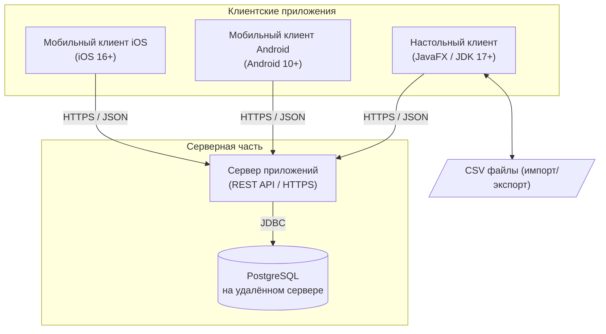
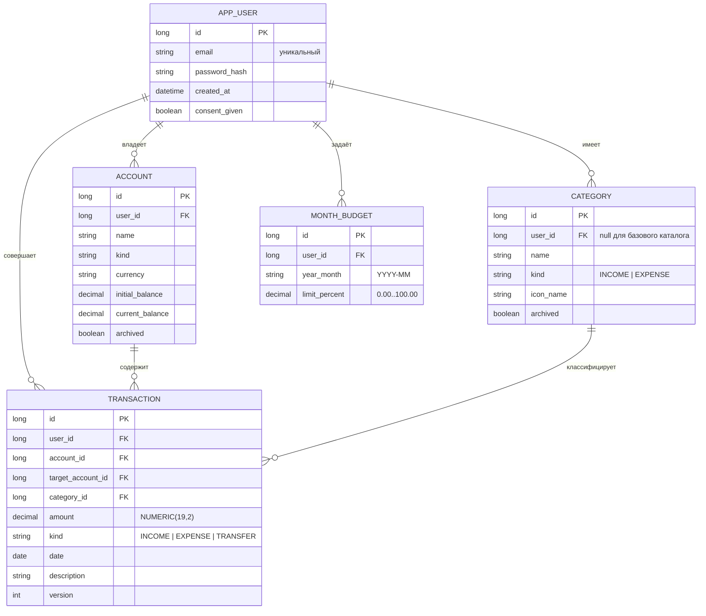

# Спецификация требований к ПО

Для «Трекер финансов»

Версия 0.1

Подготовил(а) Романчук Георгий Александрович

Проект SDLC

27.10.2026

## Оглавление

<!-- TOC -->
* [1. Введение](#1-introduction)
  * [1.1 Назначение документа](#11-document-purpose)
  * [1.2 Область применения продукта](#12-product-scope)
  * [1.3 Определения, акронимы и сокращения](#13-definitions-acronyms-and-abbreviations)
  * [1.4 Ссылки](#14-references)
  * [1.5 Обзор документа](#15-document-overview)
* [2. Обзор продукта](#2-product-overview)
  * [2.1 Перспектива продукта](#21-product-perspective)
  * [2.2 Функции продукта](#22-product-functions)
  * [2.3 Ограничения продукта](#23-product-constraints)
  * [2.4 Характеристики пользователей](#24-user-characteristics)
  * [2.5 Допущения и зависимости](#25-assumptions-and-dependencies)
  * [2.6 Распределение требований](#26-apportioning-of-requirements)
* [3. Требования](#3-requirements)
  * [3.1 Внешние интерфейсы](#31-external-interfaces)
    * [3.1.1 Пользовательские интерфейсы](#311-user-interfaces)
    * [3.1.2 Аппаратные интерфейсы](#312-hardware-interfaces)
    * [3.1.3 Программные интерфейсы](#313-software-interfaces)
  * [3.2 Функциональные требования](#32-functional)
  * [3.3 Качество обслуживания](#33-quality-of-service)
    * [3.3.1 Производительность](#331-performance)
    * [3.3.2 Безопасность](#332-security)
    * [3.3.3 Надёжность](#333-reliability)
    * [3.3.4 Доступность](#334-availability)
    * [3.3.5 Наблюдаемость](#335-observability)
  * [3.4 Соответствие стандартам](#34-compliance)
  * [3.5 Проектирование и реализация](#35-design-and-implementation)
    * [3.5.1 Установка](#351-installation)
    * [3.5.2 Сборка и поставка](#352-build-and-delivery)
    * [3.5.3 Распределение](#353-distribution)
    * [3.5.4 Сопровождаемость](#354-maintainability)
    * [3.5.5 Повторное использование](#355-reusability)
    * [3.5.6 Переносимость](#356-portability)
    * [3.5.7 Стоимость](#357-cost)
    * [3.5.8 Сроки](#358-deadline)
    * [3.5.9 Доказательство концепции](#359-proof-of-concept)
    * [3.5.10 Управление изменениями](#3510-change-management)
  * [3.6 ИИ/МО](#36-aiml)
* [4. Верификация](#4-verification)
* [5. Приложения](#5-appendixes)
<!-- TOC -->

---

## 1. Введение {#1-introduction}

Документ определяет верифицируемые требования к программному продукту «Трекер финансов» — клиент-серверной системе с настольным приложением и мобильными приложениями для Android и iOS, предназначенной для учёта личных доходов и расходов, категоризации трат и контроля месячного лимита расходов, заданного в процентах от дохода. В разделе 1 описаны назначение документа и границы продукта, в разделе 2 — контекст и ограничения, в разделе 3 — сами требования, в разделе 4 — способы их проверки.

### 1.1 Назначение документа {#11-document-purpose}

SRS определяет, **ЧТО** должна делать система «Трекер финансов», а не то, как она будет реализована. Документ предназначен для разработчиков (реализация), тестировщиков (построение тестов и матрицы верификации), заказчика (приёмка) и сопровождающих продукт. Документ является источником истины для требований версии 1.0.

### 1.2 Область применения продукта {#12-product-scope}

Продукт — «Трекер финансов», версия 1.0. Это система из четырёх основных компонентов: настольное приложение на Java (JavaFX), мобильное приложение для Android, мобильное приложение для iOS и серверное приложение, хранящее данные в базе PostgreSQL на удалённом сервере. Пользователь регистрируется, выбирает категории из справочника или создаёт свои, ведёт счета, фиксирует доходы и расходы, указывает вместе с доходом месяца процент, который планирует потратить, и видит остаток лимита до его исчерпания с подсветкой статуса, а также диаграммы расходов. Одни и те же данные доступны на компьютере и на мобильных устройствах. Цель продукта — дать ответ на вопросы: «сколько я заработал, на что потратил и сколько ещё могу потратить в этом месяце».

**Входит в версию 1.0:**

- регистрация, вход и выход; хранение данных пользователя на удалённом сервере в PostgreSQL;
- настольный клиент (JavaFX), мобильный клиент для Android и мобильный клиент для iOS с равным набором основных функций;
- учёт счетов, доходов, расходов и переводов;
- справочник категорий с добавлением категорий из списка, создание собственных категорий, правила автоматической категоризации;
- лимит расходов месяца в процентах от дохода, вводимый вместе с доходом; расчёт суммы лимита; остаток до исчерпания лимита с подсветкой;
- визуализация: круговая диаграмма расходов, диаграмма «доходы и расходы» по месяцам, динамика баланса;
- импорт и экспорт CSV (в настольном клиенте).

**Не входит в версию 1.0:**

- работа клиентов без подключения к интернету (офлайн-режим) и локальная синхронизация;
- веб-версия приложения;
- синхронизация с банками и платёжными системами;
- конвертация валют по курсам (каждый счёт ведётся в одной валюте);
- подтверждение адреса электронной почты и восстановление пароля;
- учёт инвестиций, кредитов, налогов;
- функции машинного обучения (см. раздел 3.6).

### 1.3 Определения, акронимы и сокращения {#13-definitions-acronyms-and-abbreviations}

| Term | Definition |
|------|------------|
| API | Application Programming Interface — набор определений и протоколов для создания и интеграции прикладного ПО |
| SRS | Software Requirements Specification — документ, описывающий назначение, требования и характер ПО |
| UI | User Interface — визуальная часть приложения, через которую пользователь взаимодействует с ПО |
| REST | Стиль построения API поверх HTTP, в котором ресурсы адресуются URL, а действия задаются методами HTTP |
| JSON | Текстовый формат обмена данными |
| HTTPS / TLS | Защищённый протокол передачи данных (HTTP поверх TLS) |
| CSV | Comma-Separated Values — текстовый формат табличных данных |
| JDBC | Java Database Connectivity — стандартный API доступа к базам данных из Java |
| PostgreSQL | Реляционная СУБД, в которой на удалённом сервере хранятся данные всех пользователей |
| JavaFX | Графическая библиотека для построения графического интерфейса настольных приложений на Java |
| Android | Мобильная операционная система, целевая платформа первого мобильного клиента |
| iOS | Мобильная операционная система Apple, целевая платформа второго мобильного клиента |
| dp / pt | Независимые единицы измерения размеров экрана на Android (dp) и iOS (pt) |
| Настольный клиент | Приложение для Windows, macOS и Linux, подключающееся к серверу |
| Мобильный клиент | Приложение для Android или iOS, подключающееся к серверу |
| Сервер приложений | Серверная часть продукта: предоставляет API клиентам, реализует бизнес-логику и обращается к БД |
| Токен доступа | Короткоживущий ключ JWT, подтверждающий вход пользователя в запросах к API |
| Категория | Группа операций по назначению (например, «Продукты», «Зарплата») |
| Справочник категорий | Список готовых категорий, из которого пользователь добавляет нужные в свой набор |
| Операция (транзакция) | Запись о доходе, расходе или переводе с датой, суммой, счётом и категорией |
| Перевод | Операция перемещения денег между двумя счетами пользователя; не является доходом или расходом |
| Лимит расходов месяца | Сумма, которую пользователь планирует потратить в месяце: доход месяца × процент лимита / 100 |
| Процент лимита | Доля дохода месяца (в процентах), указываемая пользователем вместе с доходом |
| Остаток лимита | Лимит расходов месяца минус расходы месяца; подсвечивается по статусу исполнения |
| Правило автокатегоризации | Правило вида «если описание содержит текст X, то категория Y» |
| Счёт | Место хранения денег: наличные, банковская карта, вклад и т. п. |

### 1.4 Ссылки {#14-references}

| № | Название | Владелец/автор | Версия/дата | Расположение | Тип |
|---|----------|----------------|-------------|--------------|-----|
| 1 | IEEE Std 830-1998. Recommended Practice for Software Requirements Specifications | IEEE | 1998 | https://standards.ieee.org | Справочная |
| 2 | ISO/IEC/IEEE 29148. Requirements engineering | ISO/IEC/IEEE | 2018 | https://www.iso.org | Справочная |
| 3 | Закон Республики Беларусь от 7 мая 2021 г. № 99-З «О защите персональных данных» | Республика Беларусь | в силе с 15.11.2021 | https://pravo.by | Нормативная |
| 4 | Apple Human Interface Guidelines | Apple Inc. | 2026 | https://developer.apple.com/design/ | Справочная |
| 5 | Google Material 3 Design Guidelines | Google LLC | 2026 | https://m3.material.io | Справочная |

### 1.5 Обзор документа {#15-document-overview}

Раздел 2 описывает контекст продукта, функции, ограничения, характеристики пользователей, допущения и распределение требований. Раздел 3 содержит формализованные требования: интерфейсы, функционал, качество обслуживания, соответствие стандартам, проектирование и реализацию. Раздел 4 содержит матрицу верификации. Раздел 5 — приложения: сценарии использования, модель данных, открытые вопросы и трассируемость.

---

## 2. Обзор продукта {#2-product-overview}

### 2.1 Перспектива продукта {#21-product-perspective}

«Трекер финансов» — клиент-серверная система, обеспечивающая единый доступ к финансовым данным с настольных компьютеров и смартфонов. Сервер приложений хранит данные всех пользователей в реляционной СУБД PostgreSQL на удалённом сервере. Клиентские приложения не обращаются к базе данных напрямую, а работают через единый HTTPS REST API.

### 2.2 Функции продукта {#22-product-functions}

1. Регистрация, вход и выход; единые данные пользователя на устройствах Desktop, Android и iOS.
2. Управление счетами (создание, архивация, расчёт баланса).
3. Учёт операций: доходы, расходы, переводы, (опционально) регулярные операции.
4. Справочник категорий, добавление категорий из списка, создание собственных категорий, правила автокатегоризации.
5. Лимит расходов месяца в процентах от дохода, вводимый вместе с доходом; расчёт суммы лимита и остатка с подсветкой.
6. Визуализация: круговая диаграмма расходов, динамика доходов и расходов по месяцам, динамика баланса.
7. Импорт и экспорт CSV (в настольном клиенте); настройки пользователя (валюта, формат дат, расчётный день месяца).

### 2.3 Ограничения продукта {#23-product-constraints}

| ID | Ограничение | Тип |
|----|-------------|-----|
| CON-01 | Серверная и настольная части должны быть реализованы на Java 17+; мобильные клиенты — под платформы Android и iOS. | Обязательное |
| CON-02 | Графический интерфейс настольного клиента должен быть реализован на JavaFX. | Обязательное |
| CON-03 | Данные должны храниться в базе данных PostgreSQL на удалённом сервере; встроенные и локальные БД для данных пользователя не допускаются. | Обязательное |
| CON-04 | Клиенты должны работать через подключение к интернету; офлайн-режим в версии 1.0 не поддерживается. | Обязательное |
| CON-05 | Денежные суммы должны обрабатываться типом `BigDecimal`, а в БД храниться типом `NUMERIC`; типы `float` и `double` запрещены. | Обязательное |
| CON-06 | Архитектура сервера должна быть разделена на слои: контроллеры → сервисы → репозитории. | Обязательное |
| CON-07 | Все сторонние библиотеки должны иметь открытые бесплатные лицензии. | Обязательное |
| CON-08 | Лимит расходов месяца должен задаваться в процентах от дохода и указываться вместе с доходом на каждый месяц. | Обязательное |
| CON-09 | Категории должны добавляться пользователем из списка (справочника), с возможностью создания своих категорий. | Обязательное |
| CON-10 | Продукт должен предоставлять настольную версию и мобильные клиенты под Android и iOS. | Обязательное |

### 2.4 Характеристики пользователей {#24-user-characteristics}

- **Владелец бюджета:** частное лицо, ведущее личный или семейный бюджет; вносит операции со смартфона (Android или iPhone) на ходу, контролирует остаток лимита, на компьютере проводит глубокий анализ отчётов и импорт выписок.
- **Начинающий пользователь:** впервые использует приложение; подключает готовые категории из справочника в один клик.
- **Администратор сервера:** обслуживает удалённый сервер Linux, Docker-контейнеры и PostgreSQL.

### 2.5 Допущения и зависимости {#25-assumptions-and-dependencies}

- **A1:** На компьютере пользователя доступна JRE 17+ либо используется пакет `jpackage`.
- **A2:** Основная валюта по умолчанию — RUB, каждый счёт ведётся в одной выбранной валюте.
- **A3:** Процент лимита задаётся на календарный месяц и применяется к суммарному доходу месяца.
- **A4:** Типовой объём данных — до 10 000 операций на пользователя и до 100 одновременных пользователей.
- **A5:** Поддерживаемые мобильные ОС: Android 10+ (API 29+) и iOS 16+.
- **A6:** Скорость подключения к сети интернет — не менее 5 Мбит/с.
- **D1:** Библиотеки UI: JavaFX (Desktop), Jetpack Compose (Android), SwiftUI (iOS).
- **D2:** PostgreSQL 16+ на удалённом сервере с пулом соединений HikariCP.

### 2.6 Распределение требований {#26-apportioning-of-requirements}

| Приоритет / Релиз | Состав | Требования |
|---|---|---|
| **1.0 (Must)** | Аутентификация, PostgreSQL, счета, транзакции, лимит в % от дохода, остаток лимита, категории, аналитические диаграммы, клиенты Desktop, Android и iOS, экспорт CSV | REQ-INT-001, REQ-INT-002, REQ-INT-005, REQ-INT-006, REQ-INT-007, REQ-INT-008, REQ-INT-009, REQ-FUNC-001, REQ-FUNC-002, REQ-FUNC-004, REQ-FUNC-005, REQ-FUNC-006, REQ-FUNC-009, REQ-FUNC-010, REQ-FUNC-012, REQ-FUNC-013, REQ-FUNC-014, REQ-FUNC-015, REQ-FUNC-016, REQ-FUNC-018, REQ-FUNC-019, REQ-FUNC-020, REQ-FUNC-024, REQ-FUNC-025, REQ-FUNC-026, REQ-FUNC-031, REQ-PERF-001, REQ-PERF-002, REQ-PERF-003, REQ-SEC-003, REQ-SEC-004, REQ-SEC-005, REQ-SEC-006, REQ-SEC-007, REQ-SEC-008, REQ-REL-001, REQ-REL-003, REQ-REL-004, REQ-COMP-001, REQ-COMP-003, REQ-INST-001, REQ-BUILD-001, REQ-DIST-002, REQ-MAINT-001, REQ-PORT-001, REQ-COST-001, REQ-POC-001, REQ-CM-001 |
| **1.1 (Should)** | Межсчётные переводы, автокатегоризация, график баланса, импорт CSV, удаление аккаунта, настройки пользователя, бэкапы БД, мониторинг | REQ-INT-003, REQ-INT-004, REQ-FUNC-003, REQ-FUNC-007, REQ-FUNC-011, REQ-FUNC-017, REQ-FUNC-021, REQ-FUNC-023, REQ-FUNC-032, REQ-PERF-004, REQ-PERF-005, REQ-SEC-009, REQ-REL-005, REQ-AVAIL-002, REQ-OBS-001, REQ-OBS-002, REQ-COMP-002, REQ-INST-002, REQ-BUILD-002, REQ-MAINT-002, REQ-REUSE-001, REQ-PORT-002, REQ-CM-002, REQ-CM-003 |
| **Отложено (Could)** | Регулярные операции, лимиты по категориям, биометрия PIN/FaceID, стиль кода | REQ-FUNC-008, REQ-FUNC-030, REQ-SEC-002, REQ-MAINT-003 |

---

## 3. Требования {#3-requirements}

### 3.1 Внешние интерфейсы {#31-external-interfaces}

#### 3.1.1 Пользовательские интерфейсы {#311-user-interfaces}

**REQ-INT-001 — Структура навигации**
- **Statement:** Настольный и мобильные клиенты (Android и iOS) должны предоставлять разделы «Обзор», «Операции», «Счета», «Категории», «Бюджет», «Отчёты», «Настройки». В настольном клиенте навигация выполняется боковой панелью, в Android — нижней панелью (Bottom Navigation Bar), в iOS — нижней панелью вкладок (Tab Bar).
- **Rationale:** Единая логика навигации с учётом платформенных гайдлайнов каждого типа устройств.
- **Acceptance Criteria:** Каждый раздел открывается в один клик/тап с главного экрана; активный раздел визуально выделен.
- **Verification Method:** Demonstration
- **More Information:** Приоритет: Must. CON-01, CON-02, CON-10.

**REQ-INT-002 — Форма операции и валидация ввода**
- **Statement:** Клиенты должны предоставлять форму добавления операции с полями: тип (доход / расход / перевод), сумма, дата, счёт, категория, описание, а для операции-дохода — обязательное поле «Лимит расходов месяца, % от дохода». Некорректный ввод (сумма ≤ 0, не выбран счёт, процент < 0 или > 100) должен блокироваться на клиенте с выводом подсказки у поля.
- **Rationale:** Предотвращение некорректных данных до отправки на сервер и быстрая обратная связь пользователю.
- **Acceptance Criteria:** Некорректные значения блокируют отправку; дата по умолчанию — текущая; сервер дублирует валидацию.
- **Verification Method:** Test
- **More Information:** Приоритет: Must. Связано: REQ-FUNC-004, REQ-FUNC-012, REQ-SEC-003.

**REQ-INT-003 — Локализация интерфейса**
- **Statement:** Интерфейс системы должен предоставляться на русском языке, а строковые ресурсы интерфейса должны храниться во внешних файлах локализации.
- **Rationale:** Удобство целевой аудитории и возможность добавления других языков без перекомпиляции кода.
- **Acceptance Criteria:** Отсутствие хардкода строковых литералов в исходном коде компонентов UI.
- **Verification Method:** Inspection
- **More Information:** Приоритет: Should.

**REQ-INT-004 — Доступность интерфейса**
- **Statement:** Настольный клиент должен поддерживать управление с клавиатуры, мобильные клиенты — динамический размер шрифта ОС, а статусы лимита («Норма», «Предупреждение», «Превышен») должны передаваться значком и текстом, а не только цветом.
- **Rationale:** Доступность для пользователей с нарушением цветового зрения (дальтонизм) и удобство быстрого ввода.
- **Acceptance Criteria:** Статусы безошибочно различимы в монохромном режиме; в мобильных приложениях верстка адаптируется к масштабированию шрифта до 130%.
- **Verification Method:** Demonstration
- **More Information:** Приоритет: Should. Связано: REQ-FUNC-013.

**REQ-INT-009 — Адаптация мобильного интерфейса под Android и iOS**
- **Statement:** Мобильные клиенты должны использовать размер элементов управления не менее 48×48 dp на Android и не менее 44×44 pt на iOS, корректно обрабатывать безопасные зоны (Safe Area / Dynamic Island) и открывать числовую клавиатуру для полей суммы и процента.
- **Rationale:** Предотвращение случайных нажатий и удобство работы одной рукой.
- **Acceptance Criteria:** На экранах смартфонов от 4.7" до 6.7" элементы не перекрывают системные панели и вырезы, сенсорные зоны соответствуют гайдлайнам.
- **Verification Method:** Demonstration
- **More Information:** Приоритет: Must. CON-10.

#### 3.1.2 Аппаратные интерфейсы {#312-hardware-interfaces}

**REQ-INT-005 — Поддерживаемые экраны и устройства**
- **Statement:** Настольный клиент должен корректно отображаться при разрешении от 1024×720, Android-клиент — на экранах шириной от 360 dp, iOS-клиент — на экранах шириной от 375 pt (iPhone SE и новее).
- **Rationale:** Охват парка устройств пользователей без обрезания контента.
- **Acceptance Criteria:** На указанных экранах основной контент не требует горизонтальной прокрутки и не наезжает на соседние блоки.
- **Verification Method:** Demonstration
- **More Information:** Приоритет: Must.

#### 3.1.3 Программные интерфейсы {#313-software-interfaces}

**REQ-INT-006 — Доступ сервера к БД PostgreSQL**
- **Statement:** Сервер приложений должен обращаться к PostgreSQL через JDBC с пулом соединений; доступ к данным должен быть инкапсулирован в интерфейсах-репозиториях, а клиенты не должны обращаться к БД напрямую.
- **Rationale:** Защита базы данных и модульность архитектуры.
- **Acceptance Criteria:** Порт 5432 закрыт от внешнего интернета; в клиентах отсутствуют реквизиты БД и JDBC-драйверы.
- **Verification Method:** Inspection
- **More Information:** Приоритет: Must. CON-03, CON-06.

**REQ-INT-007 — Формат файлов CSV**
- **Statement:** Система должна выполнять экспорт и импорт CSV-файлов в кодировке UTF-8 с разделителем `;`, строкой заголовка и полями `date, type, amount, account, category, description`.
- **Rationale:** Совместимость с электронными таблицами Excel и LibreOffice.
- **Acceptance Criteria:** Корректный экспорт и повторный импорт с сохранением всех сумм и кириллических описаний.
- **Verification Method:** Test
- **More Information:** Приоритет: Must. Связано: REQ-FUNC-020, REQ-FUNC-021.

**REQ-INT-008 — Клиент-серверный REST API**
- **Statement:** Сервер должен предоставлять клиентам Desktop, Android и iOS единый REST API по протоколу HTTPS с обменом данными в формате JSON, версионированием `/api/v1/...` и токенами Bearer JWT.
- **Rationale:** Единая реализация бэкенда для всех платформ.
- **Acceptance Criteria:** Все эндпоинты, кроме входа и регистрации, требуют валидный токен; ошибки возвращаются в едином JSON-формате.
- **Verification Method:** Test
- **More Information:** Приоритет: Must. CON-03, CON-04.

---

### 3.2 Функциональные требования {#32-functional}

#### Учётные записи и мультиплатформенность

**REQ-FUNC-024 — Регистрация пользователя**
- **Statement:** Система должна позволять зарегистрировать учётную запись по уникальному Email и паролю (не короче 8 символов) с подтверждением согласия на обработку персональных данных.
- **Rationale:** Разделение данных разных пользователей в общей базе данных на сервере.
- **Acceptance Criteria:** Успешное создание записи; отказ при повторном Email или пароле менее 8 символов.
- **Verification Method:** Test
- **More Information:** Приоритет: Must. Связано: REQ-COMP-003.

**REQ-FUNC-025 — Вход, JWT-сессии и выход**
- **Statement:** Система должна выполнять вход по Email/паролю, сохранять сессию через пару токенов (Access Token до 60 мин, Refresh Token до 30 дней) и обеспечивать выход с отзывом сессии.
- **Rationale:** Безопасный доступ без необходимости ввода пароля при каждом запуске приложения.
- **Acceptance Criteria:** Токены сохраняются в защищённых системных хранилищах (KeyStore на Android, Keychain на iOS); пароль проверяется по хешу BCrypt.
- **Verification Method:** Test
- **More Information:** Приоритет: Must. Связано: REQ-SEC-006.

**REQ-FUNC-026 — Единые данные на всех устройствах (Desktop, Android, iOS)**
- **Statement:** Система должна хранить все данные пользователя на сервере; транзакции, созданные на одном устройстве, должны отображаться на других клиентах пользователя после обновления не позднее чем через 3 секунды.
- **Rationale:** Непрерывный финансовый учёт при переходе с компьютера на смартфон и обратно.
- **Acceptance Criteria:** Операция, внесённая на iPhone, отображается в десктопном клиенте и на Android после обновления экрана.
- **Verification Method:** Test
- **More Information:** Приоритет: Must. CON-03, CON-10.

**REQ-FUNC-031 — Равенство функций настольного и мобильных клиентов**
- **Statement:** Настольный клиент, Android-клиент и iOS-клиент должны предоставлять одинаковый набор возможностей по ведению счетов, операций, категорий, контролю лимита и просмотру диаграмм. Импорт и экспорт CSV поддерживается в настольной версии.
- **Rationale:** Равный пользовательский опыт на любой поддерживаемой платформе.
- **Acceptance Criteria:** Все основные сценарии учёта доступны на Desktop, Android и iOS.
- **Verification Method:** Demonstration
- **More Information:** Приоритет: Must. CON-10.

**REQ-FUNC-032 — Удаление учётной записи**
- **Statement:** Система должна позволять пользователю удалить свою учётную запись вместе со всеми финансовыми данными после подтверждения пароля.
- **Rationale:** Право пользователя на удаление своих данных в соответствии с законодательством.
- **Acceptance Criteria:** Полное удаление данных пользователя из рабочей БД, отзыв токенов сессий.
- **Verification Method:** Test
- **More Information:** Приоритет: Should. Связано: REQ-COMP-003.

#### Счета

**REQ-FUNC-001 — Создание и редактирование счёта**
- **Statement:** Система должна позволять пользователю создавать счёт с указанием названия, типа (наличные, карта, вклад, другое), валюты и начального баланса, а также редактировать название и тип счёта.
- **Rationale:** Счета являются основой балансового учёта.
- **Acceptance Criteria:** Счёт отображается в списках и формах; дублирование имён среди активных счетов отклоняется.
- **Verification Method:** Test
- **More Information:** Приоритет: Must.

**REQ-FUNC-002 — Расчёт текущего баланса**
- **Statement:** Система должна вычислять текущий баланс счёта по формуле: Начальный баланс + Доходы − Расходы + Входящие переводы − Исходящие переводы, а также суммарный баланс по всем счетам.
- **Rationale:** Точный финансовый баланс без погрешностей округления.
- **Acceptance Criteria:** Все расчёты выполняются в типе `BigDecimal` с точностью до копейки; баланс обновляется сразу после проводки.
- **Verification Method:** Test
- **More Information:** Приоритет: Must. CON-05.

**REQ-FUNC-003 — Архивация счёта**
- **Statement:** Система должна позволять архивировать счёт; архивный счёт скрывается из форм ввода новых операций, но сохраняется в исторических отчётах.
- **Rationale:** Закрытые счета не должны загромождать интерфейс при сохранении целостности истории.
- **Acceptance Criteria:** Счёт отсутствует в селекторах форм; исторические операции остаются в отчётах.
- **Verification Method:** Test
- **More Information:** Приоритет: Should.

#### Операции (доходы, расходы, переводы)

**REQ-FUNC-004 — Добавление дохода и расхода**
- **Statement:** Система должна позволять регистрировать операции дохода и расхода с указанием суммы, даты, счёта, категории и описания.
- **Rationale:** Базовое ядро учёта личных финансов.
- **Acceptance Criteria:** Операция сохраняется на сервере, отражается в выписке и мгновенно корректирует баланс счёта.
- **Verification Method:** Test
- **More Information:** Приоритет: Must. CON-05.

**REQ-FUNC-005 — Редактирование и удаление операций**
- **Statement:** Пользователь должен иметь возможность изменить или удалить ранее созданную операцию; удаление требует подтверждения, а балансы и бюджеты пересчитываются сервером.
- **Rationale:** Исправление ошибок ручного ввода пользователем.
- **Acceptance Criteria:** Коррекция балансов при изменении суммы; сохранение операции при отмене диалога подтверждения.
- **Verification Method:** Test
- **More Information:** Приоритет: Must.

**REQ-FUNC-006 — Список операций, фильтрация и поиск**
- **Statement:** Система должна отображать журнал операций с сортировкой по дате/сумме и фильтрацией по периодам, счетам, категориям, типу и текстовому поиску по описанию.
- **Rationale:** Быстрый поиск транзакций среди тысяч записей.
- **Acceptance Criteria:** Корректное объединение нескольких условий фильтрации, пагинация на сервере.
- **Verification Method:** Test
- **More Information:** Приоритет: Must.

**REQ-FUNC-007 — Переводы между счетами**
- **Statement:** Система должна позволять создавать перевод между двумя счетами пользователя; перевод изменяет балансы счетов, но не учитывается в доходах или расходах бюджетов и отчётов.
- **Rationale:** Перемещение денег между своими картами и наличными не меняет суммарный капитал.
- **Acceptance Criteria:** Атомарное уменьшение счёта A и увеличение счёта B на одинаковую сумму; неизменность суммарного баланса.
- **Verification Method:** Test
- **More Information:** Приоритет: Should.

**REQ-FUNC-008 — Регулярные операции**
- **Statement:** Система может позволять настраивать повторяющиеся операции (ежедневно, еженедельно, ежемесячно) с автоматическим созданием пропущенных экземпляров.
- **Rationale:** Автоматизация рутинных ежемесячных платежей (подписки, аренда, зарплата).
- **Acceptance Criteria:** Создание очередных транзакций по расписанию без дублирования.
- **Verification Method:** Test
- **More Information:** Приоритет: Could.

#### Категории

**REQ-FUNC-009 — Справочник базовых категорий и выбор из списка**
- **Statement:** Система должна предоставлять встроенный каталог готовых категорий (расходы: «Продукты», «Транспорт», «Жильё», «Здоровье», «Развлечения», «Одежда», «Прочее»; доходы: «Зарплата», «Подработка», «Подарки», «Прочее») и позволять пользователю добавлять любую из них в свой набор категорий в один клик либо выбрать «Добавить все».
- **Rationale:** Быстрый старт нового пользователя без утомительного ручного ввода категорий.
- **Acceptance Criteria:** В каталоге доступны 11 категорий; после подключения категория становится доступна в формах на Desktop, Android и iOS.
- **Verification Method:** Test
- **More Information:** Приоритет: Must. CON-09.

**REQ-FUNC-010 — Создание собственных категорий и управление ими**
- **Statement:** Система должна позволять пользователю создавать собственные уникальные категории, переименовывать их и архивировать. Физическое удаление категории с существующими операциями запрещено — система предлагает перенести операции или архивировать категорию.
- **Rationale:** Индивидуальная настройка структуры расходов с защитой исторических отчётов от повреждения.
- **Acceptance Criteria:** Новая категория синхронизируется на все устройства; при попытке удаления категории с привязанными транзакциями выводится диалог выбора действия.
- **Verification Method:** Test
- **More Information:** Приоритет: Must. CON-09.

**REQ-FUNC-011 — Автоматическая категоризация**
- **Statement:** Система должна поддерживать правила сопоставления ключевых слов («если описание содержит X, то категория Y»); при вводе операции без категории применяется подходящее правило либо назначается «Прочее».
- **Rationale:** Сокращение рутинного выбора категории, особенно при пакетном импорте.
- **Acceptance Criteria:** Описание «Магазин Евроопт» автоматически получает категорию «Продукты».
- **Verification Method:** Test
- **More Information:** Приоритет: Should.

#### Лимит расходов месяца (% от дохода)

**REQ-FUNC-012 — Лимит расходов месяца в процентах от дохода**
- **Statement:** При внесении операции-дохода пользователь должен указывать процент от дохода (0..100%), который планируется потратить в месяце этого дохода; значение сохраняется сервером для календарного месяца; при повторном вводе дохода предлагается ранее сохранённое значение.
- **Rationale:** Бюджетное планирование привязывается к реально полученному доходу месяца.
- **Acceptance Criteria:** Ввод дохода 100 000 ₽ с 70% фиксирует лимит месяца в 70 000 ₽; значение вне диапазона 0..100 отклоняется.
- **Verification Method:** Test
- **More Information:** Приоритет: Must. CON-08. Связано: REQ-INT-002.

**REQ-FUNC-013 — Остаток до исчерпания лимита и светофорная индикация**
- **Statement:** Система должна рассчитывать остаток лимита (Сумма лимита − Сумма расходов месяца) и долю использования лимита, отображая цветовую и знаковую подсветку статуса:
  - менее 80% — «Норма» (зелёный цвет + галочка);
  - 80%..99.9% — «Предупреждение» (жёлтый цвет + треугольник);
  - 100% и более — «Превышен» (красный цвет + знак Стоп, перерасход со знаком минус).
- **Rationale:** Мгновенное понимание текущего финансового состояния без необходимости считать в уме.
- **Acceptance Criteria:** Проверка на граничных значениях (79.9%, 80.0%, 99.9%, 100.0%) подтверждает корректную индикацию на всех трёх клиентах.
- **Verification Method:** Test
- **More Information:** Приоритет: Must. Связано: REQ-INT-004, REQ-FUNC-014.

**REQ-FUNC-014 — Серверный расчёт суммы лимита**
- **Statement:** Сумма лимита расходов месяца вычисляется на сервере как: Суммарный доход месяца × (Процент лимита / 100) в `BigDecimal` с округлением `HALF_UP` до 2 знаков и пересчитывается при любых изменениях доходов месяца.
- **Rationale:** Абсолютный лимит автоматически растёт при поступлении дополнительных доходов в течение месяца.
- **Acceptance Criteria:** Доход 80 000 ₽ при 70% даёт лимит 56 000,00 ₽; при добавлении дохода 20 000 ₽ лимит автоматически пересчитывается в 70 000,00 ₽.
- **Verification Method:** Test
- **More Information:** Приоритет: Must. CON-05, CON-08.

**REQ-FUNC-030 — Лимиты по категориям в процентах от дохода**
- **Statement:** Система может позволять задавать для отдельных категорий расходов персональный процент от дохода месяца и отслеживать их остатки по правилам REQ-FUNC-013.
- **Rationale:** Дополнительный детальный контроль ключевых категорий трат.
- **Acceptance Criteria:** Расчёт лимита категории от дохода месяца и подсветка остатка.
- **Verification Method:** Test
- **More Information:** Приоритет: Could.

#### Визуализация и отчёты

**REQ-FUNC-015 — Круговая диаграмма расходов**
- **Statement:** Система должна строить круговую диаграмму структуры расходов по категориям за выбранный период с отображением абсолютных сумм и процентов долей.
- **Rationale:** Наглядный анализ ключевых направлений оттока средств.
- **Acceptance Criteria:** Сумма долей равна 100%; переводы между счетами исключены из диаграммы.
- **Verification Method:** Demonstration
- **More Information:** Приоритет: Must.

**REQ-FUNC-016 — Столбчатая диаграмма доходов и расходов по месяцам**
- **Statement:** Система должна строить сравнительную диаграмму помесячных доходов и расходов за период до 12 месяцев.
- **Rationale:** Анализ сезонности и динамики накоплений.
- **Acceptance Criteria:** Для каждого месяца выводятся два сопоставимых столбца (доход/расход).
- **Verification Method:** Demonstration
- **More Information:** Приоритет: Must.

**REQ-FUNC-017 — Линейный график динамики баланса**
- **Statement:** Система должна строить график изменения суммарного капитала пользователя по дням или месяцам.
- **Rationale:** Оценка тренда финансового благосостояния.
- **Acceptance Criteria:** Финальная точка графика строго совпадает с текущим суммарным балансом активных счетов.
- **Verification Method:** Test
- **More Information:** Приоритет: Should.

**REQ-FUNC-018 — Главный экран «Обзор»**
- **Statement:** Экран «Обзор» на Desktop, Android и iOS должен отображать текущий баланс, доходы и расходы месяца, сумму лимита, остаток лимита со светофорным бейджем статуса и круговую диаграмму трат.
- **Rationale:** Предоставление сводной финансовой картины на одном экране сразу после запуска.
- **Acceptance Criteria:** Данные на экране «Обзор» полностью согласованы с реестром транзакций.
- **Verification Method:** Demonstration
- **More Information:** Приоритет: Must.

**REQ-FUNC-019 — Мгновенное обновление данных**
- **Statement:** Клиенты должны обновлять диаграммы, остаток лимита и балансы сразу после ответа сервера без необходимости перезапуска приложения.
- **Rationale:** Непротиворечивое отображение информации во всех разделах.
- **Acceptance Criteria:** После добавления расхода виджеты на экране обновляются в течение 1 секунды.
- **Verification Method:** Demonstration
- **More Information:** Приоритет: Must.

#### Импорт и экспорт

**REQ-FUNC-020 — Экспорт в CSV (настольный клиент)**
- **Statement:** Настольный клиент должен экспортировать отфильтрованный список операций в файл CSV формата UTF-8 (REQ-INT-007).
- **Rationale:** Резервная выгрузка и возможность анализа в сторонних табличных процессорах.
- **Acceptance Criteria:** Файл корректно открывается с отображением дат, сумм и кириллицы.
- **Verification Method:** Test
- **More Information:** Приоритет: Must.

**REQ-FUNC-021 — Импорт из CSV (настольный клиент)**
- **Statement:** Настольный клиент должен импортировать операции из CSV-файла, показывать предпросмотр и отчёт о пропущенных некорректных строках.
- **Rationale:** Быстрый перенос истории операций из других сервисов или банков.
- **Acceptance Criteria:** Корректные строки сохраняются на сервере, некорректные не приводят к сбою и попадают в отчёт об ошибках.
- **Verification Method:** Test
- **More Information:** Приоритет: Should.

#### Настройки

**REQ-FUNC-023 — Настройки пользователя**
- **Statement:** Система должна позволять выбрать основную валюту, формат отображения дат и день начала расчётного месяца (1..28); настройки хранятся на сервере и применяются на всех устройствах.
- **Rationale:** Учёт индивидуального графика получения зарплаты пользователем.
- **Acceptance Criteria:** Изменение расчётного дня на 10 пересчитывает месячный период с 10-го по 9-е число.
- **Verification Method:** Test
- **More Information:** Приоритет: Should.

---

### 3.3 Качество обслуживания {#33-quality-of-service}

#### 3.3.1 Производительность {#331-performance}

- **REQ-PERF-001 — Время запуска:** Показ главного экрана: десктоп — не более 3.0 с; Android и iOS — не более 2.0 с. (Must).
- **REQ-PERF-002 — Отклик списков:** Открытие журнала и фильтрация при 10 000 транзакциях — не более 2.0 с; пагинация порциями по 50–100 записей. (Must).
- **REQ-PERF-003 — Скорость диаграмм:** Построение любой диаграммы за период до 12 месяцев — не более 2.0 с; агрегация выполняется сервером. (Must).
- **REQ-PERF-004 — Потребление памяти:** Настольный клиент — не более 300 МБ ОЗУ, мобильные клиенты — не более 200 МБ. (Should).
- **REQ-PERF-005 — Нагрузка сервера:** Сервер обрабатывает 95% запросов быстрее 500 мс при 100 одновременных пользователях. (Should).

#### 3.3.2 Безопасность {#332-security}

- **REQ-SEC-002 — Блокировка мобильного клиента:** Возможность включения биометрии (Fingerprint / FaceID) или PIN-кода для входа в мобильное приложение. (Could).
- **REQ-SEC-003 — Защита от SQL-инъекций:** Все запросы к PostgreSQL выполняются через параметризованные запросы; входные DTO валидируются. (Must).
- **REQ-SEC-004 — Хранение только на сервере:** Финансовые данные хранятся строго в удалённой PostgreSQL; на устройствах сохраняются только токены сессий. (Must).
- **REQ-SEC-005 — Шифрование HTTPS:** Весь обмен между клиентами и сервером выполняется по протоколу HTTPS с TLS не ниже 1.2. (Must).
- **REQ-SEC-006 — Хеширование паролей:** Пароли хранятся в виде солёных хешей BCrypt (cost factor ≥ 12); токен доступа действует до 60 мин, Refresh — до 30 дней. (Must).
- **REQ-SEC-007 — Изоляция арендаторов:** Сервер проверяет принадлежность каждой записи пользователю из JWT-токена; доступ к чужим данным блокируется. (Must).
- **REQ-SEC-008 — Закрытый периметр БД:** Порт PostgreSQL (5432) закрыт от интернета; доступ разрешён только с сервера приложений. (Must).
- **REQ-SEC-009 — Защита от брутфорса:** Ограничение не более 5 неудачных попыток входа за 15 минут временной блокировкой IP/аккаунта (HTTP 429). (Should).

#### 3.3.3 Надёжность {#333-reliability}

- **REQ-REL-001 — Транзакционность проводок:** Сервер подтверждает операции только после фиксации транзакции в PostgreSQL; переводы выполняются атомарно. (Must).
- **REQ-REL-003 — Точность денежных вычислений:** Хранение в `NUMERIC(19, 2)`, вычисления в `BigDecimal` с округлением `HALF_UP`. (Must).
- **REQ-REL-004 — Поведение при потере связи:** При сбое сети клиент выводит понятное сообщение, не теряет черновик формы и позволяет повторить запрос. (Must).
- **REQ-REL-005 — Резервное копирование:** Ежедневное резервное копирование PostgreSQL с глубиной хранения не менее 7 дней. (Should).

#### 3.3.4 Доступность и наблюдаемость {#334-availability}

- **REQ-AVAIL-002 — Доступность сервера:** Доступность серверной части не менее 99% времени в месяц. (Should).
- **REQ-OBS-001 — Журналирование:** Логирование ошибок без попадания в журнал паролей, токенов и сумм операций. (Should).
- **REQ-OBS-002 — Эндпоинт состояния:** Предоставление открытого эндпоинта `/health` со статусом работы сервера и базы данных. (Should).

---

### 3.4 Соответствие стандартам {#34-compliance}

- **REQ-COMP-001:** Использование сторонних библиотек строго с открытыми бесплатными лицензиями (MIT, Apache 2.0). (Must).
- **REQ-COMP-002:** Стандартные форматы данных: даты по ISO 8601 (`YYYY-MM-DD`), коды валют по ISO 4217. (Should).
- **REQ-COMP-003:** Обработка персональных данных пользователей в соответствии с Законом РБ № 99-З «О защите персональных данных». (Must).

---

### 3.5 Проектирование и реализация {#35-design-and-implementation}

- **REQ-INST-001:** Настольный клиент запускается из JAR/jpackage без прав администратора; мобильные приложения устанавливаются из APK/AAB (Android) и IPA/TestFlight (iOS). (Must).
- **REQ-INST-002:** Поставка сервера приложений в виде Docker-образа с автоматическими миграциями Flyway. (Should).
- **REQ-BUILD-001:** Сборка бэкенда и десктопа командой `mvn package`, Android — Gradle, iOS — Xcodebuild. (Must).
- **REQ-DIST-002:** Трёхзвенная клиент-серверная архитектура (клиенты → Spring Boot API → PostgreSQL). (Must).
- **REQ-MAINT-001:** Слоистая архитектура; все расчёты балансов, лимита месяца и аналитики выполняются на сервере. (Must).
- **REQ-MAINT-002:** Покрытие модульными тестами сервисного слоя не менее 70%. (Should).
- **REQ-REUSE-001:** Выделение разделяемого модуля контрактов DTO без платформенных зависимостей. (Should).
- **REQ-PORT-001:** Поддерживаемые платформы: Desktop (Windows 10+, macOS 12+, Ubuntu 22.04+), Android 10+, iOS 16+. (Must).
- **REQ-COST-001:** Нулевая стоимость лицензий на компоненты и размещение в рамках доступных ресурсов. (Must).
- **REQ-DEAD-001:** Поставка версии 1.0 в согласованный срок. (Must).
- **REQ-POC-001:** Создание прототипа «клиент – сервер – удалённая БД» на 10 000 операций для валидации скорости диаграмм. (Must).
- **REQ-CM-001:** Семантическое версионирование `MAJOR.MINOR.PATCH` и ведение `CHANGELOG.md`. (Must).

---

### 3.6 ИИ/МО {#36-aiml}

В версии 1.0 компоненты машинного обучения отсутствуют. Автокатегоризация (REQ-FUNC-011) работает по детерминированным правилам сопоставления текста.

---

## 4. Верификация {#4-verification}

| ID требования | Метод | Артефакт верификации | Статус |
|---|---|---|---|
| REQ-INT-001 | Demonstration | Навигационные тесты UI (Desktop, Android, iOS) | Planned |
| REQ-INT-002 | Test | TransactionFormValidatorTest | Planned |
| REQ-INT-006 | Inspection | Аудит конфигурации сети и закрытых портов БД | Planned |
| REQ-INT-008 | Test | OpenAPI Contract Tests, Newman Suite | Planned |
| REQ-FUNC-024 | Test | AuthRegistrationTest | Planned |
| REQ-FUNC-025 | Test | JwtTokenProviderTest | Planned |
| REQ-FUNC-026 | Test | CrossplatformSyncE2ETest (Desktop/Android/iOS) | Planned |
| REQ-FUNC-031 | Demonstration | Чек-лист функционального паритета клиентов | Planned |
| REQ-FUNC-001 | Test | AccountServiceTest | Planned |
| REQ-FUNC-002 | Test | BalanceCalculatorPrecisionTest | Planned |
| REQ-FUNC-004 | Test | TransactionServiceTest | Planned |
| REQ-FUNC-009 | Test | CategoryCatalogServiceTest | Planned |
| REQ-FUNC-010 | Test | CustomCategoryServiceTest | Planned |
| REQ-FUNC-012 | Test | MonthlyBudgetPercentTest | Planned |
| REQ-FUNC-013 | Test | LimitThresholdStatusTest (79.9% / 80% / 99.9% / 100%) | Planned |
| REQ-FUNC-014 | Test | LimitCalculatorTest | Planned |
| REQ-FUNC-015 | Demonstration | UI Chart rendering test | Planned |
| REQ-FUNC-020 | Test | CsvExportTest | Planned |
| REQ-PERF-001 | Test | StartupBenchmark | Planned |
| REQ-PERF-005 | Test | k6 Load Test Report (100 пользователей) | Planned |
| REQ-SEC-003 | Test | SqlInjectionPenetrationTest | Planned |
| REQ-SEC-007 | Test | MultiTenantSecurityTest | Planned |
| REQ-PORT-001 | Demonstration | Запуск на Windows, macOS, Ubuntu, Android, iPhone | Planned |

---

## 5. Приложения {#5-appendixes}

### Приложение A. Основные сценарии использования (Use Cases)

**UC-1. Добавить расход на ходу со смартфона (Android или iOS)**
1. Пользователь открывает приложение, нажимает кнопку добавления операции и выбирает «Расход».
2. Вводит сумму с числовой клавиатуры, выбирает категорию и счёт списания.
3. Нажимает «Сохранить»; клиент отправляет запрос к серверу по HTTPS.
4. Сервер сохраняет операцию в PostgreSQL, пересчитывает баланс счёта и остаток лимита месяца.
5. Экран мгновенно обновляет виджет баланса и индикатор остатка лимита.

**UC-2. Ввести доход и установить лимит расходов месяца**
1. Пользователь выбирает тип операции «Доход».
2. Вводит сумму дохода (например, 100 000 ₽), счёт и категорию («Зарплата»).
3. В поле «Лимит расходов месяца, % от дохода» указывает желаемый процент (например, 70%).
4. Сервер сохраняет доход, фиксирует 70% для месяца и рассчитывает абсолютный лимит: 70 000 ₽.
5. На Desktop, Android и iOS синхронно отображается остаток лимита и зелёный статус «Норма».

**UC-3. Контроль превышения лимита трат**
1. Пользователь совершает крупную покупку, в результате чего сумма расходов месяца превышает лимит.
2. Сервер фиксирует превышение порога 100%.
3. На экране «Обзор» индикатор переключается в красный статус «Превышен» со знаком Стоп и суммой перерасхода со знаком минус.

### Приложение B. Логическая модель данных

