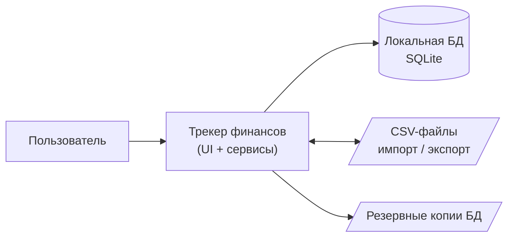
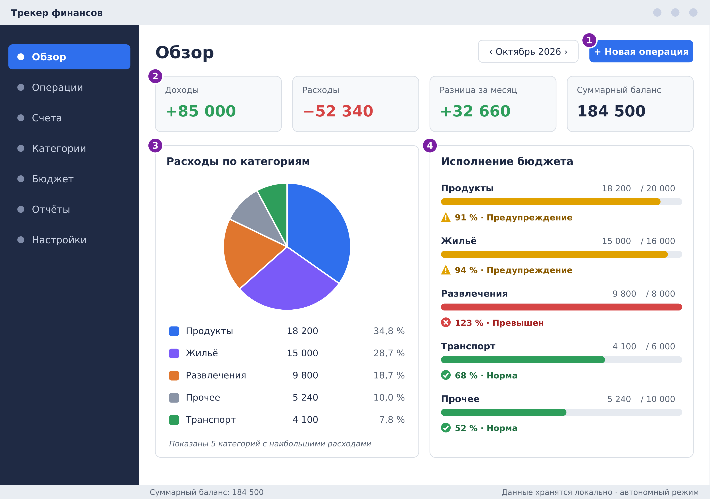
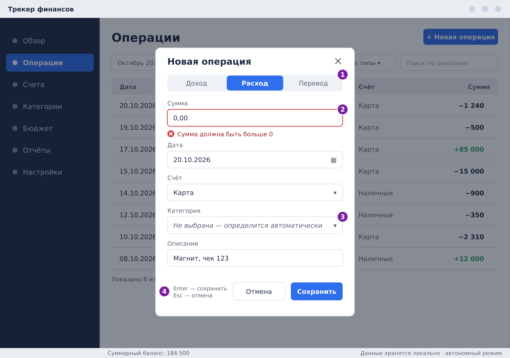
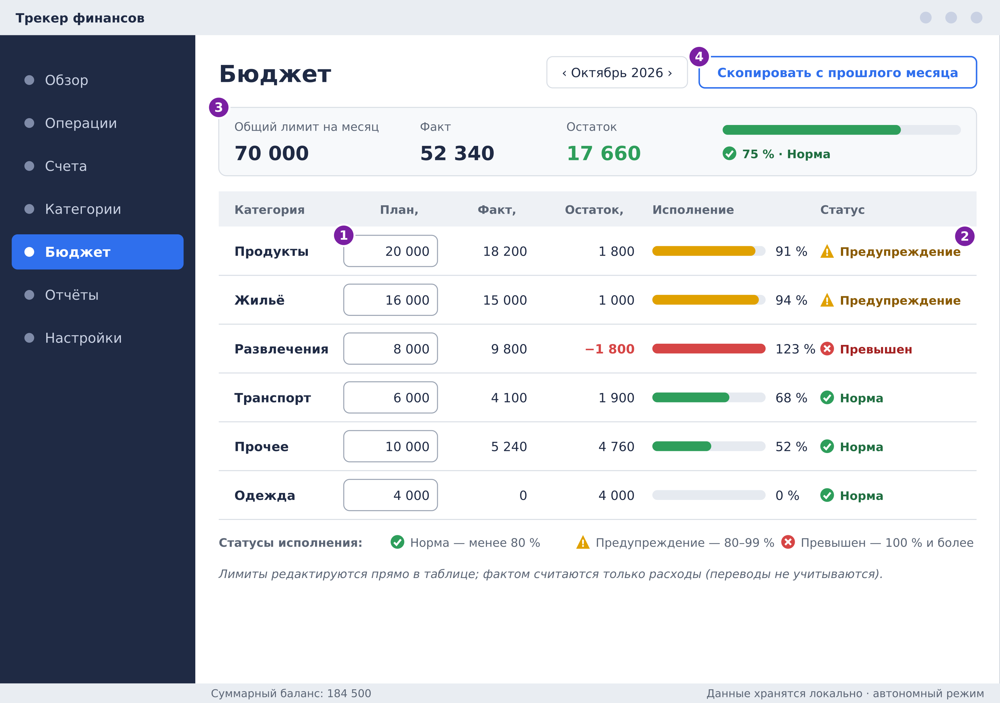

# Спецификация требований к ПО

Для «Трекер финансов»
Версия: 0.2
Подготовил: Романчук Георгий Александрович
Организация: учебный проект БГУИР по дисциплине «Жизненный цикл разработки программного обеспечения»
Дата изменения: 20.10.2026

## Оглавление

<!-- TOC -->
* [1. Введение](#1-introduction)
  * [1.1 Назначение документа](#11-document-purpose)
  * [1.2 Область применения продукта](#12-product-scope)
  * [1.3 Определения, акронимы и сокращения](#13-definitions-acronyms-and-abbreviations)
  * [1.4 Ссылки](#14-references)
  * [1.5 Обзор документа](#15-document-overview)
* [2. Обзор продукта](#2-product-overview)
  * [2.1 Перспектива продукта](#21-product-perspective)
  * [2.2 Функции продукта](#22-product-functions)
  * [2.3 Ограничения продукта](#23-product-constraints)
  * [2.4 Характеристики пользователей](#24-user-characteristics)
  * [2.5 Допущения и зависимости](#25-assumptions-and-dependencies)
  * [2.6 Распределение требований](#26-apportioning-of-requirements)
* [3. Требования](#3-requirements)
  * [3.1 Внешние интерфейсы](#31-external-interfaces)
    * [3.1.1 Пользовательские интерфейсы](#311-user-interfaces)
    * [3.1.2 Аппаратные интерфейсы](#312-hardware-interfaces)
    * [3.1.3 Программные интерфейсы](#313-software-interfaces)
  * [3.2 Функциональные требования](#32-functional)
  * [3.3 Качество обслуживания](#33-quality-of-service)
    * [3.3.1 Производительность](#331-performance)
    * [3.3.2 Безопасность](#332-security)
    * [3.3.3 Надёжность](#333-reliability)
    * [3.3.4 Доступность](#334-availability)
    * [3.3.5 Наблюдаемость](#335-observability)
  * [3.4 Соответствие стандартам](#34-compliance)
  * [3.5 Проектирование и реализация](#35-design-and-implementation)
    * [3.5.1 Установка](#351-installation)
    * [3.5.2 Сборка и поставка](#352-build-and-delivery)
    * [3.5.3 Распределение](#353-distribution)
    * [3.5.4 Сопровождаемость](#354-maintainability)
    * [3.5.5 Повторное использование](#355-reusability)
    * [3.5.6 Переносимость](#356-portability)
    * [3.5.7 Стоимость](#357-cost)
    * [3.5.8 Сроки](#358-deadline)
    * [3.5.9 Доказательство концепции](#359-proof-of-concept)
    * [3.5.10 Управление изменениями](#3510-change-management)
  * [3.6 ИИ/МО](#36-aiml)
    * [3.6.1 Спецификация модели](#361-model-specification)
    * [3.6.2 Управление данными](#362-data-management)
    * [3.6.3 Ограничители (Guardrails)](#363-guardrails)
    * [3.6.4 Этика](#364-ethics)
    * [3.6.5 Human-in-the-Loop](#365-human-in-the-loop)
    * [3.6.6 Жизненный цикл модели и операции](#366-model-lifecycle-and-operations)
* [4. Верификация](#4-verification)
* [5. Приложения](#5-appendixes)
<!-- TOC -->

## История изменений

| Name | Date | Reason For Changes | Version |
|------|------|--------------------|---------|
| Романчук Георгий Александрович | 20.10.2026 | Первичный черновик документа | 0.1 |
| Романчук Георгий Александрович | 20.10.2026 | Добавлены макеты интерфейса (MOCK-01…03) и ссылки на них из требований | 0.2 |

---

## 1. Введение {#1-introduction}

Документ определяет верифицируемые требования к программному продукту «Трекер финансов» — настольному Java-приложению для учёта личных доходов и расходов, категоризации трат и визуализации бюджета. В разделе 1 описаны назначение документа и границы продукта, в разделе 2 — контекст и ограничения, в разделе 3 — сами требования, в разделе 4 — способы их проверки.

### 1.1 Назначение документа {#11-document-purpose}

SRS определяет, **ЧТО** должна делать система «Трекер финансов», а не то, как она будет реализована. Документ предназначен для разработчиков (реализация), тестировщиков (построение тестов и матрицы верификации), преподавателя/заказчика (приёмка) и сопровождающих продукт. Документ является источником истины для требований версии 1.0 и обновляется по мере уточнения требований; изменения фиксируются в «Истории изменений».

### 1.2 Область применения продукта {#12-product-scope}

Продукт — «Трекер финансов», версия 1.0. Это автономное настольное приложение на Java, позволяющее пользователю вести счета, фиксировать доходы и расходы, распределять траты по категориям, задавать месячные лимиты бюджета и наглядно видеть финансовую картину на диаграммах. Цель продукта — дать ответ на вопросы: «сколько я заработал, на что потратил и укладываюсь ли в бюджет».

**Входит в версию 1.0:**

- учёт счетов, доходов, расходов и переводов;
- управление категориями и правила автоматической категоризации;
- месячные бюджеты по категориям и контроль их исполнения;
- визуализация: круговая диаграмма расходов, диаграмма «доходы vs расходы», динамика баланса, индикаторы бюджета;
- импорт/экспорт CSV и резервное копирование.

**Не входит в версию 1.0:**

- синхронизация с банками и платёжными системами;
- многопользовательская работа, облачное хранение, мобильная версия;
- конвертация валют по курсам (каждый счёт ведётся в одной валюте);
- учёт инвестиций, кредитов, налогов;
- функции машинного обучения (см. раздел 3.6).

### 1.3 Определения, акронимы и сокращения {#13-definitions-acronyms-and-abbreviations}

| Term | Definition |
|------|------------|
| API | Application Programming Interface — набор определений и протоколов для создания и интеграции прикладного ПО |
| SRS | Software Requirements Specification — документ, описывающий назначение, требования и характер ПО |
| UI | User Interface — визуальная часть приложения, через которую пользователь взаимодействует с ПО |
| CSV | Comma-Separated Values — текстовый формат табличных данных |
| JDBC | Java Database Connectivity — стандартный API доступа к базам данных из Java |
| JAR | Java ARchive — архив с исполняемым Java-приложением |
| JavaFX | Библиотека для построения графического интерфейса настольных Java-приложений |
| SQLite | Встраиваемая реляционная СУБД, хранящая данные в одном файле |
| Бюджет | Плановый лимит расходов по категории (или общий) на календарный месяц |
| Категория | Группа операций по назначению (например, «Продукты», «Зарплата») |
| Операция (транзакция) | Запись о доходе, расходе или переводе с датой, суммой, счётом и категорией |
| Перевод | Операция перемещения денег между двумя счетами пользователя; не является доходом или расходом |
| Правило автокатегоризации | Правило вида «если описание содержит текст X, то категория Y» |
| Счёт | Место хранения денег: наличные, банковская карта, вклад и т. п. |

### 1.4 Ссылки {#14-references}

| № | Название | Владелец/автор | Версия/дата | Расположение | Тип |
|---|----------|----------------|-------------|--------------|-----|
| 1 | IEEE Std 830-1998. Recommended Practice for Software Requirements Specifications | IEEE | 1998 | https://standards.ieee.org | Справочная |
| 2 | ISO/IEC/IEEE 29148. Requirements engineering | ISO/IEC/IEEE | 2018 | https://www.iso.org | Справочная |
| 3 | Шаблон `srs-template.md` | Романчук Георгий Александрович | — | `srs/srs-template.md` в репозитории | Нормативная |
| 4 | Репозиторий проекта SDLC | Романчук Георгий Александрович | — | https://github.com/georgiyr101/SDLC | Справочная |
| 5 | Макеты интерфейса MOCK-01…03 (PNG) | Романчук Георгий Александрович | 0.2, 20.10.2026 | `srs/mockups/` | Справочная |

### 1.5 Обзор документа {#15-document-overview}

Раздел 2 описывает контекст продукта, функции, ограничения, пользователей, допущения и распределение требований по релизам. Раздел 3 содержит требования в едином формате: интерфейсы, функции, качество обслуживания, соответствие стандартам, проектирование и реализация, ИИ/МО (для данного продукта не применяется). Раздел 4 — матрица верификации. Раздел 5 — приложения: сценарии использования, модель данных, открытые вопросы, трассируемость, макеты интерфейса. Требования используют ключевые слова «должен» (обязательно), «следует» (желательно), «может» (допустимо). Приоритет требования указан в поле More Information (Must / Should / Could).

---

## 2. Обзор продукта {#2-product-overview}

### 2.1 Перспектива продукта {#21-product-perspective}

«Трекер финансов» — новый самостоятельный продукт, не заменяющий и не расширяющий существующую систему. Он работает локально на компьютере пользователя, хранит данные во встроенной БД и не зависит от внешних сервисов. Владелец продукта и единственная сторона поддержки — автор проекта; SLA не предусмотрены.

### 2.2 Функции продукта {#22-product-functions}

1. Управление счетами (создание, архивация, расчёт баланса).
2. Учёт операций: доходы, расходы, переводы, (опционально) регулярные операции.
3. Управление категориями и правилами автоматической категоризации.
4. Планирование месячного бюджета и контроль его исполнения с предупреждениями.
5. Визуализация: диаграммы расходов, динамика доходов/расходов и баланса, индикаторы бюджета.
6. Импорт/экспорт CSV и резервное копирование/восстановление данных.
7. Настройки приложения (валюта, формат дат, расчётный день месяца).

### 2.3 Ограничения продукта {#23-product-constraints}

| ID | Ограничение | Тип |
|----|-------------|-----|
| CON-01 | Продукт должен быть реализован на языке Java версии 17 или выше. | Внутреннее, обязательное |
| CON-02 | Графический интерфейс должен быть реализован на JavaFX (окончательный выбор подтверждается в приложении C). | Внутреннее, предпочтительное |
| CON-03 | Данные должны храниться во встроенной СУБД SQLite; отдельный сервер БД не допускается. | Внутреннее, обязательное |
| CON-04 | Продукт должен полностью работать без подключения к интернету. | Внешнее, обязательное |
| CON-05 | Денежные суммы должны обрабатываться типом `BigDecimal`; типы `float` и `double` для денег запрещены. | Внутреннее, обязательное |
| CON-06 | Архитектура должна быть разделена на слои: представление → сервисы → репозитории. | Внутреннее, обязательное |
| CON-07 | Все используемые сторонние библиотеки должны быть бесплатными и иметь открытую лицензию. | Организационное, обязательное |

📝 Верифицируемые обязательства, вытекающие из этих ограничений, заданы в разделе 3 (в поле More Information требований указаны ссылки на соответствующие CON-xx).

### 2.4 Характеристики пользователей {#24-user-characteristics}

| Класс пользователя | Описание и цели | Подготовка | Частота использования |
|--------------------|-----------------|------------|-----------------------|
| Владелец бюджета | Частное лицо, ведущее личный или семейный бюджет; вносит операции, следит за лимитами и анализирует траты | Базовые навыки работы с ПК, без финансового образования | Несколько раз в неделю, обзор — раз в месяц |
| Начинающий пользователь | Впервые использует трекер; нужен быстрый старт с готовыми категориями | Минимальные | Первые дни использования |

Роли и права доступа в версии 1.0 не различаются, аутентификация не требуется. Основной язык интерфейса — русский; интерфейс должен быть доступен при работе только с клавиатуры (см. REQ-INT-004).

### 2.5 Допущения и зависимости {#25-assumptions-and-dependencies}

| № | Допущение / зависимость | Влияние, если окажется неверным |
|---|-------------------------|---------------------------------|
| A1 | На компьютере пользователя доступна среда Java 17+ (установлена или поставляется вместе с приложением) | Приложение не запустится; потребуется поставка со встроенной JRE (`jpackage`) |
| A2 | Основная валюта по умолчанию — RUB, мультивалютность не требуется | Потребуется модель курсов валют и пересмотр расчёта сумм |
| A3 | Один пользователь работает с одной локальной БД | Потребуются учётные записи и разграничение доступа |
| A4 | Типовой объём данных — до 10 000 операций | Потребуется пересмотр индексации и пагинации |
| D1 | Библиотека JavaFX (UI, диаграммы) | Смена UI-технологии (Swing) потребует переработки слоя представления |
| D2 | Драйвер SQLite JDBC | Смена СУБД потребует замены слоя репозиториев |
| D3 | JUnit 5 для автоматических тестов | Ручное тестирование увеличит трудоёмкость |

### 2.6 Распределение требований {#26-apportioning-of-requirements}

| Релиз / итерация | Состав | Требования |
|------------------|--------|------------|
| 1.0 (MVP, Must) | Счета, операции, категории, бюджеты, основные диаграммы, экспорт CSV, надёжность и производительность | REQ-INT-001, 002, 005, 006; REQ-FUNC-001, 002, 004, 005, 006, 009, 010, 012, 013, 015, 016, 018, 019, 020; REQ-PERF-001…003; REQ-SEC-001, 003; REQ-REL-001, 003; REQ-AVAIL-001; REQ-COMP-001; REQ-INST-001; REQ-BUILD-001; REQ-MAINT-001; REQ-PORT-001; REQ-COST-001; REQ-POC-001; REQ-CM-001 |
| 1.1 (Should) | Переводы, автокатегоризация, график баланса, импорт CSV, резервные копии, настройки, логирование, локализация | REQ-INT-003, 004; REQ-FUNC-003, 007, 011, 014, 017, 021, 022, 023; REQ-PERF-004; REQ-REL-002; REQ-OBS-001; REQ-COMP-002; REQ-BUILD-002; REQ-MAINT-002; REQ-REUSE-001; REQ-PORT-002; REQ-CM-002 |
| Отложено (Could) | Регулярные операции, PIN-код, темы оформления | REQ-FUNC-008; REQ-SEC-002; REQ-MAINT-003 |
| Не распределено | Сроки поставки (REQ-DEAD-001) — ожидают уточнения | См. приложение C |

---

## 3. Требования {#3-requirements}

Все требования оформлены по единому шаблону: **ID**, **Title**, **Statement**, **Rationale**, **Acceptance Criteria**, **Verification Method** (Test | Analysis | Inspection | Demonstration), **More Information** (приоритет, ссылки на ограничения и связанные требования).

**Схема идентификаторов:** `REQ-[AREA]-[NNN]`, где AREA ∈ {INT, FUNC, PERF, SEC, REL, AVAIL, OBS, COMP, INST, BUILD, DIST, MAINT, REUSE, PORT, COST, DEAD, POC, CM, ML}. ID уникальны и неизменяемы. Изменение требования фиксируется суффиксом `-[VER]` и записью в «Истории изменений».

### 3.1 Внешние интерфейсы {#31-external-interfaces}

#### 3.1.1 Пользовательские интерфейсы {#311-user-interfaces}

Иллюстрации к требованиям — низкодетальные макеты размером 1024×720: [MOCK-01](mockups/mockup-01-overview.svg) (экран «Обзор»), [MOCK-02](mockups/mockup-02-add-transaction.svg) (диалог «Новая операция») и [MOCK-03](mockups/mockup-03-budget.svg) (экран «Бюджет»). Номерные метки на макетах расшифрованы в [приложении E](#appendix-e). Макеты поясняют требования, но не заменяют их: при расхождении приоритет имеет текст требования.

**REQ-INT-001 — Структура главного окна**
- **Statement:** Система должна предоставлять графический интерфейс с главным окном и разделами «Обзор», «Операции», «Счета», «Категории», «Бюджет», «Отчёты», «Настройки».
- **Rationale:** Единая понятная навигация по всем функциям продукта.
- **Acceptance Criteria:** Из главного окна каждый из семи разделов открывается не более чем за один переход; активный раздел визуально выделен.
- **Verification Method:** Demonstration
- **More Information:** Приоритет: Must. CON-01, CON-02. Макеты: [MOCK-01](mockups/mockup-01-overview.png), [MOCK-02](mockups/mockup-02-add-transaction.png), [MOCK-03](mockups/mockup-03-budget.png) (боковая навигация по разделам).

**REQ-INT-002 — Форма операции и валидация ввода**
- **Statement:** Система должна предоставлять форму добавления операции с полями: тип (доход / расход / перевод), сумма, дата, счёт, категория, описание, а также должна отклонять некорректный ввод (пустая, нулевая или отрицательная сумма, не выбран счёт, дата вне диапазона 01.01.2000–31.12.2100), показывая сообщение об ошибке рядом с полем.
- **Rationale:** Предотвращение некорректных данных и упрощение исправления ошибок.
- **Acceptance Criteria:** При каждом из перечисленных некорректных значений операция не сохраняется, у поля отображается понятное сообщение; дата по умолчанию — текущая.
- **Verification Method:** Test
- **More Information:** Приоритет: Must. Связано: REQ-FUNC-004, REQ-SEC-003. Макет: [MOCK-02](mockups/mockup-02-add-transaction.png), метка 2 (состояние ошибки поля «Сумма»).

**REQ-INT-003 — Локализация интерфейса**
- **Statement:** Система следует предоставлять интерфейс на русском языке, при этом все тексты интерфейса должны храниться во внешних файлах ресурсов (resource bundles).
- **Rationale:** Целевая аудитория русскоязычная; вынесение текстов позволяет добавить другие языки без изменения кода.
- **Acceptance Criteria:** В исходном коде отсутствуют строковые литералы текстов интерфейса вне файлов ресурсов; при подмене файла ресурсов тексты меняются без перекомпиляции.
- **Verification Method:** Inspection
- **More Information:** Приоритет: Should.

**REQ-INT-004 — Доступность интерфейса**
- **Statement:** Система следует обеспечивать выполнение основных действий (добавление операции, переключение разделов, применение фильтра) с клавиатуры, а индикаторы бюджета должны дублироваться текстом или значком, а не только цветом.
- **Rationale:** Удобство для быстрого ввода данных и для пользователей с нарушением цветового восприятия.
- **Acceptance Criteria:** Добавление операции выполняется без мыши (Tab / Enter / горячая клавиша «Новая операция»); статус «80 %» и «превышен» различимы без опоры на цвет.
- **Verification Method:** Demonstration
- **More Information:** Приоритет: Should. Связано: REQ-FUNC-013. Макеты: [MOCK-02](mockups/mockup-02-add-transaction.png), метка 4 (подсказки горячих клавиш); [MOCK-03](mockups/mockup-03-budget.png), метка 2 (статус значком и текстом).

#### 3.1.2 Аппаратные интерфейсы {#312-hardware-interfaces}

**REQ-INT-005 — Отсутствие специальных аппаратных интерфейсов**
- **Statement:** Система должна работать на стандартном ПК без специальных устройств, а главное окно должно корректно отображаться при разрешении экрана не менее 1024×720.
- **Rationale:** Продукт ориентирован на массового пользователя с обычным компьютером.
- **Acceptance Criteria:** На экране 1024×720 все элементы главного окна доступны, не перекрывают друг друга и не требуют горизонтальной прокрутки основного содержимого.
- **Verification Method:** Demonstration
- **More Information:** Приоритет: Must. Иные аппаратные интерфейсы (датчики, сканеры, принтеры) не используются. Все макеты выполнены в размере 1024×720 (см. приложение E).

#### 3.1.3 Программные интерфейсы {#313-software-interfaces}

**REQ-INT-006 — Интерфейс доступа к БД**
- **Statement:** Система должна обращаться к SQLite через JDBC, а доступ бизнес-логики к данным должен осуществляться только через интерфейсы-репозитории.
- **Rationale:** Изоляция хранилища упрощает тестирование и возможную замену СУБД.
- **Acceptance Criteria:** Классы сервисного слоя и UI не содержат прямых вызовов JDBC и SQL; репозитории подменяются тестовыми реализациями в модульных тестах.
- **Verification Method:** Inspection
- **More Information:** Приоритет: Must. CON-03, CON-06. Данными владеет приложение; внешних потребителей БД нет.

**REQ-INT-007 — Формат CSV**
- **Statement:** Система должна выполнять импорт и экспорт CSV-файлов в кодировке UTF-8 с разделителем `;`, первой строкой-заголовком и колонками `date, type, amount, account, category, description`; дата — в формате `YYYY-MM-DD`, сумма — десятичное число с точкой, тип — `INCOME`, `EXPENSE` или `TRANSFER`.
- **Rationale:** Единый документированный формат обеспечивает обмен данными с Excel и другими программами.
- **Acceptance Criteria:** Экспортированный файл корректно открывается в Excel/LibreOffice с кириллицей; повторный импорт этого файла даёт идентичный набор операций.
- **Verification Method:** Test
- **More Information:** Приоритет: Must. Связано: REQ-FUNC-020, REQ-FUNC-021.

### 3.2 Функциональные требования {#32-functional}

#### Счета

**REQ-FUNC-001 — Создание и редактирование счёта**
- **Statement:** Система должна позволять пользователю создавать счёт с атрибутами: название, тип (наличные, карта, вклад, другое), валюта, начальный баланс — и редактировать название и тип существующего счёта.
- **Rationale:** Счета — основа учёта; операции привязываются к счетам.
- **Acceptance Criteria:** Созданный счёт появляется в списке счетов и в формах операций; название счёта уникально среди активных счетов, при дубликате выводится ошибка.
- **Verification Method:** Test
- **More Information:** Приоритет: Must.

**REQ-FUNC-002 — Расчёт баланса**
- **Statement:** Система должна вычислять и отображать текущий баланс каждого счёта как начальный баланс плюс доходы минус расходы плюс входящие переводы минус исходящие переводы, а также суммарный баланс по всем активным счетам.
- **Rationale:** Актуальный баланс — ключевой показатель для пользователя.
- **Acceptance Criteria:** Для тестового набора из 20 операций вычисленные балансы совпадают с эталонными значениями с точностью до копейки; баланс обновляется сразу после добавления, изменения или удаления операции.
- **Verification Method:** Test
- **More Information:** Приоритет: Must. CON-05. Макет: [MOCK-01](mockups/mockup-01-overview.png) (суммарный баланс и карточки показателей).

**REQ-FUNC-003 — Архивация счёта**
- **Statement:** Система следует позволять архивировать счёт; архивный счёт не должен предлагаться при вводе новых операций, но его история должна сохраняться и учитываться в отчётах.
- **Rationale:** Закрытые счета не должны засорять интерфейс, но история расходов не должна теряться.
- **Acceptance Criteria:** После архивации счёт отсутствует в выпадающих списках форм, а его операции видны в списке и отчётах за прошлые периоды.
- **Verification Method:** Test
- **More Information:** Приоритет: Should.

#### Операции

**REQ-FUNC-004 — Добавление дохода и расхода**
- **Statement:** Система должна позволять добавлять операции типа «доход» и «расход» с суммой, датой, счётом, категорией и описанием.
- **Rationale:** Ядро функциональности продукта.
- **Acceptance Criteria:** Сохранённая операция отображается в списке и влияет на баланс счёта и агрегаты отчётов; сумма хранится с точностью 2 знака после запятой; категория должна соответствовать типу операции.
- **Verification Method:** Test
- **More Information:** Приоритет: Must. CON-05. Связано: REQ-INT-002. Макет: [MOCK-02](mockups/mockup-02-add-transaction.png), метка 1 (выбор типа операции).

**REQ-FUNC-005 — Редактирование и удаление операций**
- **Statement:** Система должна позволять изменять и удалять ранее созданные операции, при этом удаление должно требовать подтверждения пользователя, а балансы и отчёты должны пересчитываться автоматически.
- **Rationale:** Пользователи ошибаются при вводе; ошибки должны исправляться без нарушения целостности данных.
- **Acceptance Criteria:** После изменения суммы операции баланс счёта корректируется на разницу; при отмене подтверждения удаления операция сохраняется.
- **Verification Method:** Test
- **More Information:** Приоритет: Must.

**REQ-FUNC-006 — Список операций: сортировка, фильтрация, поиск**
- **Statement:** Система должна отображать список операций с сортировкой по дате, сумме и категории и с фильтрацией по периоду, счёту, категории, типу операции и подстроке в описании.
- **Rationale:** Пользователю нужно быстро находить нужные записи среди тысяч операций.
- **Acceptance Criteria:** При комбинации нескольких фильтров список содержит только операции, удовлетворяющие всем условиям; сортировка меняет порядок строк согласно выбранному столбцу и направлению.
- **Verification Method:** Test
- **More Information:** Приоритет: Must. Связано: REQ-PERF-002. Макет: [MOCK-02](mockups/mockup-02-add-transaction.png) (панель фильтров и таблица операций на заднем плане).

**REQ-FUNC-007 — Переводы между счетами**
- **Statement:** Система следует позволять создавать перевод между двумя разными счетами; перевод не должен учитываться как доход или расход в отчётах и бюджетах.
- **Rationale:** Перемещение денег между своими счетами не меняет общий капитал и не должно искажать статистику.
- **Acceptance Criteria:** После перевода 1000 с A на B баланс A уменьшается, баланс B увеличивается на ту же сумму, суммарный баланс не меняется, суммы доходов и расходов за период не изменяются.
- **Verification Method:** Test
- **More Information:** Приоритет: Should. Макет: [MOCK-02](mockups/mockup-02-add-transaction.png), метка 1 (вариант «Перевод»).

**REQ-FUNC-008 — Регулярные операции**
- **Statement:** Система может позволять задавать регулярную операцию с периодичностью «ежедневно», «еженедельно» или «ежемесячно» и должна автоматически создавать пропущенные экземпляры такой операции при запуске приложения.
- **Rationale:** Уменьшает ручной ввод повторяющихся платежей (аренда, подписки, зарплата).
- **Acceptance Criteria:** Для ежемесячной операции, созданной 3 месяца назад, при запуске создаются все пропущенные экземпляры без дубликатов.
- **Verification Method:** Test
- **More Information:** Приоритет: Could (отложено).

#### Категории

**REQ-FUNC-009 — Категории по умолчанию**
- **Statement:** При первом запуске система должна создавать набор категорий. Расходы: «Продукты», «Транспорт», «Жильё», «Здоровье», «Развлечения», «Одежда», «Прочее». Доходы: «Зарплата», «Подработка», «Подарки», «Прочее».
- **Rationale:** Позволяет начать работу без предварительной настройки.
- **Acceptance Criteria:** На пустой БД после первого запуска в списке категорий присутствуют все 11 категорий с корректным типом.
- **Verification Method:** Test
- **More Information:** Приоритет: Must.

**REQ-FUNC-010 — Управление категориями**
- **Statement:** Система должна позволять создавать, переименовывать и архивировать пользовательские категории с указанием типа (доход / расход) и не должна допускать физического удаления категории, к которой привязаны операции; вместо этого система должна предложить перенести операции в другую категорию или архивировать категорию.
- **Rationale:** Сохранение целостности истории операций.
- **Acceptance Criteria:** Попытка удалить используемую категорию приводит к диалогу с выбором действия, данные не теряются; название категории уникально в пределах типа.
- **Verification Method:** Test
- **More Information:** Приоритет: Must.

**REQ-FUNC-011 — Автоматическая категоризация**
- **Statement:** Система следует позволять задавать правила вида «описание содержит текст X → категория Y» с приоритетом; при сохранении операции без выбранной категории (включая импорт) система должна применять первое подходящее правило по приоритету, а при отсутствии подходящих правил — назначать категорию «Прочее».
- **Rationale:** Сокращает ручную работу, особенно при импорте большого числа операций.
- **Acceptance Criteria:** Для правила «магнит → Продукты» операция с описанием «Магнит, чек 123» (без учёта регистра) получает категорию «Продукты»; операция без совпадений — «Прочее».
- **Verification Method:** Test
- **More Information:** Приоритет: Should. Правила детерминированы; методы ML не используются (см. 3.6). Макет: [MOCK-02](mockups/mockup-02-add-transaction.png), метка 3 (категория «определится автоматически»).

#### Бюджет

**REQ-FUNC-012 — Месячные лимиты по категориям**
- **Statement:** Система должна позволять задавать для каждой категории расходов лимит на выбранный календарный месяц.
- **Rationale:** Лимит — основа планирования и контроля расходов.
- **Acceptance Criteria:** Лимит сохраняется для конкретного месяца и категории; повторное задание лимита заменяет предыдущее значение; отрицательное значение отклоняется.
- **Verification Method:** Test
- **More Information:** Приоритет: Must. Макет: [MOCK-03](mockups/mockup-03-budget.png), метка 1 (редактируемые лимиты).

**REQ-FUNC-013 — Контроль исполнения бюджета**
- **Statement:** Система должна отображать для выбранного месяца по каждой категории плановую сумму, фактическую сумму, остаток и процент исполнения и должна выделять категории, достигшие 80 % лимита (предупреждение), и превысившие 100 % (превышение).
- **Rationale:** Пользователь должен вовремя замечать приближение к лимиту.
- **Acceptance Criteria:** При проценте исполнения 79 % статус «норма», при 80 % и 99 % — «предупреждение», при 100 % и выше — «превышен»; фактическая сумма учитывает только расходы типа EXPENSE.
- **Verification Method:** Test
- **More Information:** Приоритет: Must. Связано: REQ-INT-004. Макеты: [MOCK-03](mockups/mockup-03-budget.png), метка 2; [MOCK-01](mockups/mockup-01-overview.png), метка 4 (индикаторы исполнения).

**REQ-FUNC-014 — Общий месячный лимит и копирование бюджета**
- **Statement:** Система следует позволять задавать общий месячный лимит расходов и копировать бюджет предыдущего месяца на текущий.
- **Rationale:** Ускоряет планирование; даёт агрегированный контроль.
- **Acceptance Criteria:** После копирования все лимиты предыдущего месяца присутствуют в текущем и могут быть изменены; общий лимит учитывается в индикаторе исполнения.
- **Verification Method:** Test
- **More Information:** Приоритет: Should. Макет: [MOCK-03](mockups/mockup-03-budget.png), метки 3 и 4 (общий лимит, копирование с прошлого месяца).

#### Визуализация

**REQ-FUNC-015 — Круговая диаграмма расходов**
- **Statement:** Система должна строить круговую диаграмму расходов по категориям за выбранный период с отображением сумм и долей в процентах.
- **Rationale:** Показывает структуру трат.
- **Acceptance Criteria:** Сумма долей составляет 100 %; значения секторов совпадают с суммами расходов по категориям из списка операций за тот же период; переводы не учитываются.
- **Verification Method:** Test
- **More Information:** Приоритет: Must. Макет: [MOCK-01](mockups/mockup-01-overview.png), метка 3 (круговая диаграмма).

**REQ-FUNC-016 — Диаграмма «доходы и расходы по месяцам»**
- **Statement:** Система должна строить столбчатую диаграмму сумм доходов и расходов по месяцам за выбранный период длиной до 12 месяцев.
- **Rationale:** Показывает динамику и сезонность финансов.
- **Acceptance Criteria:** Для каждого месяца периода отображаются два столбца (доходы, расходы); месяцы без операций отображаются с нулевыми значениями.
- **Verification Method:** Test
- **More Information:** Приоритет: Must.

**REQ-FUNC-017 — График динамики баланса**
- **Statement:** Система следует строить линейный график динамики суммарного баланса по дням или месяцам за выбранный период.
- **Rationale:** Позволяет увидеть рост или падение накоплений.
- **Acceptance Criteria:** Значение последней точки графика равно текущему суммарному балансу.
- **Verification Method:** Test
- **More Information:** Приоритет: Should.

**REQ-FUNC-018 — Экран «Обзор»**
- **Statement:** Система должна отображать на экране «Обзор» за текущий месяц суммы доходов и расходов, их разницу, суммарный баланс, топ-5 категорий расходов и индикаторы исполнения бюджета.
- **Rationale:** Пользователь получает ответ на главные вопросы сразу после запуска.
- **Acceptance Criteria:** Все показатели совпадают с данными разделов «Операции» и «Бюджет» за тот же месяц.
- **Verification Method:** Demonstration
- **More Information:** Приоритет: Must. Макет: [MOCK-01](mockups/mockup-01-overview.png), метки 1–4.

**REQ-FUNC-019 — Автоматическое обновление визуализации**
- **Statement:** Система должна обновлять диаграммы, индикаторы и балансы сразу после изменения данных без перезапуска приложения и без ручного обновления.
- **Rationale:** Непротиворечивое отображение данных во всех разделах.
- **Acceptance Criteria:** После добавления операции открытые диаграммы и индикаторы отражают изменение не позднее чем через 1 секунду.
- **Verification Method:** Demonstration
- **More Information:** Приоритет: Must. Связано: REQ-PERF-003.

#### Импорт, экспорт, резервные копии, настройки

**REQ-FUNC-020 — Экспорт в CSV**
- **Statement:** Система должна экспортировать операции за выбранный период (с учётом активных фильтров) в CSV-файл в формате REQ-INT-007.
- **Rationale:** Передача данных в сторонние программы и защита от потери данных.
- **Acceptance Criteria:** Число строк файла (без заголовка) равно числу операций в выборке; значения совпадают с данными приложения.
- **Verification Method:** Test
- **More Information:** Приоритет: Must.

**REQ-FUNC-021 — Импорт из CSV**
- **Statement:** Система следует импортировать операции из CSV-файла, показывать предпросмотр и количество строк с ошибками до подтверждения, пропускать некорректные строки и выдавать отчёт со списком пропущенных строк и причин.
- **Rationale:** Быстрый перенос накопленной истории из других источников.
- **Acceptance Criteria:** При импорте файла из 100 строк, из которых 5 некорректны, импортируются 95 строк, отчёт перечисляет 5 пропущенных строк с номерами и причинами; несуществующие счета и категории не создаются автоматически без подтверждения.
- **Verification Method:** Test
- **More Information:** Приоритет: Should. Связано: REQ-INT-007, REQ-SEC-003.

**REQ-FUNC-022 — Резервное копирование и восстановление**
- **Statement:** Система следует создавать резервную копию БД по команде пользователя в выбранную папку и восстанавливать данные из такой копии с предупреждением о замене текущих данных.
- **Rationale:** Защита от потери данных при сбоях диска или ошибках пользователя.
- **Acceptance Criteria:** После восстановления из копии данные приложения идентичны состоянию на момент создания копии.
- **Verification Method:** Test
- **More Information:** Приоритет: Should. Связано: REQ-REL-002.

**REQ-FUNC-023 — Настройки приложения**
- **Statement:** Система следует позволять выбрать основную валюту, формат отображения дат и день начала расчётного месяца (1–28).
- **Rationale:** Учёт особенностей пользователя, например зарплаты не в начале месяца.
- **Acceptance Criteria:** После изменения расчётного дня на 10 «месяц» в бюджете и отчётах охватывает период с 10-го числа по 9-е следующего месяца.
- **Verification Method:** Test
- **More Information:** Приоритет: Should.

### 3.3 Качество обслуживания {#33-quality-of-service}

#### 3.3.1 Производительность {#331-performance}

Базовое окружение измерений: ПК с 4 ГБ ОЗУ, SSD, 2 ядра процессора; тестовая БД — 10 000 операций.

**REQ-PERF-001 — Время запуска**
- **Statement:** Система должна показывать главное окно не позднее чем через 3 секунды после запуска.
- **Rationale:** Быстрый запуск важен для ежедневного использования.
- **Acceptance Criteria:** 95-й процентиль времени запуска по 20 замерам не превышает 3 секунд.
- **Verification Method:** Test
- **More Information:** Приоритет: Must. Допущение A4.

**REQ-PERF-002 — Время отклика списка операций**
- **Statement:** Система должна открывать список операций и применять фильтр или сортировку не дольше чем за 1 секунду.
- **Rationale:** Работа с большим журналом операций должна быть комфортной.
- **Acceptance Criteria:** Время каждой из операций «открыть список», «применить фильтр», «сортировать» не превышает 1 секунды (среднее по 20 замерам).
- **Verification Method:** Test
- **More Information:** Приоритет: Must. Связано: REQ-FUNC-006.

**REQ-PERF-003 — Время построения диаграмм**
- **Statement:** Система должна строить любую диаграмму за период до 12 месяцев не дольше чем за 1 секунду.
- **Rationale:** Визуализация — ключевая функция продукта.
- **Acceptance Criteria:** Время от выбора периода до отображения диаграммы не превышает 1 секунды на тестовой БД.
- **Verification Method:** Test
- **More Information:** Приоритет: Must.

**REQ-PERF-004 — Использование памяти**
- **Statement:** Система следует использовать не более 300 МБ оперативной памяти при работе с БД в 10 000 операций.
- **Rationale:** Приложение должно комфортно работать на недорогих компьютерах.
- **Acceptance Criteria:** Пиковое потребление памяти процессом (RSS) не превышает 300 МБ в 30-минутном сценарии использования.
- **Verification Method:** Analysis
- **More Information:** Приоритет: Should.

#### 3.3.2 Безопасность {#332-security}

**REQ-SEC-001 — Локальное хранение и отсутствие телеметрии**
- **Statement:** Система должна хранить данные пользователя только локально и не должна устанавливать сетевые соединения и передавать данные третьим лицам, включая телеметрию.
- **Rationale:** Финансовые данные конфиденциальны; продукт не нуждается в сети.
- **Acceptance Criteria:** При мониторинге сетевого трафика во время полного сценария использования исходящие соединения отсутствуют.
- **Verification Method:** Analysis
- **More Information:** Приоритет: Must. CON-04.

**REQ-SEC-002 — Защита входа PIN-кодом**
- **Statement:** Система может позволять включить защиту запуска приложения PIN-кодом, при этом PIN-код должен храниться только в виде соленого хеша.
- **Rationale:** Защита данных от посторонних на общем компьютере.
- **Acceptance Criteria:** При включённой защите главное окно не открывается без верного PIN-кода; в файле настроек PIN в открытом виде отсутствует.
- **Verification Method:** Test
- **More Information:** Приоритет: Could (отложено).

**REQ-SEC-003 — Защита от некорректных и вредоносных данных**
- **Statement:** Система должна выполнять все обращения к БД через параметризованные запросы и валидировать все внешние данные (ввод пользователя, содержимое CSV) по типу, формату и допустимому диапазону.
- **Rationale:** Предотвращение SQL-инъекций и порчи данных через описания операций и импортируемые файлы.
- **Acceptance Criteria:** Описание вида `'; DROP TABLE transaction; --` сохраняется как обычный текст и не влияет на схему БД; CSV со строкой с некорректным типом или суммой не приводит к аварийному завершению.
- **Verification Method:** Test
- **More Information:** Приоритет: Must. Связано: REQ-INT-002, REQ-FUNC-021.

#### 3.3.3 Надёжность {#333-reliability}

**REQ-REL-001 — Транзакционность записи**
- **Statement:** Система должна выполнять каждое изменение данных (создание, изменение, удаление операции, счёта, категории, бюджета) в транзакции БД и не должна терять подтверждённые изменения при аварийном завершении приложения.
- **Rationale:** Финансовые данные не должны теряться или оказываться в несогласованном состоянии.
- **Acceptance Criteria:** При принудительном завершении процесса сразу после подтверждения сохранения данные присутствуют при следующем запуске; при ошибке в середине многошагового изменения (например, перевода) частичные изменения не сохраняются.
- **Verification Method:** Test
- **More Information:** Приоритет: Must. CON-03.

**REQ-REL-002 — Поведение при повреждении БД**
- **Statement:** При отсутствии или повреждении файла БД система должна сообщить об ошибке и предложить восстановление из резервной копии либо создание новой БД, не завершаясь аварийно.
- **Rationale:** Пользователь не должен остаться перед «белым экраном» или без объяснения.
- **Acceptance Criteria:** При запуске с намеренно повреждённым файлом БД отображается диалог с двумя вариантами действий; файл повреждённой БД не удаляется без подтверждения.
- **Verification Method:** Test
- **More Information:** Приоритет: Should. Связано: REQ-FUNC-022.

**REQ-REL-003 — Корректность денежных расчётов**
- **Statement:** Система должна выполнять расчёты денежных сумм типом `BigDecimal` с точностью 2 знака и режимом округления HALF_UP и не должна накапливать ошибки округления в суммах и процентах.
- **Rationale:** Расхождения в копейки подрывают доверие к финансовому приложению.
- **Acceptance Criteria:** Сумма 1000 операций по 0,10 равна ровно 100,00; процент исполнения бюджета вычисляется с округлением до 1 знака.
- **Verification Method:** Test
- **More Information:** Приоритет: Must. CON-05.

#### 3.3.4 Доступность {#334-availability}

**REQ-AVAIL-001 — Работа без сети**
- **Statement:** Система должна быть полностью работоспособна без подключения к интернету и без внешних сервисов, а её функции должны быть доступны сразу после запуска.
- **Rationale:** Локальное приложение не должно зависеть от доступности сторонних сервисов.
- **Acceptance Criteria:** При отключённых сетевых интерфейсах все функции раздела 3.2 (кроме функций, требующих только локальных файлов) выполняются без ошибок.
- **Verification Method:** Demonstration
- **More Information:** Приоритет: Must. CON-04. Окон обслуживания и SLA нет.

#### 3.3.5 Наблюдаемость {#335-observability}

**REQ-OBS-001 — Журналирование**
- **Statement:** Система следует вести журнал событий приложения в локальном файле с уровнями ERROR, WARN, INFO, ротацией файлов (не более 5 файлов по 5 МБ) и без записи сумм, описаний операций и других персональных финансовых данных.
- **Rationale:** Журнал нужен для диагностики сбоев без риска утечки финансовой информации.
- **Acceptance Criteria:** При искусственной ошибке в журнале появляется запись уровня ERROR со стеком; поиск по журналу после сценария использования не находит введённых сумм и описаний.
- **Verification Method:** Inspection
- **More Information:** Приоритет: Should.

### 3.4 Соответствие стандартам {#34-compliance}

**REQ-COMP-001 — Лицензии зависимостей**
- **Statement:** Система должна использовать только сторонние компоненты с открытыми лицензиями, допускающими бесплатное использование и распространение, а список используемых компонентов и их лицензий должен поставляться вместе с продуктом (файл `THIRD-PARTY-LICENSES`).
- **Rationale:** Исключение лицензионных рисков и выполнение условий лицензий.
- **Acceptance Criteria:** Для каждой зависимости из `pom.xml` в файле присутствует запись о лицензии.
- **Verification Method:** Inspection
- **More Information:** Приоритет: Must. CON-07.

**REQ-COMP-002 — Стандартные форматы данных**
- **Statement:** Система следует хранить и экспортировать даты в формате ISO 8601 (`YYYY-MM-DD`), а коды валют — по ISO 4217 (например, `RUB`).
- **Rationale:** Совместимость с другими программами и однозначность данных.
- **Acceptance Criteria:** Даты в БД и CSV соответствуют ISO 8601, коды валют — списку ISO 4217.
- **Verification Method:** Inspection
- **More Information:** Приоритет: Should. Персональные данные не передаются оператору или третьим лицам (REQ-SEC-001), отдельная регуляторная обработка не требуется.

### 3.5 Проектирование и реализация {#35-design-and-implementation}

#### 3.5.1 Установка {#351-installation}

**REQ-INST-001 — Установка и удаление**
- **Statement:** Система должна запускаться из исполняемого JAR-файла (или пакета, собранного `jpackage`) без прав администратора, хранить БД и настройки в каталоге пользователя (`~/.finance-tracker/`) и при первом запуске автоматически создавать БД и структуру каталогов.
- **Rationale:** Простая установка и отсутствие привилегированных операций.
- **Acceptance Criteria:** На чистой ОС с Java 17 приложение запускается одной командой/двойным кликом; при удалении приложения данные пользователя остаются, пока пользователь не удалит каталог данных вручную.
- **Verification Method:** Demonstration
- **More Information:** Приоритет: Must. Допущение A1.

#### 3.5.2 Сборка и поставка {#352-build-and-delivery}

**REQ-BUILD-001 — Воспроизводимая сборка**
- **Statement:** Система должна собираться одной командой (`mvn package`) в исполняемый артефакт, версии всех зависимостей должны быть зафиксированы в `pom.xml`, а автоматические тесты должны запускаться в рамках сборки.
- **Rationale:** Воспроизводимость сборки на любом компьютере разработчика.
- **Acceptance Criteria:** На чистом клоне репозитория команда `mvn package` завершается успешно и создаёт артефакт; изменение версии зависимости только через `pom.xml`.
- **Verification Method:** Inspection
- **More Information:** Приоритет: Must. CON-01.

**REQ-BUILD-002 — Непрерывная интеграция**
- **Statement:** Система следует собираться и тестироваться автоматически (GitHub Actions) при каждом push и pull request в основную ветку.
- **Rationale:** Раннее обнаружение регрессий.
- **Acceptance Criteria:** В репозитории есть workflow, который запускает сборку и тесты; неудачная сборка отмечается в pull request.
- **Verification Method:** Inspection
- **More Information:** Приоритет: Should.

#### 3.5.3 Распределение {#353-distribution}

**REQ-DIST-001 — Единый процесс, без распределённости**
- **Statement:** Система должна работать как единый процесс на одном компьютере; все компоненты (UI, сервисы, БД) должны выполняться локально без сетевого взаимодействия между ними.
- **Rationale:** Упрощает установку, повышает приватность и надёжность.
- **Acceptance Criteria:** Приложение не открывает сетевые порты и не требует запуска дополнительных серверных процессов.
- **Verification Method:** Analysis
- **More Information:** Приоритет: Must. CON-03, CON-04. Репликация и горизонтальное масштабирование не предусмотрены.

#### 3.5.4 Сопровождаемость {#354-maintainability}

**REQ-MAINT-001 — Слоистая архитектура**
- **Statement:** Исходный код должен быть разделён на слои «представление», «сервисы (бизнес-логика)», «репозитории (доступ к данным)», при этом зависимости направлены только сверху вниз, а расчёты баланса, бюджета и агрегаций для диаграмм должны выполняться в сервисном слое.
- **Rationale:** Возможность тестировать логику без UI и менять UI или БД независимо.
- **Acceptance Criteria:** Классы слоя представления не содержат бизнес-расчётов и SQL; сервисы не зависят от классов JavaFX (проверяется анализом импортов).
- **Verification Method:** Inspection
- **More Information:** Приоритет: Must. CON-06.

**REQ-MAINT-002 — Покрытие тестами**
- **Statement:** Модульные тесты должны покрывать не менее 70 % строк кода сервисного слоя.
- **Rationale:** Безопасное изменение расчётной логики.
- **Acceptance Criteria:** Отчёт JaCoCo показывает покрытие сервисного слоя не ниже 70 %.
- **Verification Method:** Analysis
- **More Information:** Приоритет: Should. Допущение D3.

**REQ-MAINT-003 — Стиль кода и документация**
- **Statement:** Код может соответствовать единому стилю (Checkstyle, Google Java Style), а публичные классы и методы сервисного слоя следует снабжать Javadoc.
- **Rationale:** Читаемость и снижение порога входа для новых участников.
- **Acceptance Criteria:** Проверка Checkstyle проходит без ошибок; в Javadoc описаны все публичные методы сервисов.
- **Verification Method:** Inspection
- **More Information:** Приоритет: Could.

#### 3.5.5 Повторное использование {#355-reusability}

**REQ-REUSE-001 — Независимость бизнес-логики от UI**
- **Statement:** Слои сервисов и репозиториев следует выделить в отдельный Maven-модуль без зависимости от JavaFX.
- **Rationale:** Позволяет в будущем создать консольную, веб- или мобильную версию на тех же сервисах.
- **Acceptance Criteria:** Модуль логики собирается и тестируется без подключения JavaFX.
- **Verification Method:** Inspection
- **More Information:** Приоритет: Should. Связано: REQ-MAINT-001.

#### 3.5.6 Переносимость {#356-portability}

**REQ-PORT-001 — Поддерживаемые платформы**
- **Statement:** Система должна работать на Windows 10 и выше, macOS 12 и выше, Ubuntu 22.04 и выше при наличии Java 17+.
- **Rationale:** Охват основных настольных ОС.
- **Acceptance Criteria:** Сценарии из приложения A выполняются на всех трёх ОС без изменений кода.
- **Verification Method:** Demonstration
- **More Information:** Приоритет: Must. CON-01.

**REQ-PORT-002 — Независимость от окружения**
- **Statement:** Система следует определять пути к данным через системные свойства (`user.home`), не использовать жёстко заданные абсолютные пути и хранить настройки окружения вне исходного кода.
- **Rationale:** Корректная работа на разных ОС и под разными пользователями.
- **Acceptance Criteria:** В исходном коде нет абсолютных путей файловой системы; приложение работает под пользователем с именем, содержащим пробелы и кириллицу.
- **Verification Method:** Inspection
- **More Information:** Приоритет: Should.

#### 3.5.7 Стоимость {#357-cost}

**REQ-COST-001 — Нулевая стоимость лицензий**
- **Statement:** Разработка и эксплуатация продукта не должны требовать платных лицензий на компоненты, инструменты сборки и хостинг.
- **Rationale:** Проект некоммерческий (учебный), бюджет не предусмотрен.
- **Acceptance Criteria:** Все зависимости и инструменты проекта бесплатны для использования (подтверждается реестром лицензий).
- **Verification Method:** Inspection
- **More Information:** Приоритет: Must. CON-07. Связано: REQ-COMP-001.

#### 3.5.8 Сроки {#358-deadline}

| Этап | Результат | Срок |
|------|-----------|------|
| Требования | SRS версии 1.0 утверждена | TBD |
| Проектирование | Архитектура и схема БД | TBD |
| Реализация MVP | Релиз 1.0 (Must-требования) | TBD |
| Тестирование и приёмка | Матрица верификации (раздел 4) заполнена | TBD |
| Релиз 1.1 | Should-требования | TBD |

**REQ-DEAD-001 — Срок поставки версии 1.0**
- **Statement:** Версия 1.0, реализующая все требования с приоритетом Must, должна быть поставлена не позднее даты, согласованной с заказчиком.
- **Rationale:** Сроки определяют объём поставки (раздел 2.6).
- **Acceptance Criteria:** К согласованной дате все Must-требования имеют статус «Passed» в разделе 4.
- **Verification Method:** Inspection
- **More Information:** Дата — TBD, см. приложение C.

#### 3.5.9 Доказательство концепции {#359-proof-of-concept}

**REQ-POC-001 — Прототип визуализации и хранилища**
- **Statement:** До начала полной реализации должен быть создан прототип, подтверждающий, что JavaFX-диаграммы и SQLite обеспечивают показатели REQ-PERF-002 и REQ-PERF-003 на 10 000 сгенерированных операций.
- **Rationale:** Снижение технического риска выбора технологий (JavaFX, SQLite).
- **Acceptance Criteria:** Прототип строит круговую и столбчатую диаграммы за период 12 месяцев не дольше чем за 1 секунду; результаты замеров приложены в репозиторий. При невыполнении критерия принимается решение о смене технологии (приложение C, вопрос 1).
- **Verification Method:** Demonstration
- **More Information:** Приоритет: Must. Допущения D1, D2.

#### 3.5.10 Управление изменениями {#3510-change-management}

**REQ-CM-001 — Версионирование и журнал изменений**
- **Statement:** Версии продукта должны нумероваться по схеме `MAJOR.MINOR.PATCH` (Semantic Versioning), а каждый релиз должен сопровождаться записью в файле `CHANGELOG.md` с разделением на «Добавлено», «Изменено», «Исправлено».
- **Rationale:** Прозрачность изменений для пользователей и разработчиков.
- **Acceptance Criteria:** Каждый релизный тег Git имеет соответствующую запись в `CHANGELOG.md`.
- **Verification Method:** Inspection
- **More Information:** Приоритет: Must.

**REQ-CM-002 — Миграции схемы БД**
- **Statement:** Схема БД должна быть версионирована, а при обновлении приложения система должна автоматически выполнять миграцию данных без их потери и перед миграцией создавать резервную копию БД.
- **Rationale:** Пользовательские данные должны переживать обновления.
- **Acceptance Criteria:** БД версии N, созданная предыдущим релизом и заполненная тестовыми данными, после запуска новой версии открывается без потерь; резервная копия создана.
- **Verification Method:** Test
- **More Information:** Приоритет: Should. Связано: REQ-FUNC-022.

### 3.6 ИИ/МО {#36-aiml}

В версии 1.0 продукт не содержит компонентов машинного обучения. Автоматическая категоризация (REQ-FUNC-011) реализована детерминированными правилами, а не обучаемой моделью. Подразделы 3.6.1–3.6.6 для данной версии не применяются; требования с областью `ML` не определены. При добавлении ML-функций (например, подсказки категорий по истории операций) раздел подлежит заполнению, а локальная обработка данных (REQ-SEC-001) должна быть сохранена.

#### 3.6.1 Спецификация модели {#361-model-specification}

Не применимо в версии 1.0.

#### 3.6.2 Управление данными {#362-data-management}

Не применимо в версии 1.0.

#### 3.6.3 Ограничители (Guardrails) {#363-guardrails}

Не применимо в версии 1.0.

#### 3.6.4 Этика {#364-ethics}

Не применимо в версии 1.0.

#### 3.6.5 Human-in-the-Loop {#365-human-in-the-loop}

Не применимо в версии 1.0. Все изменения данных выполняются только по явным действиям пользователя.

#### 3.6.6 Жизненный цикл модели и операции {#366-model-lifecycle-and-operations}

Не применимо в версии 1.0.

---

## 4. Верификация {#4-verification}

Тестовые артефакты (классы тестов, сценарии) создаются на этапе реализации; ссылки ниже — плановые. Статус «Planned» заменяется на «WIP» / «Passed» / «Failed» по мере проверки.

| Requirement ID | Метод проверки | Тест/Артефакт | Статус | Доказательство |
|----------------|---------------------|--------------------|--------|----------|
| REQ-INT-001 | Demonstration | tests/manual/UI-navigation.md; макеты mockups/mockup-01…03 | Planned | |
| REQ-INT-002 | Test | TransactionFormValidatorTest; макет mockups/mockup-02-add-transaction.svg | Planned | |
| REQ-INT-003 | Inspection | checklist-i18n.md | Planned | |
| REQ-INT-004 | Demonstration | tests/manual/accessibility.md; макеты mockup-02, mockup-03 | Planned | |
| REQ-INT-005 | Demonstration | tests/manual/resolution.md; макеты 1024×720 | Planned | |
| REQ-INT-006 | Inspection | code-review-layers.md | Planned | |
| REQ-INT-007 | Test | CsvFormatTest | Planned | |
| REQ-FUNC-001 | Test | AccountServiceTest | Planned | |
| REQ-FUNC-002 | Test | BalanceCalculatorTest | Planned | |
| REQ-FUNC-003 | Test | AccountServiceTest#archive | Planned | |
| REQ-FUNC-004 | Test | TransactionServiceTest#add | Planned | |
| REQ-FUNC-005 | Test | TransactionServiceTest#editDelete | Planned | |
| REQ-FUNC-006 | Test | TransactionQueryTest | Planned | |
| REQ-FUNC-007 | Test | TransferServiceTest | Planned | |
| REQ-FUNC-008 | Test | RecurringServiceTest | Planned | |
| REQ-FUNC-009 | Test | DatabaseInitTest | Planned | |
| REQ-FUNC-010 | Test | CategoryServiceTest | Planned | |
| REQ-FUNC-011 | Test | CategoryRuleEngineTest | Planned | |
| REQ-FUNC-012 | Test | BudgetServiceTest#setLimit | Planned | |
| REQ-FUNC-013 | Test | BudgetServiceTest#thresholds (79 / 80 / 100 / 101 %); макет mockups/mockup-03-budget.svg | Planned | |
| REQ-FUNC-014 | Test | BudgetServiceTest#copyMonth | Planned | |
| REQ-FUNC-015 | Test | ReportServiceTest#expensesByCategory | Planned | |
| REQ-FUNC-016 | Test | ReportServiceTest#incomeVsExpense | Planned | |
| REQ-FUNC-017 | Test | ReportServiceTest#balanceDynamics | Planned | |
| REQ-FUNC-018 | Demonstration | tests/manual/dashboard.md; макет mockups/mockup-01-overview.svg | Planned | |
| REQ-FUNC-019 | Demonstration | tests/manual/live-refresh.md | Planned | |
| REQ-FUNC-020 | Test | CsvExportTest | Planned | |
| REQ-FUNC-021 | Test | CsvImportTest | Planned | |
| REQ-FUNC-022 | Test | BackupServiceTest | Planned | |
| REQ-FUNC-023 | Test | SettingsServiceTest | Planned | |
| REQ-PERF-001 | Test | perf/startup-benchmark | Planned | |
| REQ-PERF-002 | Test | perf/list-filter-benchmark | Planned | |
| REQ-PERF-003 | Test | perf/chart-benchmark | Planned | |
| REQ-PERF-004 | Analysis | perf/memory-profile.md | Planned | |
| REQ-SEC-001 | Analysis | security/network-capture.md | Planned | |
| REQ-SEC-002 | Test | PinServiceTest | Planned | |
| REQ-SEC-003 | Test | SqlInjectionTest, CsvFuzzTest | Planned | |
| REQ-REL-001 | Test | TransactionAtomicityTest, crash-test.md | Planned | |
| REQ-REL-002 | Test | CorruptedDbStartupTest | Planned | |
| REQ-REL-003 | Test | MoneyRoundingTest | Planned | |
| REQ-AVAIL-001 | Demonstration | tests/manual/offline.md | Planned | |
| REQ-OBS-001 | Inspection | logging-review.md | Planned | |
| REQ-COMP-001 | Inspection | THIRD-PARTY-LICENSES | Planned | |
| REQ-COMP-002 | Inspection | data-format-review.md | Planned | |
| REQ-INST-001 | Demonstration | tests/manual/install.md | Planned | |
| REQ-BUILD-001 | Inspection | pom.xml, clean-clone build log | Planned | |
| REQ-BUILD-002 | Inspection | .github/workflows/ci.yml | Planned | |
| REQ-DIST-001 | Analysis | security/network-capture.md | Planned | |
| REQ-MAINT-001 | Inspection | code-review-layers.md | Planned | |
| REQ-MAINT-002 | Analysis | JaCoCo report | Planned | |
| REQ-MAINT-003 | Inspection | Checkstyle report | Planned | |
| REQ-REUSE-001 | Inspection | module structure review | Planned | |
| REQ-PORT-001 | Demonstration | tests/manual/cross-os.md | Planned | |
| REQ-PORT-002 | Inspection | code-review-paths.md | Planned | |
| REQ-COST-001 | Inspection | THIRD-PARTY-LICENSES | Planned | |
| REQ-DEAD-001 | Inspection | milestone report | Planned | |
| REQ-POC-001 | Demonstration | poc/results.md | Planned | |
| REQ-CM-001 | Inspection | CHANGELOG.md, git tags | Planned | |
| REQ-CM-002 | Test | MigrationTest | Planned | |

---

## 5. Приложения {#5-appendixes}

### Приложение A. Основные сценарии использования

**UC-1. Добавить расход**
1. Пользователь нажимает «Новая операция» и выбирает тип «Расход».
2. Вводит сумму, выбирает счёт и категорию (или оставляет категорию пустой — сработает автокатегоризация), при необходимости вводит описание.
3. Нажимает «Сохранить».
4. Система сохраняет операцию, обновляет баланс счёта, список операций, диаграммы и индикаторы бюджета.

*Альтернативный поток:* введена некорректная сумма → система показывает сообщение у поля и не сохраняет операцию (REQ-INT-002).

**UC-2. Проверить исполнение бюджета**
1. Пользователь открывает раздел «Бюджет» и выбирает месяц.
2. Система показывает по каждой категории план, факт, остаток и процент исполнения.
3. Категории с 80 % и более выделены предупреждением, с 100 % и более — отметкой «превышен» (REQ-FUNC-013).

**UC-3. Проанализировать расходы за период**
1. Пользователь открывает «Отчёты» и выбирает период.
2. Система строит круговую диаграмму расходов по категориям и столбчатую диаграмму «доходы vs расходы» (REQ-FUNC-015, 016).

**UC-4. Перенести историю из CSV**
1. Пользователь выбирает «Импорт» и указывает файл.
2. Система показывает предпросмотр и число ошибочных строк.
3. Пользователь подтверждает; система импортирует корректные строки и показывает отчёт о пропущенных (REQ-FUNC-021).

### Приложение Б. Макеты интерфейса {#appendix-e}

Макеты — низкодетальные иллюстрации (PNG, 1024×720, соответствуют REQ-INT-005), выполненные в `srs/mockups/`. Данные на макетах условные, но согласованы между экранами: расходы за октябрь 2026 — 52 340 ₽, доходы — 85 000 ₽, суммарный баланс — 184 500 ₽. Фиолетовые номерные метки в таблицах ниже связывают элементы макета с требованиями.

#### MOCK-01. Экран «Обзор»

[Файл макета](mockups/mockup-01-overview.png)

| Метка | Элемент | Требования |
|-------|---------|------------|
| 1 | Кнопка «+ Новая операция» | REQ-FUNC-004, REQ-INT-004 |
| 2 | Карточки: доходы, расходы, разница, суммарный баланс | REQ-FUNC-002, REQ-FUNC-018 |
| 3 | Круговая диаграмма расходов по категориям с суммами и долями | REQ-FUNC-015, REQ-FUNC-018 |
| 4 | Индикаторы исполнения бюджета (значок + текст + процент) | REQ-FUNC-013, REQ-FUNC-018, REQ-INT-004 |

#### MOCK-02. Диалог «Новая операция»

[Файл макета](mockups/mockup-02-add-transaction.png)

| Метка | Элемент | Требования |
|-------|---------|------------|
| 1 | Переключатель типа: Доход / Расход / Перевод | REQ-FUNC-004, REQ-FUNC-007 |
| 2 | Поле «Сумма» в состоянии ошибки с сообщением рядом с полем | REQ-INT-002 |
| 3 | Категория не выбрана — будет определена автоматически | REQ-FUNC-011 |
| 4 | Подсказки клавиатуры: Enter — сохранить, Esc — отмена | REQ-INT-004 |
| — | Список операций с фильтрами на заднем плане | REQ-FUNC-006 |

#### MOCK-03. Экран «Бюджет»

[Файл макета](mockups/mockup-03-budget.png)

| Метка | Элемент | Требования |
|-------|---------|------------|
| 1 | Редактируемые месячные лимиты по категориям | REQ-FUNC-012 |
| 2 | Статус исполнения: «Норма» (менее 80 %), «Предупреждение» (80–99 %), «Превышен» (100 % и более) — значок и текст, а не только цвет | REQ-FUNC-013, REQ-INT-004 |
| 3 | Общий месячный лимит, факт, остаток и общий индикатор | REQ-FUNC-014 |
| 4 | Кнопка «Скопировать с прошлого месяца» | REQ-FUNC-014 |
