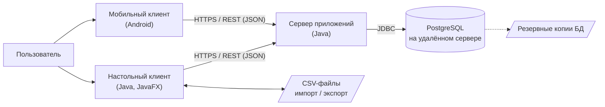
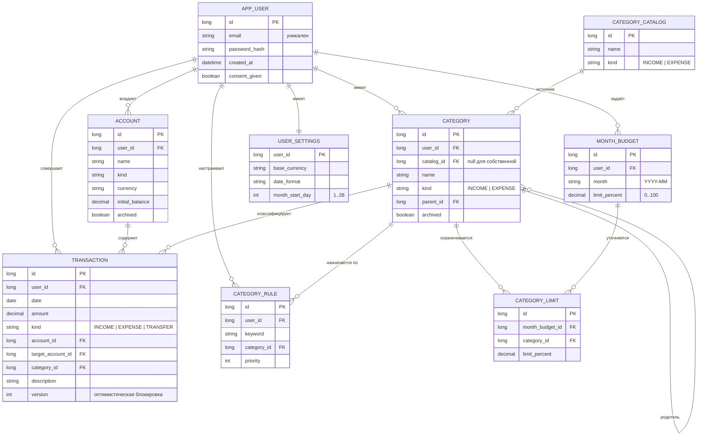

# Спецификация требований к ПО

Для «Трекер финансов»

Версия 0.4

Подготовил(а) Романчук Георгий Александрович

Проект SDLC

27.10.2026

## Оглавление

<!-- TOC -->
* [1. Введение](#1-introduction)
  * [1.1 Назначение документа](#11-document-purpose)
  * [1.2 Область применения продукта](#12-product-scope)
  * [1.3 Определения, акронимы и сокращения](#13-definitions-acronyms-and-abbreviations)
  * [1.4 Ссылки](#14-references)
  * [1.5 Обзор документа](#15-document-overview)
* [2. Обзор продукта](#2-product-overview)
  * [2.1 Перспектива продукта](#21-product-perspective)
  * [2.2 Функции продукта](#22-product-functions)
  * [2.3 Ограничения продукта](#23-product-constraints)
  * [2.4 Характеристики пользователей](#24-user-characteristics)
  * [2.5 Допущения и зависимости](#25-assumptions-and-dependencies)
  * [2.6 Распределение требований](#26-apportioning-of-requirements)
* [3. Требования](#3-requirements)
  * [3.1 Внешние интерфейсы](#31-external-interfaces)
    * [3.1.1 Пользовательские интерфейсы](#311-user-interfaces)
    * [3.1.2 Аппаратные интерфейсы](#312-hardware-interfaces)
    * [3.1.3 Программные интерфейсы](#313-software-interfaces)
  * [3.2 Функциональные требования](#32-functional)
  * [3.3 Качество обслуживания](#33-quality-of-service)
    * [3.3.1 Производительность](#331-performance)
    * [3.3.2 Безопасность](#332-security)
    * [3.3.3 Надёжность](#333-reliability)
    * [3.3.4 Доступность](#334-availability)
    * [3.3.5 Наблюдаемость](#335-observability)
  * [3.4 Соответствие стандартам](#34-compliance)
  * [3.5 Проектирование и реализация](#35-design-and-implementation)
    * [3.5.1 Установка](#351-installation)
    * [3.5.2 Сборка и поставка](#352-build-and-delivery)
    * [3.5.3 Распределение](#353-distribution)
    * [3.5.4 Сопровождаемость](#354-maintainability)
    * [3.5.5 Повторное использование](#355-reusability)
    * [3.5.6 Переносимость](#356-portability)
    * [3.5.7 Стоимость](#357-cost)
    * [3.5.8 Сроки](#358-deadline)
    * [3.5.9 Доказательство концепции](#359-proof-of-concept)
    * [3.5.10 Управление изменениями](#3510-change-management)
  * [3.6 ИИ/МО](#36-aiml)
    * [3.6.1 Спецификация модели](#361-model-specification)
    * [3.6.2 Управление данными](#362-data-management)
    * [3.6.3 Ограничители (Guardrails)](#363-guardrails)
    * [3.6.4 Этика](#364-ethics)
    * [3.6.5 Human-in-the-Loop](#365-human-in-the-loop)
    * [3.6.6 Жизненный цикл модели и операции](#366-model-lifecycle-and-operations)
* [4. Верификация](#4-verification)
* [5. Приложения](#5-appendixes)
<!-- TOC -->

## История изменений

| Name | Date | Reason For Changes | Version |
|------|------|--------------------|---------|
| georgiyr101 | 20.10.2026 | Первичный черновик документа | 0.1 |
| georgiyr101 | 20.10.2026 | Добавлены макеты интерфейса (MOCK-01…03) и ссылки на них из требований; приложение E | 0.2 |
| georgiyr101 | 20.10.2026 | Добавлена модель SysML v2 (`srs/sysml/`), трассируемая на требования SRS | 0.3 |
| georgiyr101 | 27.10.2026 | Учтены требования преподавателя: категории из списка и собственные; настольная и мобильная версии с доступом к интернету; PostgreSQL на удалённом сервере; лимит расходов в процентах от дохода с подсветкой остатка. Добавлены учётные записи, безопасность клиент-серверного обмена, приложение F | 0.4 |

---

## 1. Введение {#1-introduction}

Документ определяет верифицируемые требования к программному продукту «Трекер финансов» — клиент-серверной системе с настольным и мобильным приложениями для учёта личных доходов и расходов, категоризации трат и контроля месячного лимита расходов, заданного в процентах от дохода. В разделе 1 описаны назначение документа и границы продукта, в разделе 2 — контекст и ограничения, в разделе 3 — сами требования, в разделе 4 — способы их проверки.

### 1.1 Назначение документа {#11-document-purpose}

SRS определяет, **ЧТО** должна делать система «Трекер финансов», а не то, как она будет реализована. Документ предназначен для разработчиков (реализация), тестировщиков (построение тестов и матрицы верификации), преподавателя/заказчика (приёмка) и сопровождающих продукт. Документ является источником истины для требований версии 1.0 и обновляется по мере уточнения требований; изменения фиксируются в «Истории изменений» и в приложении F. Версия 0.4 учитывает требования преподавателя (приложение F, таблица F.1).

### 1.2 Область применения продукта {#12-product-scope}

Продукт — «Трекер финансов», версия 1.0. Это система из трёх частей: настольное приложение на Java, мобильное приложение для Android и серверное приложение, хранящее данные в базе PostgreSQL на удалённом сервере. Пользователь регистрируется, выбирает категории из справочника или создаёт свои, ведёт счета, фиксирует доходы и расходы, указывает вместе с доходом месяца процент, который планирует потратить, и видит остаток лимита до его исчерпания с подсветкой статуса, а также диаграммы расходов. Одни и те же данные доступны на компьютере и на телефоне. Цель продукта — дать ответ на вопросы: «сколько я заработал, на что потратил и сколько ещё могу потратить в этом месяце».

**Входит в версию 1.0:**

- регистрация, вход и выход; хранение данных пользователя на удалённом сервере в PostgreSQL;
- настольный клиент (JavaFX) и мобильный клиент (Android) с равным набором основных функций;
- учёт счетов, доходов, расходов и переводов;
- справочник категорий с добавлением категорий из списка, создание собственных категорий, правила автоматической категоризации;
- лимит расходов месяца в процентах от дохода, вводимый вместе с доходом; расчёт суммы лимита; остаток до исчерпания лимита с подсветкой;
- визуализация: круговая диаграмма расходов, диаграмма «доходы и расходы» по месяцам, динамика баланса;
- импорт и экспорт CSV (в настольном клиенте).

**Не входит в версию 1.0:**

- работа клиентов без подключения к интернету (офлайн-режим) и локальная синхронизация;
- клиент для iOS и веб-версия;
- синхронизация с банками и платёжными системами;
- конвертация валют по курсам (каждый счёт ведётся в одной валюте);
- подтверждение адреса электронной почты и восстановление пароля;
- учёт инвестиций, кредитов, налогов;
- функции машинного обучения (см. раздел 3.6).

### 1.3 Определения, акронимы и сокращения {#13-definitions-acronyms-and-abbreviations}

| Term | Definition |
|------|------------|
| API | Application Programming Interface — набор определений и протоколов для создания и интеграции прикладного ПО |
| SRS | Software Requirements Specification — документ, описывающий назначение, требования и характер ПО |
| UI | User Interface — визуальная часть приложения, через которую пользователь взаимодействует с ПО |
| REST | Стиль построения API поверх HTTP, в котором ресурсы адресуются URL, а действия задаются методами HTTP |
| JSON | Текстовый формат обмена данными |
| HTTPS / TLS | Защищённый протокол передачи данных (HTTP поверх TLS) |
| CSV | Comma-Separated Values — текстовый формат табличных данных |
| JDBC | Java Database Connectivity — стандартный API доступа к базам данных из Java |
| PostgreSQL | Реляционная СУБД, в которой на удалённом сервере хранятся данные всех пользователей |
| JAR | Java ARchive — архив с исполняемым Java-приложением |
| JavaFX | Библиотека для построения графического интерфейса настольных Java-приложений |
| Android | Мобильная операционная система, платформа мобильного клиента |
| dp | Density-independent pixels — независимая от плотности экрана единица размера на Android |
| Настольный клиент | Приложение для Windows, macOS и Linux, подключающееся к серверу |
| Мобильный клиент | Приложение для Android, подключающееся к серверу |
| Сервер приложений | Серверная часть продукта: предоставляет API клиентам, реализует бизнес-логику и обращается к БД |
| Токен доступа | Короткоживущий ключ, подтверждающий вход пользователя в запросах к API |
| Категория | Группа операций по назначению (например, «Продукты», «Зарплата») |
| Справочник категорий | Список готовых категорий, из которого пользователь добавляет нужные в свой набор |
| Операция (транзакция) | Запись о доходе, расходе или переводе с датой, суммой, счётом и категорией |
| Перевод | Операция перемещения денег между двумя счетами пользователя; не является доходом или расходом |
| Лимит расходов месяца | Сумма, которую пользователь планирует потратить в месяце: доход месяца × процент лимита / 100 |
| Процент лимита | Доля дохода месяца (в процентах), указываемая пользователем вместе с доходом |
| Остаток лимита | Лимит расходов месяца минус расходы месяца; подсвечивается по статусу исполнения |
| Правило автокатегоризации | Правило вида «если описание содержит текст X, то категория Y» |
| Счёт | Место хранения денег: наличные, банковская карта, вклад и т. п. |

### 1.4 Ссылки {#14-references}

| № | Название | Владелец/автор | Версия/дата | Расположение | Тип |
|---|----------|----------------|-------------|--------------|-----|
| 1 | IEEE Std 830-1998. Recommended Practice for Software Requirements Specifications | IEEE | 1998 | https://standards.ieee.org | Справочная |
| 2 | ISO/IEC/IEEE 29148. Requirements engineering | ISO/IEC/IEEE | 2018 | https://www.iso.org | Справочная |
| 3 | Шаблон `srs-template.md` | georgiyr101 | — | `srs/srs-template.md` в репозитории | Нормативная |
| 4 | Репозиторий проекта SDLC | georgiyr101 | — | https://github.com/georgiyr101/SDLC | Справочная |
| 5 | Макеты интерфейса MOCK-01…03 (SVG, PNG) | georgiyr101 | 0.2, 20.10.2026 | `srs/mockups/`, см. приложение E | Справочная |
| 6 | Модель системы SysML v2 | georgiyr101 | 0.3, 20.10.2026 | [`srs/sysml/finance-tracker.sysml`](sysml/finance-tracker.sysml), обзор: [`srs/sysml/README.md`](sysml/README.md) | Справочная |
| 7 | Требования преподавателя к проекту (исходные) | Преподаватель | получены 27.10.2026 | приложение F, таблица F.1 | Нормативная |
| 8 | Закон Республики Беларусь от 7 мая 2021 г. № 99-З «О защите персональных данных» | Республика Беларусь | в силе с 15.11.2021 | https://pravo.by | Нормативная |

### 1.5 Обзор документа {#15-document-overview}

Раздел 2 описывает контекст продукта, функции, ограничения, пользователей, допущения и распределение требований по релизам. Раздел 3 содержит требования в едином формате: интерфейсы, функции, качество обслуживания, соответствие стандартам, проектирование и реализация, ИИ/МО (для данного продукта не применяется). Раздел 4 — матрица верификации. Раздел 5 — приложения: сценарии использования, модель данных, открытые вопросы, трассируемость, макеты интерфейса и журнал изменений требований. Требования используют ключевые слова «должен» (обязательно), «следует» (желательно), «может» (допустимо). Приоритет требования указан в поле More Information (Must / Should / Could). Суффикс `-2` в идентификаторе означает вторую редакцию требования (версия документа 0.4).

---

## 2. Обзор продукта {#2-product-overview}

### 2.1 Перспектива продукта {#21-product-perspective}

«Трекер финансов» — новый самостоятельный продукт, не заменяющий и не расширяющий существующую систему. Это клиент-серверная система: настольный и мобильный клиенты подключаются через интернет к серверу приложений, который хранит данные всех пользователей в БД PostgreSQL на удалённом сервере. Клиенты не обращаются к БД напрямую. Владелец продукта и единственная сторона поддержки — автор проекта; формальные соглашения об уровне обслуживания не предусмотрены, целевая доступность сервера задана требованием REQ-AVAIL-002.

### 2.2 Функции продукта {#22-product-functions}

1. Регистрация, вход и выход; единые данные пользователя на всех его устройствах.
2. Управление счетами (создание, архивация, расчёт баланса).
3. Учёт операций: доходы, расходы, переводы, (опционально) регулярные операции.
4. Справочник категорий, добавление категорий из списка, создание собственных категорий, правила автоматической категоризации.
5. Лимит расходов месяца в процентах от дохода, вводимый вместе с доходом; расчёт суммы лимита и остаток до его исчерпания с подсветкой статуса.
6. Визуализация: диаграммы расходов, динамика доходов и расходов, динамика баланса.
7. Импорт и экспорт CSV (настольный клиент); настройки пользователя (валюта, формат дат, расчётный день месяца).

### 2.3 Ограничения продукта {#23-product-constraints}

| ID | Ограничение | Тип |
|----|-------------|-----|
| CON-01 | Серверная и настольная части должны быть реализованы на языке Java версии 17 или выше; мобильный клиент — Android-приложение на Java. | Внешнее (требование преподавателя), обязательное |
| CON-02 | Графический интерфейс настольного клиента должен быть реализован на JavaFX (окончательный выбор подтверждается в приложении C). | Внутреннее, предпочтительное |
| CON-03 | Данные должны храниться в базе данных PostgreSQL на удалённом сервере; встроенные и локальные БД для данных пользователя не допускаются. | Внешнее (требование преподавателя), обязательное |
| CON-04 | Клиенты должны работать через подключение к интернету; офлайн-режим в версии 1.0 не поддерживается. | Внешнее (требование преподавателя), обязательное |
| CON-05 | Денежные суммы должны обрабатываться типом `BigDecimal`, а в БД храниться типом `NUMERIC`; типы `float` и `double` для денег запрещены. | Внутреннее, обязательное |
| CON-06 | Архитектура сервера должна быть разделена на слои: контроллеры → сервисы → репозитории. | Внутреннее, обязательное |
| CON-07 | Все используемые сторонние библиотеки должны быть бесплатными и иметь открытую лицензию. | Организационное, обязательное |
| CON-08 | Лимит расходов месяца должен задаваться в процентах от дохода и указываться вместе с доходом на каждый месяц. | Внешнее (требование преподавателя), обязательное |
| CON-09 | Категории должны добавляться пользователем из списка (справочника), при этом пользователь должен иметь возможность создать свою категорию. | Внешнее (требование преподавателя), обязательное |
| CON-10 | Продукт должен иметь две клиентские версии: настольную и мобильную. | Внешнее (требование преподавателя), обязательное |

📝 Верифицируемые обязательства, вытекающие из этих ограничений, заданы в разделе 3 (в поле More Information требований указаны ссылки на соответствующие CON-xx).

### 2.4 Характеристики пользователей {#24-user-characteristics}

| Класс пользователя | Описание и цели | Подготовка | Частота использования |
|--------------------|-----------------|------------|-----------------------|
| Владелец бюджета | Частное лицо, ведущее личный или семейный бюджет; вносит операции, следит за остатком лимита и анализирует траты с компьютера и телефона | Базовые навыки работы с ПК и смартфоном, без финансового образования | Несколько раз в неделю, обзор — раз в месяц |
| Начинающий пользователь | Впервые использует трекер; нужен быстрый старт с выбором готовых категорий | Минимальные | Первые дни использования |
| Администратор сервера | Развёртывает и обслуживает сервер, БД и резервные копии; в пользовательские интерфейсы продукта не входит | Навыки администрирования Linux, Docker и PostgreSQL | По мере необходимости |

Все пользователи продукта имеют одну роль и видят только собственные данные (REQ-SEC-007). Аутентификация обязательна (REQ-FUNC-025). Основной язык интерфейса — русский; настольный клиент доступен при работе только с клавиатуры (REQ-INT-004-2).

### 2.5 Допущения и зависимости {#25-assumptions-and-dependencies}

| № | Допущение / зависимость | Влияние, если окажется неверным |
|---|-------------------------|---------------------------------|
| A1 | На компьютере пользователя доступна среда Java 17+ (установлена или поставляется вместе с приложением) | Настольный клиент не запустится; потребуется поставка со встроенной JRE (`jpackage`) |
| A2 | Основная валюта по умолчанию — RUB, мультивалютность не требуется | Потребуется модель курсов валют и пересмотр расчёта сумм |
| A3 | Процент лимита задаётся один на месяц и применяется к суммарному доходу месяца (трактовка требования «Сумма (% от дохода)») | Потребуется пересмотр модели лимита (процент на каждый доход или на категорию) |
| A4 | Типовой объём данных — до 10 000 операций на пользователя и до 100 одновременных пользователей | Потребуется пересмотр индексации, пагинации и ресурсов сервера |
| A5 | Мобильная платформа — Android 10 (API 29) и выше; iOS не поддерживается | Потребуется отдельный клиент для iOS |
| A6 | У пользователя есть подключение к интернету со скоростью не менее 5 Мбит/с и задержкой до 100 мс | Целевые показатели времени отклика (раздел 3.3.1) не будут достигнуты |
| A7 | Для проекта доступен сервер для приложения и БД PostgreSQL на удалённом хосте | Потребуется выбор другого хостинга; возможна оплата (REQ-COST-001-2) |
| D1 | Библиотека JavaFX (UI и диаграммы настольного клиента) | Смена UI-технологии (Swing) потребует переработки слоя представления |
| D2 | PostgreSQL и JDBC-драйвер PostgreSQL | Смена СУБД потребует замены слоя репозиториев и миграций |
| D3 | JUnit 5 для автоматических тестов | Ручное тестирование увеличит трудоёмкость |
| D4 | Серверный фреймворк на Java (предполагается Spring Boot) и Android SDK | Смена технологий потребует пересмотра сборки и развёртывания |

### 2.6 Распределение требований {#26-apportioning-of-requirements}

Идентификаторы в таблице приведены без префикса `REQ-`.

| Релиз / итерация | Состав | Требования |
|------------------|--------|------------|
| 1.0 (MVP, Must) | Учётные записи, клиент-серверный обмен, безопасность, счета, операции, категории, лимит месяца в % от дохода, остаток лимита, основные диаграммы, экспорт CSV, оба клиента | INT-001-2, INT-002-2, INT-009, INT-005-2, INT-006-2, INT-007, INT-008, FUNC-024, FUNC-025, FUNC-026, FUNC-031, FUNC-001, FUNC-002, FUNC-004, FUNC-005, FUNC-006, FUNC-009-2, FUNC-010-2, FUNC-012-2, FUNC-013-2, FUNC-014-2, FUNC-015, FUNC-016, FUNC-018-2, FUNC-019-2, FUNC-020-2, PERF-001-2, PERF-002-2, PERF-003-2, SEC-003-2, SEC-004, SEC-005, SEC-006, SEC-007, SEC-008, REL-001-2, REL-003-2, REL-004, COMP-001, COMP-003, INST-001-2, BUILD-001-2, DIST-002, MAINT-001-2, PORT-001-2, COST-001-2, POC-001-2, CM-001 |
| 1.1 (Should) | Переводы, автокатегоризация, график баланса, импорт CSV, удаление учётной записи, настройки, резервные копии, мониторинг, логирование, локализация | INT-003, INT-004-2, FUNC-032, FUNC-003, FUNC-007, FUNC-011, FUNC-017, FUNC-021-2, FUNC-023-2, PERF-004-2, PERF-005, SEC-009, REL-005, AVAIL-002, OBS-001-2, OBS-002, COMP-002, INST-002, BUILD-002, MAINT-002, REUSE-001-2, PORT-002-2, CM-002-2, CM-003 |
| Отложено (Could) | Регулярные операции, лимиты по категориям, блокировка мобильного клиента PIN-кодом, стиль кода | FUNC-008, FUNC-030, SEC-002-2, MAINT-003 |
| Не распределено | Сроки поставки (DEAD-001) — ожидают уточнения | См. приложение C |

---

## 3. Требования {#3-requirements}

Все требования оформлены по единому шаблону: **ID**, **Title**, **Statement**, **Rationale**, **Acceptance Criteria**, **Verification Method** (Test | Analysis | Inspection | Demonstration), **More Information** (приоритет, ссылки на ограничения и связанные требования).

**Схема идентификаторов:** `REQ-[AREA]-[NNN]-[VER]`, где AREA ∈ {INT, FUNC, PERF, SEC, REL, AVAIL, OBS, COMP, INST, BUILD, DIST, MAINT, REUSE, PORT, COST, DEAD, POC, CM, ML}. ID уникальны и неизменяемы. Изменение требования фиксируется суффиксом `-[VER]` (отсутствие суффикса означает редакцию 1, суффикс `-2` — редакцию 2 в версии документа 0.4) и записью в «Истории изменений». Снятые требования не переиспользуются; их список и замены приведены в приложении F.

### 3.1 Внешние интерфейсы {#31-external-interfaces}

#### 3.1.1 Пользовательские интерфейсы {#311-user-interfaces}

Иллюстрации к требованиям настольного клиента — низкодетальные макеты размером 1024×720: [MOCK-01](mockups/mockup-01-overview.svg) (экран «Обзор»), [MOCK-02](mockups/mockup-02-add-transaction.svg) (диалог «Новая операция») и [MOCK-03](mockups/mockup-03-budget.svg) (экран «Бюджет»). Макеты подготовлены по версии 0.2–0.3 документа и подлежат обновлению (приложение E). Номерные метки на макетах расшифрованы в [приложении E](#appendix-e). Макеты поясняют требования, но не заменяют их: при расхождении приоритет имеет текст требования. Макеты мобильного клиента пока не разработаны.

**REQ-INT-001-2 — Структура главного окна и навигации**
- **Statement:** Настольный и мобильный клиенты должны предоставлять разделы «Обзор», «Операции», «Счета», «Категории», «Бюджет», «Отчёты», «Настройки»; в настольном клиенте навигация выполняется боковой панелью, в мобильном — нижней панелью навигации.
- **Rationale:** Единая понятная навигация по функциям продукта на обоих типах устройств.
- **Acceptance Criteria:** Из главного окна (экрана) каждый из семи разделов открывается не более чем за одно нажатие; активный раздел визуально выделен.
- **Verification Method:** Demonstration
- **More Information:** Приоритет: Must. CON-01, CON-02, CON-10. Макеты настольного клиента: [MOCK-01](mockups/mockup-01-overview.svg), [MOCK-02](mockups/mockup-02-add-transaction.svg), [MOCK-03](mockups/mockup-03-budget.svg).

**REQ-INT-002-2 — Форма операции и валидация ввода**
- **Statement:** Клиенты должны предоставлять форму добавления операции с полями: тип (доход / расход / перевод), сумма, дата, счёт, категория, описание, а для операции-дохода — дополнительное поле «Лимит расходов месяца, % от дохода» (REQ-FUNC-012-2); клиент должен отклонять некорректный ввод (пустая, нулевая или отрицательная сумма, не выбран счёт, дата вне диапазона 01.01.2000–31.12.2100, процент вне диапазона 0–100), показывая сообщение об ошибке рядом с полем.
- **Rationale:** Предотвращение некорректных данных до отправки на сервер и быстрая обратная связь пользователю.
- **Acceptance Criteria:** При каждом из перечисленных некорректных значений запрос на сервер не отправляется, рядом с полем отображается понятное сообщение; дата по умолчанию — текущая; сервер повторно проверяет те же правила (REQ-SEC-003-2).
- **Verification Method:** Test
- **More Information:** Приоритет: Must. Макет: [MOCK-02](mockups/mockup-02-add-transaction.svg), метка 2 (состояние ошибки поля «Сумма»; поле процента для дохода будет добавлено в следующей версии макета). Связано: REQ-FUNC-004, REQ-FUNC-012-2.

**REQ-INT-003 — Локализация интерфейса**
- **Statement:** Система следует предоставлять интерфейс на русском языке, при этом все тексты интерфейса должны храниться во внешних файлах ресурсов (resource bundles).
- **Rationale:** Целевая аудитория русскоязычная; вынесение текстов позволяет добавить другие языки без изменения кода.
- **Acceptance Criteria:** В исходном коде отсутствуют строковые литералы текстов интерфейса вне файлов ресурсов; при подмене файла ресурсов тексты меняются без перекомпиляции.
- **Verification Method:** Inspection
- **More Information:** Приоритет: Should.

**REQ-INT-004-2 — Доступность интерфейса**
- **Statement:** Клиенты следует обеспечивать выполнение основных действий с клавиатуры (настольный клиент) и поддержку масштабирования шрифта системы (мобильный клиент), а статус лимита и остаток должны передаваться значком и текстом, а не только цветом.
- **Rationale:** Удобство быстрого ввода данных и доступность для пользователей с нарушением цветового восприятия.
- **Acceptance Criteria:** Добавление операции в настольном клиенте выполняется без мыши (Tab / Enter / горячая клавиша «Новая операция»); при увеличении шрифта в системе мобильного устройства до 130 % тексты не обрезаются; статусы «Норма», «Предупреждение», «Превышен» различимы без опоры на цвет.
- **Verification Method:** Demonstration
- **More Information:** Приоритет: Should. Связано: REQ-FUNC-013-2. Макеты: [MOCK-02](mockups/mockup-02-add-transaction.svg), метка 4 (подсказки горячих клавиш); [MOCK-03](mockups/mockup-03-budget.svg), метка 2 (статус значком и текстом).

**REQ-INT-009 — Адаптация мобильного интерфейса**
- **Statement:** Мобильный клиент должен использовать элементы управления размером не менее 48×48 dp, поддерживать портретную и ландшафтную ориентации и открывать цифровую клавиатуру для полей суммы и процента.
- **Rationale:** Удобство работы одной рукой и снижение числа ошибок ввода.
- **Acceptance Criteria:** Все нажимаемые элементы имеют размер не менее 48×48 dp; при повороте устройства введённые в форму данные сохраняются; для полей суммы и процента открывается цифровая клавиатура.
- **Verification Method:** Demonstration
- **More Information:** Приоритет: Must. CON-10. Связано: REQ-INT-001-2, REQ-INT-005-2.

#### 3.1.2 Аппаратные интерфейсы {#312-hardware-interfaces}

**REQ-INT-005-2 — Поддерживаемые экраны и устройства**
- **Statement:** Настольный клиент должен корректно отображаться при разрешении экрана не менее 1024×720, мобильный клиент — на экранах шириной от 360 dp в портретной ориентации; специальные аппаратные интерфейсы продукт не использует.
- **Rationale:** Продукт ориентирован на массового пользователя с обычным компьютером и смартфоном.
- **Acceptance Criteria:** На экране 1024×720 (настольный клиент) и 360×640 dp (мобильный клиент) все элементы главного экрана доступны, не перекрывают друг друга и не требуют горизонтальной прокрутки основного содержимого.
- **Verification Method:** Demonstration
- **More Information:** Приоритет: Must. Иные аппаратные интерфейсы (датчики, сканеры, принтеры) не используются. Макеты настольного клиента выполнены в размере 1024×720 (приложение E).

#### 3.1.3 Программные интерфейсы {#313-software-interfaces}

**REQ-INT-006-2 — Доступ сервера к БД**
- **Statement:** Серверное приложение должно обращаться к PostgreSQL через JDBC, при этом доступ бизнес-логики к данным должен осуществляться только через интерфейсы-репозитории, а клиентские приложения не должны обращаться к БД напрямую.
- **Rationale:** Изоляция хранилища упрощает тестирование и защищает БД от прямого доступа из интернета.
- **Acceptance Criteria:** Классы сервисного слоя и контроллеров не содержат прямых вызовов JDBC и SQL; в клиентских приложениях отсутствуют JDBC-зависимости и параметры подключения к БД; репозитории подменяются тестовыми реализациями в модульных тестах.
- **Verification Method:** Inspection
- **More Information:** Приоритет: Must. CON-03, CON-06. Данными владеет серверное приложение.

**REQ-INT-007 — Формат CSV**
- **Statement:** Система должна выполнять импорт и экспорт CSV-файлов в кодировке UTF-8 с разделителем `;`, первой строкой-заголовком и колонками `date, type, amount, account, category, description`; дата — в формате `YYYY-MM-DD`, сумма — десятичное число с точкой, тип — `INCOME`, `EXPENSE` или `TRANSFER`.
- **Rationale:** Единый документированный формат обеспечивает обмен данными с Excel и другими программами.
- **Acceptance Criteria:** Экспортированный файл корректно открывается в Excel/LibreOffice с кириллицей; повторный импорт этого файла даёт идентичный набор операций.
- **Verification Method:** Test
- **More Information:** Приоритет: Must. Связано: REQ-FUNC-020-2, REQ-FUNC-021-2.

**REQ-INT-008 — Программный интерфейс клиент–сервер (REST API)**
- **Statement:** Сервер должен предоставлять клиентам REST API по протоколу HTTPS с обменом данными в формате JSON, версионированием в пути (`/api/v1/...`), единым форматом сообщений об ошибках (код, сообщение, поле) и передачей токена доступа в заголовке `Authorization`.
- **Rationale:** Единый интерфейс для настольного и мобильного клиентов; изоляция клиентов от схемы БД.
- **Acceptance Criteria:** Описание API (OpenAPI) опубликовано и соответствует реализации; все эндпоинты, кроме регистрации, входа и проверки состояния сервера, требуют токен; на некорректный запрос сервер возвращает код 4xx и сообщение в едином формате.
- **Verification Method:** Test
- **More Information:** Приоритет: Must. CON-03, CON-04. Связано: REQ-SEC-005, REQ-SEC-006, REQ-CM-003.

### 3.2 Функциональные требования {#32-functional}

#### Учётные записи и устройства

**REQ-FUNC-024 — Регистрация пользователя**
- **Statement:** Система должна позволять зарегистрировать учётную запись по адресу электронной почты и паролю (не короче 8 символов) с подтверждением согласия на обработку персональных данных; адрес электронной почты должен быть уникален.
- **Rationale:** Данные хранятся на удалённом сервере, поэтому для разделения данных пользователей нужна учётная запись.
- **Acceptance Criteria:** Регистрация с новым адресом создаёт учётную запись и выполняет вход; повторная регистрация с тем же адресом отклоняется с сообщением; пароль короче 8 символов и отсутствие согласия на обработку персональных данных отклоняются.
- **Verification Method:** Test
- **More Information:** Приоритет: Must. Связано: REQ-SEC-006, REQ-COMP-003. Подтверждение адреса электронной почты в версию 1.0 не входит (приложение C).

**REQ-FUNC-025 — Вход и выход**
- **Statement:** Система должна позволять войти по адресу электронной почты и паролю, сохранять вход на устройстве до выхода пользователя или истечения срока токена обновления и позволять выйти из учётной записи с отзывом токена.
- **Rationale:** Пользователь не должен вводить пароль при каждом запуске, но должен иметь возможность завершить сеанс на устройстве.
- **Acceptance Criteria:** После входа повторный запуск приложения не запрашивает пароль до истечения срока сессии; после выхода токен не принимается сервером; при неверном пароле выводится сообщение, не раскрывающее, какое из полей неверно.
- **Verification Method:** Test
- **More Information:** Приоритет: Must. Связано: REQ-SEC-006, REQ-SEC-009.

**REQ-FUNC-026 — Единые данные на всех устройствах**
- **Statement:** Система должна хранить все данные пользователя (счета, категории, операции, лимиты, настройки) на сервере так, чтобы они были одинаковы в настольном и мобильном клиентах при входе под одной учётной записью, а при одновременном изменении одной записи с двух устройств не должна терять данные.
- **Rationale:** Одна из целей продукта — работа с одними и теми же данными с компьютера и телефона.
- **Acceptance Criteria:** Операция, созданная в настольном клиенте, отображается в мобильном клиенте после обновления экрана не позднее чем через 5 секунд при доступной сети; сервер отклоняет устаревшее изменение записи (проверка версии записи), клиент сообщает пользователю об этом и предлагает обновить запись.
- **Verification Method:** Test
- **More Information:** Приоритет: Must. CON-03, CON-10. Связано: REQ-FUNC-019-2, REQ-DIST-002.

**REQ-FUNC-031 — Равенство функций настольного и мобильного клиентов**
- **Statement:** Настольный и мобильный клиенты должны предоставлять одинаковый набор функций учёта (счета, операции, категории), контроля лимита и визуализации; исключение составляют импорт и экспорт CSV, доступные только в настольном клиенте.
- **Rationale:** Пользователь должен получать одинаковые возможности на любом устройстве.
- **Acceptance Criteria:** Для каждого требования раздела 3.2, кроме REQ-FUNC-020-2 и REQ-FUNC-021-2, сценарий приёмки успешно выполняется на обоих клиентах.
- **Verification Method:** Demonstration
- **More Information:** Приоритет: Must. CON-10. Требование преподавателя: «Разработка десктопа и мобильной версии».

**REQ-FUNC-032 — Удаление учётной записи**
- **Statement:** Система следует позволять пользователю удалить учётную запись вместе со всеми его данными после подтверждения пароля.
- **Rationale:** Право пользователя на удаление своих данных (REQ-COMP-003).
- **Acceptance Criteria:** После подтверждения все данные пользователя удалены из рабочей БД, вход под этой учётной записью невозможен, токены отозваны.
- **Verification Method:** Test
- **More Information:** Приоритет: Should. Связано: REQ-COMP-003.

#### Счета

**REQ-FUNC-001 — Создание и редактирование счёта**
- **Statement:** Система должна позволять пользователю создавать счёт с атрибутами: название, тип (наличные, карта, вклад, другое), валюта, начальный баланс — и редактировать название и тип существующего счёта.
- **Rationale:** Счета — основа учёта; операции привязываются к счетам.
- **Acceptance Criteria:** Созданный счёт появляется в списке счетов и в формах операций; название счёта уникально среди активных счетов, при дубликате выводится ошибка.
- **Verification Method:** Test
- **More Information:** Приоритет: Must.

**REQ-FUNC-002 — Расчёт баланса**
- **Statement:** Система должна вычислять и отображать текущий баланс каждого счёта как начальный баланс плюс доходы минус расходы плюс входящие переводы минус исходящие переводы, а также суммарный баланс по всем активным счетам.
- **Rationale:** Актуальный баланс — ключевой показатель для пользователя.
- **Acceptance Criteria:** Для тестового набора из 20 операций вычисленные балансы совпадают с эталонными значениями с точностью до копейки; баланс обновляется сразу после добавления, изменения или удаления операции.
- **Verification Method:** Test
- **More Information:** Приоритет: Must. CON-05. Макет: [MOCK-01](mockups/mockup-01-overview.svg) (суммарный баланс и карточки показателей).

**REQ-FUNC-003 — Архивация счёта**
- **Statement:** Система следует позволять архивировать счёт; архивный счёт не должен предлагаться при вводе новых операций, но его история должна сохраняться и учитываться в отчётах.
- **Rationale:** Закрытые счета не должны засорять интерфейс, но история расходов не должна теряться.
- **Acceptance Criteria:** После архивации счёт отсутствует в выпадающих списках форм, а его операции видны в списке и отчётах за прошлые периоды.
- **Verification Method:** Test
- **More Information:** Приоритет: Should.

#### Операции (доходы и расходы)

**REQ-FUNC-004 — Добавление дохода и расхода**
- **Statement:** Система должна позволять добавлять операции типа «доход» и «расход» с суммой, датой, счётом, категорией и описанием.
- **Rationale:** Ядро функциональности продукта.
- **Acceptance Criteria:** Сохранённая операция отображается в списке и влияет на баланс счёта и агрегаты отчётов; сумма хранится с точностью 2 знака после запятой; категория должна соответствовать типу операции.
- **Verification Method:** Test
- **More Information:** Приоритет: Must. CON-05. Связано: REQ-INT-002-2. Макет: [MOCK-02](mockups/mockup-02-add-transaction.svg), метка 1 (выбор типа операции).

**REQ-FUNC-005 — Редактирование и удаление операций**
- **Statement:** Система должна позволять изменять и удалять ранее созданные операции, при этом удаление должно требовать подтверждения пользователя, а балансы и отчёты должны пересчитываться автоматически.
- **Rationale:** Пользователи ошибаются при вводе; ошибки должны исправляться без нарушения целостности данных.
- **Acceptance Criteria:** После изменения суммы операции баланс счёта корректируется на разницу; при отмене подтверждения удаления операция сохраняется.
- **Verification Method:** Test
- **More Information:** Приоритет: Must.

**REQ-FUNC-006 — Список операций: сортировка, фильтрация, поиск**
- **Statement:** Система должна отображать список операций с сортировкой по дате, сумме и категории и с фильтрацией по периоду, счёту, категории, типу операции и подстроке в описании.
- **Rationale:** Пользователю нужно быстро находить нужные записи среди тысяч операций.
- **Acceptance Criteria:** При комбинации нескольких фильтров список содержит только операции, удовлетворяющие всем условиям; сортировка меняет порядок строк согласно выбранному столбцу и направлению.
- **Verification Method:** Test
- **More Information:** Приоритет: Must. Связано: REQ-PERF-002-2. Макет: [MOCK-02](mockups/mockup-02-add-transaction.svg) (панель фильтров и таблица операций на заднем плане).

**REQ-FUNC-007 — Переводы между счетами**
- **Statement:** Система следует позволять создавать перевод между двумя разными счетами; перевод не должен учитываться как доход или расход в отчётах и бюджетах.
- **Rationale:** Перемещение денег между своими счетами не меняет общий капитал и не должно искажать статистику.
- **Acceptance Criteria:** После перевода 1000 с A на B баланс A уменьшается, баланс B увеличивается на ту же сумму, суммарный баланс не меняется, суммы доходов и расходов за период не изменяются.
- **Verification Method:** Test
- **More Information:** Приоритет: Should. Макет: [MOCK-02](mockups/mockup-02-add-transaction.svg), метка 1 (вариант «Перевод»).

**REQ-FUNC-008 — Регулярные операции**
- **Statement:** Система может позволять задавать регулярную операцию с периодичностью «ежедневно», «еженедельно» или «ежемесячно» и должна автоматически создавать пропущенные экземпляры такой операции при запуске приложения.
- **Rationale:** Уменьшает ручной ввод повторяющихся платежей (аренда, подписки, зарплата).
- **Acceptance Criteria:** Для ежемесячной операции, созданной 3 месяца назад, при запуске создаются все пропущенные экземпляры без дубликатов.
- **Verification Method:** Test
- **More Information:** Приоритет: Could (отложено).

#### Категории

**REQ-FUNC-009-2 — Справочник категорий и добавление из списка**
- **Statement:** Система должна предоставлять справочник готовых категорий (расходы: «Продукты», «Транспорт», «Жильё», «Здоровье», «Развлечения», «Одежда», «Прочее»; доходы: «Зарплата», «Подработка», «Подарки», «Прочее») и позволять пользователю добавлять любую из них в свой набор категорий; при первом входе пользователю должен предлагаться выбор категорий из справочника с возможностью «Добавить все».
- **Rationale:** Быстрый старт без ручного создания категорий и возможность оставить только нужные.
- **Acceptance Criteria:** В справочнике доступны все 11 категорий с корректным типом; после добавления категории из справочника она появляется в наборе пользователя и в формах операций на обоих клиентах; повторное добавление той же категории отклоняется с сообщением; действие «Добавить все» добавляет все 11 категорий; у нового пользователя набор категорий пуст до выбора.
- **Verification Method:** Test
- **More Information:** Приоритет: Must. CON-09. Требование преподавателя: «Добавление категорий из списка». Заменяет REQ-FUNC-009-2 (редакция 1, категории создавались автоматически).

**REQ-FUNC-010-2 — Создание собственных категорий и управление ими**
- **Statement:** Система должна позволять пользователю создавать собственные категории с указанием названия и типа (доход / расход), переименовывать и архивировать любые категории из своего набора и не должна допускать физического удаления категории, к которой привязаны операции; вместо этого система должна предложить перенести операции в другую категорию или архивировать категорию.
- **Rationale:** Список категорий должен отражать реальные траты пользователя; история операций не должна теряться.
- **Acceptance Criteria:** Созданная категория появляется в наборе пользователя и в формах операций на обоих клиентах; название уникально в пределах типа у одного пользователя; попытка удалить используемую категорию приводит к диалогу с выбором действия, данные не теряются.
- **Verification Method:** Test
- **More Information:** Приоритет: Must. CON-09. Требование преподавателя: «возможность создать свою». Связано: REQ-FUNC-009-2.

**REQ-FUNC-011 — Автоматическая категоризация**
- **Statement:** Система следует позволять задавать правила вида «описание содержит текст X → категория Y» с приоритетом; при сохранении операции без выбранной категории (включая импорт) система должна применять первое подходящее правило по приоритету, а при отсутствии подходящих правил — назначать категорию «Прочее».
- **Rationale:** Сокращает ручную работу, особенно при импорте большого числа операций.
- **Acceptance Criteria:** Для правила «магнит → Продукты» операция с описанием «Магнит, чек 123» (без учёта регистра) получает категорию «Продукты»; операция без совпадений — «Прочее».
- **Verification Method:** Test
- **More Information:** Приоритет: Should. Правила детерминированы; методы ML не используются (см. 3.6). Макет: [MOCK-02](mockups/mockup-02-add-transaction.svg), метка 3 (категория «определится автоматически»).

#### Лимит расходов месяца

**REQ-FUNC-012-2 — Лимит расходов месяца в процентах от дохода**
- **Statement:** Система должна позволять указывать при вводе дохода процент от дохода (0–100, до двух знаков после запятой), который пользователь планирует потратить в месяце этого дохода (лимит расходов месяца), и сохранять этот процент для месяца; при вводе дохода в тот же месяц процент должен предлагаться по умолчанию, а при первом вводе дохода в новом месяце — процент предыдущего месяца; предложенное значение может быть изменено.
- **Rationale:** Бюджет привязывается к реально полученному доходу месяца; пользователь задаёт его одним полем вместе с доходом.
- **Acceptance Criteria:** При вводе дохода 80 000 ₽ с процентом 70 для месяца сохраняется процент 70; повторный ввод дохода в этом месяце предлагает 70; при первом вводе дохода в следующем месяце предлагается 70; значение вне диапазона 0–100 отклоняется; для месяца без заданного процента лимит считается не заданным.
- **Verification Method:** Test
- **More Information:** Приоритет: Must. CON-08. Требование преподавателя: «Сумма (% от дохода) указывается вместе с доходом на каждый месяц». Месяцем считается расчётный месяц (REQ-FUNC-023-2, по умолчанию календарный). Заменяет REQ-FUNC-012-2 (редакция 1, лимиты по категориям в рублях). Связано: REQ-INT-002-2.

**REQ-FUNC-013-2 — Остаток до исчерпания лимита и его подсветка**
- **Statement:** Система должна вычислять и отображать для выбранного месяца остаток лимита расходов (сумма лимита минус расходы месяца) и процент использования лимита, а также подсвечивать остаток: при использовании менее 80 % лимита — статус «Норма» (зелёный), при 80–99 % — «Предупреждение» (жёлтый), при 100 % и более — «Превышен» (красный; при перерасходе остаток отображается отрицательным числом).
- **Rationale:** Пользователь должен сразу видеть, сколько ещё можно потратить до исчерпания лимита.
- **Acceptance Criteria:** При лимите 56 000 ₽ и расходах 44 800 ₽ показываются остаток 11 200 ₽, использование 80 % и статус «Предупреждение»; при расходах 56 000 ₽ — остаток 0 ₽ и статус «Превышен»; при расходах 58 000 ₽ — остаток −2 000 ₽ и статус «Превышен»; при расходах 44 000 ₽ — статус «Норма» (78,6 %); в расходы входят только операции-расходы, переводы не учитываются.
- **Verification Method:** Test
- **More Information:** Приоритет: Must. Требование преподавателя: «подсвечивается сумма до исчерпания её лимита». Заменяет REQ-FUNC-013-2 (редакция 1, статусы по категориям). Связано: REQ-INT-004-2, REQ-FUNC-018-2, REQ-FUNC-014-2.

**REQ-FUNC-014-2 — Расчёт суммы лимита**
- **Statement:** Система должна вычислять сумму лимита расходов месяца как суммарный доход месяца, умноженный на процент лимита и делённый на 100, с округлением HALF_UP до двух знаков и пересчитывать её при добавлении, изменении или удалении операций-доходов месяца; если процент или доход не заданы, система должна показывать подсказку «Укажите доход и процент лимита» вместо остатка.
- **Rationale:** Лимит всегда соответствует фактическому доходу месяца.
- **Acceptance Criteria:** Доход месяца 80 000 ₽ и 70 % дают лимит 56 000,00 ₽; после добавления дохода 20 000 ₽ лимит становится 70 000,00 ₽; доход 33,33 ₽ при 15 % даёт лимит 5,00 ₽ (4,9995 округляется до 5,00); для месяца без дохода выводится подсказка.
- **Verification Method:** Test
- **More Information:** Приоритет: Must. CON-05, CON-08. Заменяет REQ-FUNC-014-2 (редакция 1, общий лимит и копирование бюджета). Связано: REQ-REL-003-2.

**REQ-FUNC-030 — Лимиты по категориям в процентах от дохода**
- **Statement:** Система может позволять задавать для категории расходов лимит в процентах от дохода месяца и показывать остаток и статус по каждой такой категории по правилам REQ-FUNC-013-2.
- **Rationale:** Дополнительный контроль отдельных категорий; сохраняет возможность, предусмотренную редакцией 1.
- **Acceptance Criteria:** Для категории «Продукты» с лимитом 25 % при доходе месяца 80 000 ₽ показываются лимит 20 000 ₽ и остаток с подсветкой по правилам REQ-FUNC-013-2.
- **Verification Method:** Test
- **More Information:** Приоритет: Could. Макет: [MOCK-03](mockups/mockup-03-budget.svg) (показывает лимиты по категориям; в рублях, будет обновлён).

#### Визуализация и отчёты

**REQ-FUNC-015 — Круговая диаграмма расходов**
- **Statement:** Система должна строить круговую диаграмму расходов по категориям за выбранный период с отображением сумм и долей в процентах.
- **Rationale:** Показывает структуру трат.
- **Acceptance Criteria:** Сумма долей составляет 100 %; значения секторов совпадают с суммами расходов по категориям из списка операций за тот же период; переводы не учитываются.
- **Verification Method:** Test
- **More Information:** Приоритет: Must. Макет: [MOCK-01](mockups/mockup-01-overview.svg), метка 3 (круговая диаграмма).

**REQ-FUNC-016 — Диаграмма «доходы и расходы по месяцам»**
- **Statement:** Система должна строить столбчатую диаграмму сумм доходов и расходов по месяцам за выбранный период длиной до 12 месяцев.
- **Rationale:** Показывает динамику и сезонность финансов.
- **Acceptance Criteria:** Для каждого месяца периода отображаются два столбца (доходы, расходы); месяцы без операций отображаются с нулевыми значениями.
- **Verification Method:** Test
- **More Information:** Приоритет: Must.

**REQ-FUNC-017 — График динамики баланса**
- **Statement:** Система следует строить линейный график динамики суммарного баланса по дням или месяцам за выбранный период.
- **Rationale:** Позволяет увидеть рост или падение накоплений.
- **Acceptance Criteria:** Значение последней точки графика равно текущему суммарному балансу.
- **Verification Method:** Test
- **More Information:** Приоритет: Should.

**REQ-FUNC-018-2 — Экран «Обзор»**
- **Statement:** Экран «Обзор» должен отображать за текущий месяц суммы доходов и расходов, их разницу, суммарный баланс, сумму лимита, остаток лимита с подсветкой статуса и топ-5 категорий расходов.
- **Rationale:** Пользователь получает ответ на главные вопросы сразу после запуска.
- **Acceptance Criteria:** Все показатели совпадают с данными разделов «Операции» и «Бюджет» за тот же месяц; остаток лимита подсвечен по правилам REQ-FUNC-013-2.
- **Verification Method:** Demonstration
- **More Information:** Приоритет: Must. Макет: [MOCK-01](mockups/mockup-01-overview.svg), метки 1–3 (в макете карточка остатка лимита пока отсутствует и показаны индикаторы по категориям; будет обновлено).

**REQ-FUNC-019-2 — Автоматическое обновление данных**
- **Statement:** Клиенты должны обновлять диаграммы, остаток лимита и балансы сразу после подтверждения сервером изменения данных без перезапуска приложения, а при открытии экрана или по действию «Обновить» — отображать данные, изменённые с другого устройства пользователя.
- **Rationale:** Непротиворечивое отображение данных во всех разделах и на всех устройствах.
- **Acceptance Criteria:** После добавления операции открытые диаграммы и индикаторы отражают изменение не позднее чем через 1 секунду после ответа сервера; операция, добавленная в мобильном клиенте, появляется в списке настольного клиента после его обновления.
- **Verification Method:** Demonstration
- **More Information:** Приоритет: Must. Связано: REQ-FUNC-026, REQ-PERF-003-2.

#### Импорт и экспорт

**REQ-FUNC-020-2 — Экспорт в CSV**
- **Statement:** Настольный клиент должен экспортировать операции пользователя за выбранный период (с учётом активных фильтров) в CSV-файл в формате REQ-INT-007.
- **Rationale:** Передача данных в сторонние программы и дополнительная защита от потери данных.
- **Acceptance Criteria:** Число строк файла (без заголовка) равно числу операций в выборке; значения совпадают с данными приложения.
- **Verification Method:** Test
- **More Information:** Приоритет: Must. Экспорт выполняется на стороне клиента из данных, полученных от сервера. Для мобильного клиента не требуется (REQ-FUNC-031).

**REQ-FUNC-021-2 — Импорт из CSV**
- **Statement:** Настольный клиент следует импортировать операции из CSV-файла, показывать предпросмотр и количество строк с ошибками до подтверждения, пропускать некорректные строки и выдавать отчёт со списком пропущенных строк и причин; данные отправляются на сервер пакетами, а сервер повторно валидирует каждую строку.
- **Rationale:** Быстрый перенос накопленной истории из других источников.
- **Acceptance Criteria:** При импорте файла из 100 строк, из которых 5 некорректны, импортируются 95 строк, отчёт перечисляет 5 пропущенных строк с номерами и причинами; несуществующие счета и категории не создаются автоматически без подтверждения.
- **Verification Method:** Test
- **More Information:** Приоритет: Should. Связано: REQ-INT-007, REQ-SEC-003-2.

#### Настройки

**REQ-FUNC-023-2 — Настройки пользователя**
- **Statement:** Система следует позволять выбрать основную валюту, формат отображения дат и день начала расчётного месяца (1–28); настройки должны храниться на сервере и применяться на всех устройствах пользователя.
- **Rationale:** Учёт особенностей пользователя, например зарплаты не в начале месяца, и единообразие на разных устройствах.
- **Acceptance Criteria:** После изменения расчётного дня на 10 «месяц» в лимите и отчётах охватывает период с 10-го числа по 9-е следующего месяца; настройка, изменённая в настольном клиенте, применяется в мобильном после обновления.
- **Verification Method:** Test
- **More Information:** Приоритет: Should. Связано: REQ-FUNC-026.

### 3.3 Качество обслуживания {#33-quality-of-service}

#### 3.3.1 Производительность {#331-performance}

Базовое окружение измерений: ПК с 4 ГБ ОЗУ, SSD, 2 ядра процессора; смартфон Android 10 с 3 ГБ ОЗУ; сеть — задержка до 100 мс, скорость не менее 5 Мбит/с; тестовая БД — 10 000 операций на пользователя.

**REQ-PERF-001-2 — Время запуска клиентов**
- **Statement:** Настольный и мобильный клиенты должны показывать главный экран не позднее чем через 3 секунды после запуска (без учёта времени загрузки данных с сервера, на которое должен отображаться индикатор загрузки).
- **Rationale:** Быстрый запуск важен для ежедневного использования.
- **Acceptance Criteria:** 95-й процентиль времени запуска по 20 замерам не превышает 3 секунд на базовом окружении (раздел 3.3.1).
- **Verification Method:** Test
- **More Information:** Приоритет: Must. Допущение A4.

**REQ-PERF-002-2 — Время отклика списка операций**
- **Statement:** Система должна показывать список операций пользователя и применять фильтр или сортировку не дольше чем за 2 секунды с момента действия пользователя при 10 000 операций у пользователя, при этом данные должны загружаться постранично (не более 100 записей за запрос).
- **Rationale:** Работа с большим журналом операций через сеть должна оставаться комфортной.
- **Acceptance Criteria:** Среднее время по 20 замерам не превышает 2 с для каждого действия: открытие списка, применение фильтра, смена сортировки; ответ сервера содержит не более 100 записей.
- **Verification Method:** Test
- **More Information:** Приоритет: Must. Связано: REQ-FUNC-006, REQ-PERF-005.

**REQ-PERF-003-2 — Время построения диаграмм**
- **Statement:** Система должна строить любую диаграмму за период до 12 месяцев не дольше чем за 2 секунды с момента выбора периода; агрегирование данных для диаграмм должно выполняться на сервере.
- **Rationale:** Визуализация — ключевая функция продукта; перенос агрегирования на сервер снижает объём передаваемых данных.
- **Acceptance Criteria:** Время от выбора периода до отображения диаграммы не превышает 2 секунд на тестовой БД; клиент получает от сервера агрегированные значения, а не полный список операций.
- **Verification Method:** Test
- **More Information:** Приоритет: Must.

**REQ-PERF-004-2 — Использование памяти клиентами**
- **Statement:** Настольный клиент следует использовать не более 300 МБ оперативной памяти, мобильный — не более 200 МБ при 10 000 операций у пользователя.
- **Rationale:** Клиенты должны комфортно работать на недорогих устройствах.
- **Acceptance Criteria:** Пиковое потребление памяти процессом не превышает указанных значений в 30-минутном сценарии использования.
- **Verification Method:** Analysis
- **More Information:** Приоритет: Should.

**REQ-PERF-005 — Производительность и нагрузка сервера**
- **Statement:** Сервер должен обрабатывать 95 % запросов API не дольше 500 мс (без учёта сетевой задержки) при 100 одновременно работающих пользователях, у каждого из которых 10 000 операций.
- **Rationale:** Сервер обслуживает всех пользователей и клиентов одновременно.
- **Acceptance Criteria:** В нагрузочном тесте на 100 одновременных пользователей 95-й процентиль времени обработки не превышает 500 мс, доля ответов 5xx — менее 1 %.
- **Verification Method:** Test
- **More Information:** Приоритет: Should. Связано: REQ-POC-001-2.

#### 3.3.2 Безопасность {#332-security}

**REQ-SEC-002-2 — Блокировка мобильного клиента**
- **Statement:** Мобильный клиент может позволять включить блокировку входа PIN-кодом или биометрией; PIN-код не должен храниться в открытом виде и не должен передаваться на сервер.
- **Rationale:** Защита данных при утере или передаче незаблокированного смартфона.
- **Acceptance Criteria:** При включённой блокировке экран приложения не открывается без PIN-кода или биометрии; PIN-код в хранилище приложения в открытом виде отсутствует; в запросах к серверу PIN не передаётся.
- **Verification Method:** Test
- **More Information:** Приоритет: Could (отложено).

**REQ-SEC-003-2 — Защита от некорректных и вредоносных данных**
- **Statement:** Сервер должен выполнять все обращения к БД через параметризованные запросы и валидировать все внешние данные (тело и параметры запросов API, содержимое CSV) по типу, формату и допустимому диапазону независимо от проверок на клиенте.
- **Rationale:** Предотвращение SQL-инъекций и порчи данных через описания операций, запросы API и импортируемые файлы.
- **Acceptance Criteria:** Описание вида `'; DROP TABLE transaction; --` сохраняется как обычный текст и не влияет на схему БД; запрос API с некорректными типами или значениями вне диапазона отклоняется кодом 400; CSV со строкой с некорректным типом или суммой не приводит к аварийному завершению.
- **Verification Method:** Test
- **More Information:** Приоритет: Must. Связано: REQ-INT-002-2, REQ-FUNC-021-2.

**REQ-SEC-004 — Хранение данных только на сервере проекта**
- **Statement:** Система должна хранить данные пользователя только в БД PostgreSQL на сервере проекта (на устройствах допускаются токены доступа в защищённом хранилище и настройки интерфейса), не передавать их третьим лицам и не использовать в клиентах сторонние рекламные и аналитические SDK.
- **Rationale:** Финансовые данные конфиденциальны; единственным хранилищем должен быть контролируемый сервер проекта.
- **Acceptance Criteria:** Анализ сетевого трафика клиентов показывает обращения только к серверу проекта; в зависимостях клиентов отсутствуют рекламные и аналитические SDK; после выхода из учётной записи на устройстве не остаётся финансовых данных.
- **Verification Method:** Analysis
- **More Information:** Приоритет: Must. CON-03. Заменяет REQ-SEC-001 (редакция 1, локальное хранение без сетевых соединений).

**REQ-SEC-005 — Шифрование канала связи**
- **Statement:** Весь обмен между клиентами и сервером должен выполняться по HTTPS (TLS 1.2 или выше) с проверкой сертификата сервера клиентом; незащищённые HTTP-соединения должны отклоняться или перенаправляться на HTTPS.
- **Rationale:** Защита финансовых данных и токенов от перехвата в сети.
- **Acceptance Criteria:** Сканирование сервера подтверждает отсутствие поддержки TLS ниже 1.2; клиент отказывается подключаться к серверу с недействительным сертификатом.
- **Verification Method:** Test
- **More Information:** Приоритет: Must. CON-04. Связано: REQ-INT-008.

**REQ-SEC-006 — Аутентификация и токены**
- **Statement:** Система должна хранить пароли только в виде солёных хешей (bcrypt или Argon2), выдавать после входа токен доступа со сроком действия не более 60 минут и токен обновления со сроком не более 30 суток и принимать запросы только с действительным токеном.
- **Rationale:** Защита учётных записей при утечке БД и при краже токена.
- **Acceptance Criteria:** В БД отсутствуют пароли в открытом виде; запрос с просроченным или отозванным токеном отклоняется кодом 401; токен доступа не продлевается без токена обновления.
- **Verification Method:** Test
- **More Information:** Приоритет: Must. Связано: REQ-FUNC-024, REQ-FUNC-025.

**REQ-SEC-007 — Изоляция данных пользователей**
- **Statement:** Сервер должен предоставлять пользователю доступ только к его собственным данным и проверять принадлежность каждой запрашиваемой записи учётной записи из токена.
- **Rationale:** Один сервер обслуживает многих пользователей; данные одного не должны быть доступны другому.
- **Acceptance Criteria:** Запрос пользователя А к записи пользователя Б по идентификатору возвращает 404 и не раскрывает наличие записи; автоматические тесты покрывают все типы сущностей (счета, категории, операции, лимиты, правила, настройки).
- **Verification Method:** Test
- **More Information:** Приоритет: Must.

**REQ-SEC-008 — Защита БД и секретов**
- **Statement:** БД PostgreSQL не должна быть доступна из интернета (доступ только с сервера приложений), а учётные данные БД и ключи подписи токенов должны задаваться через переменные окружения или хранилище секретов и не должны храниться в исходном коде.
- **Rationale:** Сокращение поверхности атаки на удалённую БД и предотвращение утечки секретов через репозиторий.
- **Acceptance Criteria:** Проверка с внешнего хоста показывает закрытый порт БД; поиск по репозиторию и истории Git не находит паролей и ключей.
- **Verification Method:** Inspection
- **More Information:** Приоритет: Must. CON-03. Связано: REQ-DIST-002.

**REQ-SEC-009 — Защита от подбора пароля**
- **Statement:** Сервер следует ограничивать число неудачных попыток входа (не более 5 за 15 минут для пары «адрес электронной почты и IP-адрес») временной блокировкой.
- **Rationale:** Защита учётных записей от автоматического подбора пароля.
- **Acceptance Criteria:** После 5 неудачных попыток за 15 минут вход временно блокируется, сервер возвращает код 429; после окончания блокировки вход с верным паролем успешен.
- **Verification Method:** Test
- **More Information:** Приоритет: Should. Связано: REQ-FUNC-025.

#### 3.3.3 Надёжность {#333-reliability}

**REQ-REL-001-2 — Транзакционность записи на сервере**
- **Statement:** Сервер должен подтверждать клиенту успешное изменение данных только после фиксации транзакции в PostgreSQL и выполнять многошаговые изменения (например, перевод между счетами) атомарно.
- **Rationale:** Финансовые данные не должны теряться или оказываться в несогласованном состоянии.
- **Acceptance Criteria:** При принудительном завершении серверного процесса сразу после ответа «успешно» данные присутствуют при следующем запуске; при ошибке в середине перевода частичные изменения не сохраняются.
- **Verification Method:** Test
- **More Information:** Приоритет: Must. CON-03.

**REQ-REL-003-2 — Корректность денежных расчётов**
- **Statement:** Денежные суммы должны храниться в БД типом NUMERIC(19,2), обрабатываться на сервере и в клиентах типом `BigDecimal` с режимом округления HALF_UP и передаваться в API без потери точности; процент использования лимита должен вычисляться с округлением до 1 знака.
- **Rationale:** Расхождения в копейки подрывают доверие к финансовому приложению.
- **Acceptance Criteria:** Сумма 1000 операций по 0,10 равна ровно 100,00; значение 0,1 + 0,2 хранится, передаётся и отображается как 0,30; лимит и процент использования совпадают на сервере и обоих клиентах.
- **Verification Method:** Test
- **More Information:** Приоритет: Must. CON-05.

**REQ-REL-004 — Поведение клиента при потере связи**
- **Statement:** При отсутствии связи с сервером клиент должен сообщать об этом пользователю понятным сообщением, не терять введённые в форму данные, не создавать дублирующих записей при повторной отправке и позволять повторить действие вручную.
- **Rationale:** Мобильные и настольные клиенты работают через интернет, связь может пропадать.
- **Acceptance Criteria:** При отключении сети во время сохранения операции появляется сообщение с кнопкой «Повторить», введённые данные сохранены; повторная отправка после восстановления связи создаёт ровно одну запись (запрос идемпотентен).
- **Verification Method:** Test
- **More Information:** Приоритет: Must. CON-04. Автономная работа без сети (офлайн-режим) в версии 1.0 не поддерживается (раздел 1.2).

**REQ-REL-005 — Резервное копирование БД**
- **Statement:** Эксплуатация сервера должна обеспечивать ежедневное резервное копирование БД PostgreSQL с хранением не менее 7 копий и проверенной процедурой восстановления.
- **Rationale:** Защита данных всех пользователей от сбоя сервера и ошибок эксплуатации.
- **Acceptance Criteria:** Восстановление БД из последней копии на тестовом стенде выполнено успешно; возможная потеря данных не превышает 24 часов.
- **Verification Method:** Demonstration
- **More Information:** Приоритет: Should. Заменяет REQ-FUNC-022 (редакция 1, резервная копия локальной БД пользователем).

#### 3.3.4 Доступность {#334-availability}

**REQ-AVAIL-002 — Доступность сервера**
- **Statement:** Сервер приложений и БД должны быть доступны не менее 99 % времени в месяц (без учёта заранее объявленных окон обслуживания не более 4 часов в месяц).
- **Rationale:** Клиенты не работают без сервера, поэтому доступность сервера определяет доступность продукта.
- **Acceptance Criteria:** По данным мониторинга за календарный месяц доступность не ниже 99 %; окна обслуживания объявлены не менее чем за 24 часа.
- **Verification Method:** Analysis
- **More Information:** Приоритет: Should. Заменяет REQ-AVAIL-001 (редакция 1, работа без сети). Целевой показатель уточняется при выборе хостинга (приложение C).

#### 3.3.5 Наблюдаемость {#335-observability}

**REQ-OBS-001-2 — Журналирование клиентов и сервера**
- **Statement:** Клиенты и сервер следует вести журнал событий с уровнями ERROR, WARN, INFO и ротацией, при этом в журнал не должны попадать пароли, токены, суммы и описания операций, а серверные записи должны содержать идентификатор запроса.
- **Rationale:** Журнал нужен для диагностики сбоев без риска утечки финансовой информации.
- **Acceptance Criteria:** При искусственной ошибке в журнале появляется запись уровня ERROR со стеком и идентификатором запроса; поиск по журналам после сценария использования не находит введённых паролей, токенов, сумм и описаний.
- **Verification Method:** Inspection
- **More Information:** Приоритет: Should.

**REQ-OBS-002 — Проверка состояния сервера**
- **Statement:** Сервер следует предоставлять конечную точку проверки состояния (`/health`) без авторизации, возвращающую статус приложения и доступности БД без раскрытия внутренней информации.
- **Rationale:** Позволяет мониторингу и оркестратору контейнеров определять работоспособность сервера.
- **Acceptance Criteria:** Запрос `/health` при исправной системе возвращает 200 и статус «UP»; при недоступной БД — 503; в ответе нет имён хостов, версий и учётных данных.
- **Verification Method:** Test
- **More Information:** Приоритет: Should. Связано: REQ-AVAIL-002.

### 3.4 Соответствие стандартам {#34-compliance}

**REQ-COMP-001 — Лицензии зависимостей**
- **Statement:** Система должна использовать только сторонние компоненты с открытыми лицензиями, допускающими бесплатное использование и распространение, а список используемых компонентов и их лицензий должен поставляться вместе с продуктом (файл `THIRD-PARTY-LICENSES`).
- **Rationale:** Исключение лицензионных рисков и выполнение условий лицензий.
- **Acceptance Criteria:** Для каждой зависимости из `pom.xml` в файле присутствует запись о лицензии.
- **Verification Method:** Inspection
- **More Information:** Приоритет: Must. CON-07.

**REQ-COMP-002 — Стандартные форматы данных**
- **Statement:** Система следует хранить и экспортировать даты в формате ISO 8601 (`YYYY-MM-DD`), а коды валют — по ISO 4217 (например, `RUB`).
- **Rationale:** Совместимость с другими программами и однозначность данных.
- **Acceptance Criteria:** Даты в БД и CSV соответствуют ISO 8601, коды валют — списку ISO 4217.
- **Verification Method:** Inspection
- **More Information:** Приоритет: Should. Персональные данные не передаются оператору или третьим лицам (REQ-SEC-001), отдельная регуляторная обработка не требуется.

**REQ-COMP-003 — Обработка персональных данных**
- **Statement:** Обработка персональных данных пользователей (адрес электронной почты) должна выполняться с их согласия, в минимально необходимом объёме и в соответствии с Законом Республики Беларусь от 7 мая 2021 г. № 99-З «О защите персональных данных»; пользователь должен иметь возможность удалить учётную запись и все свои данные.
- **Rationale:** Система хранит на сервере персональные данные пользователей, обработка которых регулируется законом.
- **Acceptance Criteria:** При регистрации отображается и фиксируется согласие на обработку; после удаления учётной записи данные пользователя удалены из рабочей БД, а из резервных копий — по истечении срока их хранения (не более 30 суток).
- **Verification Method:** Test
- **More Information:** Приоритет: Must. Закон вступил в силу 15.11.2021; полный состав обязанностей оператора уточняется перед вводом системы в эксплуатацию. Связано: REQ-FUNC-024, REQ-FUNC-032.

### 3.5 Проектирование и реализация {#35-design-and-implementation}

#### 3.5.1 Установка {#351-installation}

**REQ-INST-001-2 — Установка клиентов**
- **Statement:** Настольный клиент должен запускаться из исполняемого JAR-файла или пакета, собранного `jpackage`, без прав администратора, мобильный клиент — устанавливаться из APK/AAB на Android; адрес сервера должен задаваться конфигурацией сборки, а клиенты не должны хранить данные пользователя, кроме токенов и настроек интерфейса.
- **Rationale:** Простая установка и отсутствие привилегированных операций.
- **Acceptance Criteria:** На чистой ОС с Java 17 настольный клиент запускается одной командой или двойным щелчком; мобильный клиент устанавливается на Android 10+; после выхода из учётной записи на устройстве не остаётся финансовых данных.
- **Verification Method:** Demonstration
- **More Information:** Приоритет: Must. Допущения A1, A5.

**REQ-INST-002 — Развёртывание сервера**
- **Statement:** Сервер приложений следует поставлять в виде Docker-образа с настройкой через переменные окружения; при старте сервер должен автоматически применять миграции схемы БД и подключаться к PostgreSQL на удалённом сервере.
- **Rationale:** Воспроизводимое развёртывание на любом хосте.
- **Acceptance Criteria:** Команда `docker compose up` (или эквивалент) поднимает сервер на чистой машине; сервер подключается к БД по параметрам из переменных окружения и применяет миграции.
- **Verification Method:** Demonstration
- **More Information:** Приоритет: Should. Связано: REQ-CM-002-2, REQ-SEC-008.

#### 3.5.2 Сборка и поставка {#352-build-and-delivery}

**REQ-BUILD-001-2 — Воспроизводимая сборка**
- **Statement:** Серверная и настольная части должны собираться одной командой `mvn package`, мобильная — командой Gradle (`./gradlew assembleRelease`); версии всех зависимостей должны быть зафиксированы, а автоматические тесты — запускаться в составе сборки.
- **Rationale:** Воспроизводимость сборки на любом компьютере разработчика.
- **Acceptance Criteria:** На чистом клоне репозитория обе команды завершаются успешно и создают артефакты; изменение версии зависимости выполняется только через файлы сборки.
- **Verification Method:** Inspection
- **More Information:** Приоритет: Must. CON-01.

**REQ-BUILD-002 — Непрерывная интеграция**
- **Statement:** Система следует собираться и тестироваться автоматически (GitHub Actions) при каждом push и pull request в основную ветку.
- **Rationale:** Раннее обнаружение регрессий.
- **Acceptance Criteria:** В репозитории есть workflow, который запускает сборку и тесты; неудачная сборка отмечается в pull request.
- **Verification Method:** Inspection
- **More Information:** Приоритет: Should.

#### 3.5.3 Распределение {#353-distribution}

**REQ-DIST-002 — Трёхзвенная архитектура**
- **Statement:** Система должна иметь трёхзвенную архитектуру: клиенты (настольный и мобильный) → сервер приложений → БД PostgreSQL на удалённом сервере; клиенты должны взаимодействовать только с сервером приложений по REST API.
- **Rationale:** Единая точка доступа к данным, контроль безопасности и общая бизнес-логика для обоих клиентов.
- **Acceptance Criteria:** Схема развёртывания соответствует описанию; сетевой доступ клиентов к порту БД невозможен.
- **Verification Method:** Analysis
- **More Information:** Приоритет: Must. CON-03, CON-04. Требование преподавателя: «Данные хранятся … в базе данных PostgreSQL на удалённом сервере». Заменяет REQ-DIST-001 (редакция 1, единый локальный процесс).

#### 3.5.4 Сопровождаемость {#354-maintainability}

**REQ-MAINT-001-2 — Слоистая архитектура**
- **Statement:** Сервер должен быть разделён на слои «контроллеры (API)», «сервисы (бизнес-логика)», «репозитории», а расчёты баланса, лимита, остатка и агрегаций для диаграмм должны выполняться только на сервере; клиенты должны только отображать полученные значения.
- **Rationale:** Единый источник расчётов для обоих клиентов, возможность тестировать логику без UI и менять UI или БД независимо.
- **Acceptance Criteria:** Контроллеры не содержат бизнес-расчётов и SQL; в клиентах нет реализации формул лимита и баланса (проверяется инспекцией); сервисы не зависят от JavaFX и Android SDK.
- **Verification Method:** Inspection
- **More Information:** Приоритет: Must. CON-06. Связано: REQ-REUSE-001-2.

**REQ-MAINT-002 — Покрытие тестами**
- **Statement:** Модульные тесты должны покрывать не менее 70 % строк кода сервисного слоя.
- **Rationale:** Безопасное изменение расчётной логики.
- **Acceptance Criteria:** Отчёт JaCoCo показывает покрытие сервисного слоя не ниже 70 %.
- **Verification Method:** Analysis
- **More Information:** Приоритет: Should. Допущение D3.

**REQ-MAINT-003 — Стиль кода и документация**
- **Statement:** Код может соответствовать единому стилю (Checkstyle, Google Java Style), а публичные классы и методы сервисного слоя следует снабжать Javadoc.
- **Rationale:** Читаемость и снижение порога входа для новых участников.
- **Acceptance Criteria:** Проверка Checkstyle проходит без ошибок; в Javadoc описаны все публичные методы сервисов.
- **Verification Method:** Inspection
- **More Information:** Приоритет: Could.

#### 3.5.5 Повторное использование {#355-reusability}

**REQ-REUSE-001-2 — Общий модуль контрактов**
- **Statement:** Контракты API (DTO) и общие модели следует выделить в отдельный модуль, подключаемый к серверу и клиентам на Java; бизнес-логика сервера не должна зависеть от JavaFX и Android SDK.
- **Rationale:** Исключает расхождение форматов данных между сервером и клиентами и позволяет добавлять новые клиенты.
- **Acceptance Criteria:** Модуль контрактов собирается без зависимостей от JavaFX и Android SDK; сервер и клиенты используют одни и те же классы контрактов.
- **Verification Method:** Inspection
- **More Information:** Приоритет: Should. Связано: REQ-MAINT-001-2.

#### 3.5.6 Переносимость {#356-portability}

**REQ-PORT-001-2 — Поддерживаемые платформы**
- **Statement:** Настольный клиент должен работать на Windows 10 и выше, macOS 12 и выше, Ubuntu 22.04 и выше при наличии Java 17+; мобильный клиент — на Android 10 (API 29) и выше; сервер — на Linux в контейнере Docker.
- **Rationale:** Охват основных настольных ОС и платформы мобильных устройств.
- **Acceptance Criteria:** Сценарии приложения A выполняются на всех трёх настольных ОС и на устройстве (эмуляторе) Android 10+ без изменений кода; сервер запускается в контейнере на Linux.
- **Verification Method:** Demonstration
- **More Information:** Приоритет: Must. CON-01, CON-10. iOS в версии 1.0 не поддерживается (приложение C).

**REQ-PORT-002-2 — Независимость от окружения**
- **Statement:** Клиенты следует определять пути к локальным файлам через системные свойства (`user.home`) и получать адрес сервера из конфигурации, а не из исходного кода.
- **Rationale:** Корректная работа на разных ОС и в разных окружениях (разработка, тестирование, эксплуатация).
- **Acceptance Criteria:** В исходном коде нет абсолютных путей файловой системы и жёстко заданных адресов серверов окружений, кроме значений по умолчанию в конфигурации; настольный клиент работает под пользователем ОС с пробелами и кириллицей в имени.
- **Verification Method:** Inspection
- **More Information:** Приоритет: Should.

#### 3.5.7 Стоимость {#357-cost}

**REQ-COST-001-2 — Нулевая стоимость лицензий и хостинга**
- **Statement:** Разработка и эксплуатация продукта не должны требовать платных лицензий на компоненты и инструменты, а размещение сервера и БД должно укладываться в бесплатные тарифы или ресурсы, доступные проекту.
- **Rationale:** Проект некоммерческий (учебный), бюджет не предусмотрен.
- **Acceptance Criteria:** Все зависимости и инструменты бесплатны для использования (подтверждается реестром лицензий); выбранный хостинг сервера и БД не требует оплаты.
- **Verification Method:** Inspection
- **More Information:** Приоритет: Must. CON-07. Связано: REQ-COMP-001, REQ-AVAIL-002.

#### 3.5.8 Сроки {#358-deadline}

| Этап | Результат | Срок |
|------|-----------|------|
| Требования | SRS версии 1.0 утверждена | TBD |
| Проектирование | Архитектура, API и схема БД | TBD |
| Прототип | Результаты замеров PoC (REQ-POC-001-2) | TBD |
| Реализация MVP | Релиз 1.0 (Must-требования): сервер, настольный и мобильный клиенты | TBD |
| Тестирование и приёмка | Матрица верификации (раздел 4) заполнена | TBD |
| Релиз 1.1 | Should-требования | TBD |

**REQ-DEAD-001 — Срок поставки версии 1.0**
- **Statement:** Версия 1.0, реализующая все требования с приоритетом Must, должна быть поставлена не позднее даты, согласованной с заказчиком.
- **Rationale:** Сроки определяют объём поставки (раздел 2.6).
- **Acceptance Criteria:** К согласованной дате все Must-требования имеют статус «Passed» в разделе 4.
- **Verification Method:** Inspection
- **More Information:** Дата — TBD, см. приложение C.

#### 3.5.9 Доказательство концепции {#359-proof-of-concept}

**REQ-POC-001-2 — Прототип «клиент – сервер – удалённая БД»**
- **Statement:** До начала полной реализации должен быть создан прототип «клиент – сервер – PostgreSQL на удалённом хосте» на 10 000 сгенерированных операций, подтверждающий показатели REQ-PERF-002-2, REQ-PERF-003-2 и REQ-PERF-005.
- **Rationale:** Снижение технического риска: диаграммы и списки должны укладываться в целевое время при удалённой БД и сетевой задержке.
- **Acceptance Criteria:** Прототип строит круговую и столбчатую диаграммы за 12 месяцев не дольше 2 секунд при удалённой БД; результаты замеров приложены в репозиторий; при невыполнении критерия принимается решение об оптимизации (индексы, кэширование) или смене технологий (приложение C, вопрос 1).
- **Verification Method:** Demonstration
- **More Information:** Приоритет: Must. Допущения D1, D2.

#### 3.5.10 Управление изменениями {#3510-change-management}

**REQ-CM-001 — Версионирование и журнал изменений**
- **Statement:** Версии продукта должны нумероваться по схеме `MAJOR.MINOR.PATCH` (Semantic Versioning), а каждый релиз должен сопровождаться записью в файле `CHANGELOG.md` с разделением на «Добавлено», «Изменено», «Исправлено».
- **Rationale:** Прозрачность изменений для пользователей и разработчиков.
- **Acceptance Criteria:** Каждый релизный тег Git имеет соответствующую запись в `CHANGELOG.md`.
- **Verification Method:** Inspection
- **More Information:** Приоритет: Must.

**REQ-CM-002-2 — Миграции схемы БД**
- **Statement:** Схема БД PostgreSQL должна версионироваться инструментом миграций (Flyway или Liquibase), миграции должны применяться автоматически при запуске сервера, а перед миграцией, изменяющей данные, должна создаваться резервная копия БД.
- **Rationale:** Пользовательские данные должны переживать обновления сервера.
- **Acceptance Criteria:** БД версии N, созданная предыдущим релизом и заполненная тестовыми данными, после запуска новой версии сервера открывается без потерь; резервная копия перед миграцией создана.
- **Verification Method:** Test
- **More Information:** Приоритет: Should. Связано: REQ-INST-002, REQ-REL-005.

**REQ-CM-003 — Совместимость версий API**
- **Statement:** Сервер следует сохранять совместимость с клиентами предыдущей минорной версии API v1, а несовместимые изменения должны выпускаться под новой версией пути (`/api/v2`).
- **Rationale:** Мобильные клиенты обновляются у пользователей не мгновенно, поэтому сервер должен поддерживать предыдущую версию клиента.
- **Acceptance Criteria:** Клиент предыдущей минорной версии успешно проходит автоматические контрактные тесты против новой версии сервера.
- **Verification Method:** Test
- **More Information:** Приоритет: Should. Связано: REQ-INT-008.

### 3.6 ИИ/МО {#36-aiml}

В версии 1.0 продукт не содержит компонентов машинного обучения. Автоматическая категоризация (REQ-FUNC-011) реализована детерминированными правилами, а не обучаемой моделью. Подразделы 3.6.1–3.6.6 для данной версии не применяются; требования с областью `ML` не определены. При добавлении ML-функций (например, подсказки категорий по истории операций) раздел подлежит заполнению, а локальная обработка данных (REQ-SEC-001) должна быть сохранена.

#### 3.6.1 Спецификация модели {#361-model-specification}

Не применимо в версии 1.0.

#### 3.6.2 Управление данными {#362-data-management}

Не применимо в версии 1.0.

#### 3.6.3 Ограничители (Guardrails) {#363-guardrails}

Не применимо в версии 1.0.

#### 3.6.4 Этика {#364-ethics}

Не применимо в версии 1.0.

#### 3.6.5 Human-in-the-Loop {#365-human-in-the-loop}

Не применимо в версии 1.0. Все изменения данных выполняются только по явным действиям пользователя.

#### 3.6.6 Жизненный цикл модели и операции {#366-model-lifecycle-and-operations}

Не применимо в версии 1.0.

---

## 4. Верификация {#4-verification}

Методы: **T** — тестирование (модульное/интеграционное/ручное), **D** — демонстрация, **I** — инспекция кода/документации, **A** — анализ. Тестовые артефакты (классы тестов, сценарии) создаются на этапе реализации; ссылки ниже — плановые. Статус «Planned» заменяется на «WIP» / «Passed» / «Failed» по мере проверки.

| Requirement ID | Verification Method | Test/Artifact Link | Status | Evidence |
|----------------|---------------------|--------------------|--------|----------|
| REQ-INT-001-2 | Demonstration | tests/manual/UI-navigation.md; макеты mockups/mockup-01…03 | Planned | |
| REQ-INT-002-2 | Test | TransactionFormValidatorTest; макет mockups/mockup-02-add-transaction.svg | Planned | |
| REQ-INT-003 | Inspection | checklist-i18n.md | Planned | |
| REQ-INT-004-2 | Demonstration | tests/manual/accessibility.md; макеты mockup-02, mockup-03 | Planned | |
| REQ-INT-009 | Demonstration | tests/manual/mobile-ui.md | Planned | |
| REQ-INT-005-2 | Demonstration | tests/manual/resolution.md; макеты 1024×720 | Planned | |
| REQ-INT-006-2 | Inspection | code-review-layers.md | Planned | |
| REQ-INT-007 | Test | CsvFormatTest | Planned | |
| REQ-INT-008 | Test | openapi.yaml, ApiContractTest | Planned | |
| REQ-FUNC-024 | Test | AuthRegistrationTest | Planned | |
| REQ-FUNC-025 | Test | AuthLoginTest | Planned | |
| REQ-FUNC-026 | Test | SyncConsistencyTest | Planned | |
| REQ-FUNC-031 | Demonstration | tests/manual/client-parity.md | Planned | |
| REQ-FUNC-032 | Test | AccountDeletionTest | Planned | |
| REQ-FUNC-001 | Test | AccountServiceTest | Planned | |
| REQ-FUNC-002 | Test | BalanceCalculatorTest | Planned | |
| REQ-FUNC-003 | Test | AccountServiceTest#archive | Planned | |
| REQ-FUNC-004 | Test | TransactionServiceTest#add | Planned | |
| REQ-FUNC-005 | Test | TransactionServiceTest#editDelete | Planned | |
| REQ-FUNC-006 | Test | TransactionQueryTest | Planned | |
| REQ-FUNC-007 | Test | TransferServiceTest | Planned | |
| REQ-FUNC-008 | Test | RecurringServiceTest | Planned | |
| REQ-FUNC-009-2 | Test | CategoryCatalogServiceTest | Planned | |
| REQ-FUNC-010-2 | Test | CategoryServiceTest | Planned | |
| REQ-FUNC-011 | Test | CategoryRuleEngineTest | Planned | |
| REQ-FUNC-012-2 | Test | BudgetPercentServiceTest | Planned | |
| REQ-FUNC-013-2 | Test | RemainingLimitTest (границы 79 / 80 / 99 / 100 / 101 %) | Planned | |
| REQ-FUNC-014-2 | Test | LimitCalculatorTest | Planned | |
| REQ-FUNC-030 | Test | CategoryLimitTest | Planned | |
| REQ-FUNC-015 | Test | ReportServiceTest#expensesByCategory | Planned | |
| REQ-FUNC-016 | Test | ReportServiceTest#incomeVsExpense | Planned | |
| REQ-FUNC-017 | Test | ReportServiceTest#balanceDynamics | Planned | |
| REQ-FUNC-018-2 | Demonstration | tests/manual/dashboard.md; макет mockups/mockup-01-overview.svg | Planned | |
| REQ-FUNC-019-2 | Demonstration | tests/manual/live-refresh.md | Planned | |
| REQ-FUNC-020-2 | Test | CsvExportTest | Planned | |
| REQ-FUNC-021-2 | Test | CsvImportTest | Planned | |
| REQ-FUNC-023-2 | Test | SettingsServiceTest | Planned | |
| REQ-PERF-001-2 | Test | perf/startup-benchmark | Planned | |
| REQ-PERF-002-2 | Test | perf/list-filter-benchmark | Planned | |
| REQ-PERF-003-2 | Test | perf/chart-benchmark | Planned | |
| REQ-PERF-004-2 | Analysis | perf/memory-profile.md | Planned | |
| REQ-PERF-005 | Test | perf/load-test (k6 или JMeter) | Planned | |
| REQ-SEC-002-2 | Test | PinServiceTest | Planned | |
| REQ-SEC-003-2 | Test | SqlInjectionTest, ApiFuzzTest | Planned | |
| REQ-SEC-004 | Analysis | security/network-capture.md | Planned | |
| REQ-SEC-005 | Test | security/tls-scan.md | Planned | |
| REQ-SEC-006 | Test | PasswordHashingTest, TokenExpiryTest | Planned | |
| REQ-SEC-007 | Test | DataIsolationTest | Planned | |
| REQ-SEC-008 | Inspection | security/db-exposure-check.md | Planned | |
| REQ-SEC-009 | Test | LoginRateLimitTest | Planned | |
| REQ-REL-001-2 | Test | TransactionAtomicityTest, crash-test.md | Planned | |
| REQ-REL-003-2 | Test | MoneyRoundingTest | Planned | |
| REQ-REL-004 | Test | NetworkLossTest | Planned | |
| REQ-REL-005 | Demonstration | ops/backup-restore.md | Planned | |
| REQ-AVAIL-002 | Analysis | ops/uptime-report.md | Planned | |
| REQ-OBS-001-2 | Inspection | logging-review.md | Planned | |
| REQ-OBS-002 | Test | HealthEndpointTest | Planned | |
| REQ-COMP-001 | Inspection | THIRD-PARTY-LICENSES | Planned | |
| REQ-COMP-002 | Inspection | data-format-review.md | Planned | |
| REQ-COMP-003 | Test | PersonalDataConsentTest, AccountDeletionTest | Planned | |
| REQ-INST-001-2 | Demonstration | tests/manual/install.md | Planned | |
| REQ-INST-002 | Demonstration | deploy/docker-compose.yml | Planned | |
| REQ-BUILD-001-2 | Inspection | pom.xml, build.gradle, лог сборки на чистом клоне | Planned | |
| REQ-BUILD-002 | Inspection | .github/workflows/ci.yml | Planned | |
| REQ-DIST-002 | Analysis | схема развёртывания; security/db-exposure-check.md | Planned | |
| REQ-MAINT-001-2 | Inspection | code-review-layers.md | Planned | |
| REQ-MAINT-002 | Analysis | JaCoCo report | Planned | |
| REQ-MAINT-003 | Inspection | Checkstyle report | Planned | |
| REQ-REUSE-001-2 | Inspection | структура модулей | Planned | |
| REQ-PORT-001-2 | Demonstration | tests/manual/cross-os.md | Planned | |
| REQ-PORT-002-2 | Inspection | code-review-paths.md | Planned | |
| REQ-COST-001-2 | Inspection | THIRD-PARTY-LICENSES, описание хостинга | Planned | |
| REQ-DEAD-001 | Inspection | milestone report | Planned | |
| REQ-POC-001-2 | Demonstration | poc/results.md | Planned | |
| REQ-CM-001 | Inspection | CHANGELOG.md, git tags | Planned | |
| REQ-CM-002-2 | Test | MigrationTest | Planned | |
| REQ-CM-003 | Test | ApiCompatibilityTest | Planned | |

---

## 5. Приложения {#5-appendixes}

### Приложение A. Основные сценарии использования

**UC-1. Добавить расход**
1. Пользователь входит в учётную запись (настольный или мобильный клиент), нажимает «Новая операция» и выбирает тип «Расход».
2. Вводит сумму, выбирает счёт и категорию (или оставляет категорию пустой — сработает автокатегоризация), при необходимости вводит описание.
3. Нажимает «Сохранить»; клиент отправляет запрос на сервер.
4. Сервер сохраняет операцию, пересчитывает баланс и остаток лимита месяца и возвращает результат; клиент обновляет список, диаграммы и подсветку остатка.

*Альтернативные потоки:* введена некорректная сумма → клиент показывает сообщение у поля и не отправляет запрос (REQ-INT-002-2); нет связи с сервером → сообщение и кнопка «Повторить», введённые данные сохраняются (REQ-REL-004).

**UC-2. Ввести доход и лимит расходов месяца**
1. Пользователь нажимает «Новая операция» и выбирает тип «Доход».
2. Вводит сумму дохода (например, 80 000 ₽), счёт, категорию и в поле «Лимит расходов месяца, % от дохода» указывает 70 (по умолчанию подставлено значение этого или предыдущего месяца).
3. Нажимает «Сохранить»; сервер сохраняет доход, запоминает процент для месяца и вычисляет лимит 56 000 ₽ (REQ-FUNC-012-2, REQ-FUNC-014-2).
4. Клиент показывает остаток лимита с подсветкой статуса (REQ-FUNC-013-2).

**UC-3. Проверить остаток лимита**
1. Пользователь открывает экран «Обзор» или «Бюджет».
2. Система показывает доход и лимит месяца, расходы, остаток и процент использования.
3. При использовании 80 % и более остаток подсвечивается жёлтым (статус «Предупреждение»), при 100 % и более — красным (статус «Превышен»), в обоих случаях значком и текстом.

**UC-4. Проанализировать расходы за период**
1. Пользователь открывает «Отчёты» и выбирает период.
2. Сервер агрегирует данные; клиент строит круговую диаграмму расходов по категориям и столбчатую диаграмму «доходы и расходы» (REQ-FUNC-015, 016, REQ-PERF-003-2).

**UC-5. Зарегистрироваться и выбрать категории**
1. Пользователь вводит адрес электронной почты и пароль, подтверждает согласие на обработку персональных данных (REQ-FUNC-024).
2. Система предлагает выбрать категории из справочника (или «Добавить все») и создать собственные (REQ-FUNC-009-2, REQ-FUNC-010-2).
3. Пользователь создаёт счёт и начинает вносить операции.

**UC-6. Перенести историю из CSV (настольный клиент)**
1. Пользователь выбирает «Импорт» и указывает файл.
2. Система показывает предпросмотр и число ошибочных строк.
3. Пользователь подтверждает; система импортирует корректные строки и показывает отчёт о пропущенных (REQ-FUNC-021-2).

### Приложение B. Логическая модель данных

Вычисляемые значения (не хранятся): доход месяца — сумма операций-доходов месяца; сумма лимита = доход месяца × `limit_percent` / 100 (HALF_UP, 2 знака); остаток лимита = сумма лимита − расходы месяца; процент использования = расходы / сумма лимита × 100. Правила: сумма операции всегда положительна, направление определяется типом; `target_account_id` заполняется только для переводов; все записи, кроме справочника категорий, принадлежат пользователю (`user_id`) и доступны только ему (REQ-SEC-007); суммы хранятся как `NUMERIC(19,2)` (REQ-REL-003-2).

### Приложение C. Открытые вопросы (TBD)

| № | Вопрос | Ответственный | Статус |
|---|--------|---------------|--------|
| 1 | Финальный выбор UI-технологии настольного клиента: JavaFX или Swing (по итогам REQ-POC-001-2) | Команда | Открыт |
| 2 | Нужна ли в версии 1.0 поддержка нескольких валют | Заказчик | Открыт |
| 3 | Нужны ли регулярные операции (REQ-FUNC-008) в версии 1.0 | Заказчик | Открыт |
| 4 | Формат распространения клиентов: JAR или jpackage для настольного; APK или AAB для мобильного | Команда | Открыт |
| 5 | Сроки этапов (раздел 3.5.8) и название организации в титульной части | Заказчик | Открыт |
| 6 | Макеты MOCK-01…03 подготовлены по версии 0.2–0.3: нужны поле «% от дохода» при вводе дохода, карточка остатка лимита месяца и макеты мобильного клиента; финальный визуальный стиль не утверждён | Команда | Открыт |
| 7 | Трактовка требования «Сумма (% от дохода)»: принято, что один процент задаётся на месяц и применяется к суммарному доходу месяца (допущение A3); процент по категориям — опционально (REQ-FUNC-030) | Преподаватель | Требует подтверждения |
| 8 | Мобильная платформа: принят только Android 10+ (допущение A5); нужна ли поддержка iOS | Преподаватель | Требует подтверждения |
| 9 | Офлайн-режим (работа без сети с последующей синхронизацией) в версии 1.0 не поддерживается (CON-04); подтвердить | Преподаватель | Требует подтверждения |
| 10 | Хостинг сервера и удалённой БД PostgreSQL, версия PostgreSQL, серверный фреймворк (предполагается Spring Boot), целевая доступность (REQ-AVAIL-002) | Команда | Открыт |
| 11 | Подтверждение адреса электронной почты и восстановление пароля в версию 1.0 не включены; нужны ли | Преподаватель | Открыт |
| 12 | Модель SysML v2 и отчёт по лабораторной работе подготовлены по версии 0.3 и требуют обновления | Команда | Открыт |

### Приложение D. Трассируемость целей к требованиям

| Цель продукта | Функциональные требования | Требования к качеству и реализации |
|---------------|---------------------------|------------------------------------|
| Учёт доходов и расходов | FUNC-001…008, 020-2, 021-2, 023-2 | REL-001-2, REL-003-2, SEC-003-2 |
| Категории из списка и собственные | FUNC-009-2, 010-2, 011 | MAINT-001-2 |
| Лимит в % от дохода и остаток | FUNC-012-2, 013-2, 014-2, 030 | INT-004-2, REL-003-2 |
| Визуализация | FUNC-015, 016, 017, 018-2, 019-2 | PERF-003-2, POC-001-2 |
| Настольная и мобильная версии | FUNC-026, 031 | INT-001-2, INT-005-2, INT-009, PORT-001-2 |
| Хранение в PostgreSQL на удалённом сервере | FUNC-024, 025, 026, 032 | DIST-002, INT-006-2, INT-008, SEC-004…009, REL-004, REL-005, AVAIL-002, COMP-003 |

### Приложение E. Макеты интерфейса {#appendix-e}

Макеты — низкодетальные иллюстрации настольного клиента (SVG и PNG, 1024×720, соответствуют REQ-INT-005-2), выполненные в `srs/mockups/`. **Макеты подготовлены по версии 0.2–0.3 документа и отражают предыдущую редакцию: на них показаны лимиты по категориям в рублях и нет поля «% от дохода» при вводе дохода, карточки остатка лимита месяца и мобильного клиента. Актуальное поведение определяют требования раздела 3; макеты подлежат обновлению (приложение C, вопрос 6).** Данные на макетах условные, но согласованы между экранами: расходы за октябрь 2026 — 52 340 ₽, доходы — 85 000 ₽, суммарный баланс — 184 500 ₽. Фиолетовые номерные метки в таблицах ниже связывают элементы макета с требованиями.

#### MOCK-01. Экран «Обзор»

[Файл макета](mockups/mockup-01-overview.svg)

| Метка | Элемент | Требования |
|-------|---------|------------|
| 1 | Кнопка «+ Новая операция» | REQ-FUNC-004, REQ-INT-004-2 |
| 2 | Карточки: доходы, расходы, разница, суммарный баланс | REQ-FUNC-002, REQ-FUNC-018-2 |
| 3 | Круговая диаграмма расходов по категориям с суммами и долями | REQ-FUNC-015, REQ-FUNC-018-2 |
| 4 | Индикаторы исполнения бюджета (значок + текст + процент) | REQ-FUNC-013-2 (в макете — по категориям), REQ-FUNC-018-2, REQ-INT-004-2 |

#### MOCK-02. Диалог «Новая операция»

[Файл макета](mockups/mockup-02-add-transaction.svg)

| Метка | Элемент | Требования |
|-------|---------|------------|
| 1 | Переключатель типа: Доход / Расход / Перевод | REQ-FUNC-004, REQ-FUNC-007 |
| 2 | Поле «Сумма» в состоянии ошибки с сообщением рядом с полем | REQ-INT-002-2 |
| 3 | Категория не выбрана — будет определена автоматически | REQ-FUNC-011 |
| 4 | Подсказки клавиатуры: Enter — сохранить, Esc — отмена | REQ-INT-004-2 |
| — | Список операций с фильтрами на заднем плане | REQ-FUNC-006 |

#### MOCK-03. Экран «Бюджет»

[Файл макета](mockups/mockup-03-budget.svg)

| Метка | Элемент | Требования |
|-------|---------|------------|
| 1 | Редактируемые месячные лимиты по категориям | REQ-FUNC-030 (в макете — в рублях; основной вариант — REQ-FUNC-012-2) |
| 2 | Статус исполнения: «Норма» (менее 80 %), «Предупреждение» (80–99 %), «Превышен» (100 % и более) — значок и текст, а не только цвет | REQ-FUNC-013-2, REQ-INT-004-2 |
| 3 | Общий месячный лимит, факт, остаток и общий индикатор | REQ-FUNC-013-2, REQ-FUNC-014-2 (в макете лимит задан напрямую, а не как % от дохода) |
| 4 | Кнопка «Скопировать с прошлого месяца» | REQ-FUNC-012-2 (в версии 0.4 вместо копирования бюджета процент предыдущего месяца подставляется по умолчанию) |

