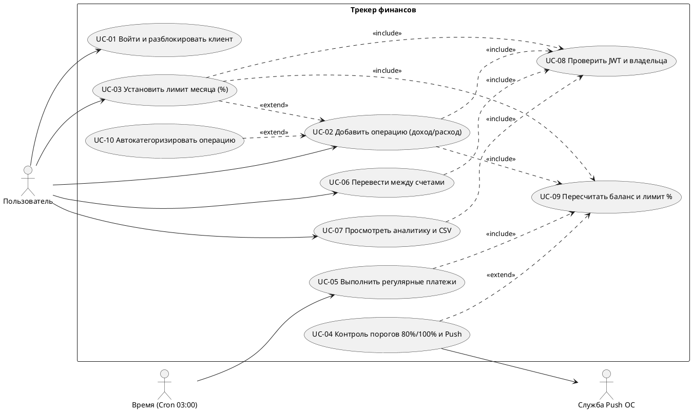

# Модель вариантов использования (Use Case Model)

**Проект:** «Трекер финансов» (Desktop JavaFX, Android, iOS, Spring Boot API, PostgreSQL)  
**Диаграмма PlantUML:** [use-case.puml](./uml/use-case.puml)  
**Основа:** SRS v0.2, Глоссарий проекта, Дополнительные спецификации

---

## 1. Описание действующих лиц (Актёров)

| Актёр | Тип | Описание роли в системе (1–2 строки) |
|---|---|---|
| **Пользователь** | Первичный (человек) | Частное лицо, владелец личного бюджета, работающий с приложением на Desktop (JavaFX), Android или iOS для ведения счетов, операций, регулярных платежей, лимитов и отчётов. |
| **Время (Cron 03:00)** | Первичный (системный триггер) | Системный планировщик, ежедневно в 03:00 инициирующий проверку и автоматическое проведение регулярных платежей. |
| **Служба Push ОС** | Вторичный (внешняя система) | Подсистема уведомлений мобильных ОС, получающая предупреждения при достижении порогов 80% и 100% месячного лимита. |

> **Примечание по правилам UML (ЛР5):** Актёры вынесены за границы проектируемой системы (слева — инициаторы **Пользователь** и **Время (Cron 03:00)**, справа — получатель **Служба Push ОС**). Обязательные повторяющиеся шаги подключены через `<<include>>`, а условное поведение (отправка Push при превышении 80%/100% и автокатегоризация при пустой категории) — через `<<extend>>` (стрелка от расширяющего прецедента к базовому).

---

## 2. Встроенная PlantUML-диаграмма прецедентов

---

## 3. Подробные спецификации прецедентов (Flow of Events)

### UC-01. Войти в систему и разблокировать клиент (JWT / PIN / Биометрия)

- **Связанные требования:** `REQ-FUNC-025`, `REQ-SEC-002`, `REQ-SEC-006`, `REQ-SEC-009`
- **Краткое описание:** Позволяет пользователю пройти полную аутентификацию по Email и паролю с получением пары JWT-токенов или выполнить быструю локальную разблокировку мобильного клиента (Android/iOS) с помощью 4-значного PIN-кода или системной биометрии (FaceID/TouchID/BiometricPrompt).
- **Предусловия:**
  1. Пользователь имеет зарегистрированную учётную запись в системе.
  2. Устройство подключено к сети интернет.
  3. *(Для быстрого входа)* На смартфоне ранее была выполнена успешная первичная авторизация, и в KeyStore/Keychain сохранён действительный Refresh Token.
- **Основной поток событий (полный вход по Email и паролю):**
  1. Вариант использования начинается, когда Пользователь запускает клиентское приложение без активной локальной сессии.
  2. Система отображает форму входа с полями «Email» и «Пароль».
  3. Пользователь вводит Email и пароль и нажимает «Войти».
  4. Клиент валидирует формат Email и непустой пароль и отправляет HTTPS POST `/api/v1/auth/login`.
  5. Сервер ищет учётную запись в PostgreSQL и сверяет пароль с солёным хешем BCrypt (cost 12).
  6. Сервер генерирует Access Token (60 мин) и Refresh Token (30 дней) и возвращает их клиенту.
  7. Клиент сохраняет токены в защищённом хранилище (KeyStore / Keychain), при первом входе на смартфоне предлагает задать 4-значный PIN-код и включить биометрию.
  8. Система открывает главный экран «Обзор». Вариант использования завершается.
- **Альтернативные потоки:**
  - **A1 (Быстрая разблокировка по биометрии или PIN на смартфоне):**
    1. На шаге 1 клиент обнаруживает валидный Refresh Token в KeyStore/Keychain и активный флаг биометрии/PIN.
    2. Клиент отображает экран блокировки и вызывает системный диалог `BiometricPrompt` (Android) / `LocalAuthentication` (iOS) или цифровую клавиатуру PIN.
    3. После успешной локальной проверки клиент тихо обновляет Access Token через `/api/v1/auth/refresh` (если срок старого истёк) и переходит к шагу 8 основного потока.
- **Потоки ошибок:**
  - **E1 (Неверный Email или пароль):** На шаге 5 пароль не совпадает с хешем. Сервер увеличивает счётчик неудачных попыток (лимит 5 попыток за 15 мин) и возвращает HTTP 401; клиент выводит сообщение об ошибке. При превышении 5 попыток сервер возвращает HTTP 429 (блокировка на 15 мин).
  - **E2 (3 неудачные попытки PIN/биометрии в A1):** Клиент очищает локальную привязку быстрого входа, сбрасывает сессию и переводит пользователя на шаг 2 основного потока (полный ввод Email и пароля).
  - **E3 (Истёк или отозван Refresh Token):** Сервер возвращает HTTP 401 на `/auth/refresh`; клиент очищает хранилище и переводит на шаг 2.
- **Постусловия:** Пользователь авторизован, в памяти клиента присутствует валидный Bearer Access Token, открыт экран «Обзор».

---

### UC-02. Зарегистрировать операцию (доход / расход) и пересчитать баланс

- **Связанные требования:** `REQ-FUNC-002`, `REQ-FUNC-004`, `REQ-FUNC-011`, `REQ-INT-002`, `REQ-REL-001`, `REQ-REL-003`
- **Краткое описание:** Позволяет пользователю внести новую транзакцию дохода или расхода с любого клиента (Desktop, Android, iOS), автоматически подобрать категорию при необходимости, атомарно пересчитать баланс счёта в `BigDecimal` и инициировать пересчёт лимита месяца.
- **Предусловия:**
  1. Пользователь авторизован (валидный JWT и изоляция по `user_id`).
  2. У пользователя создан хотя бы один активный (не архивный) счёт.
- **Основной поток событий:**
  1. Вариант использования начинается, когда Пользователь нажимает кнопку «Добавить операцию» в клиенте.
  2. Система отображает унифицированную форму: тип (`Доход` / `Расход`), сумма, дата (по умолчанию текущая), счёт, категория (опционально), описание.
  3. Пользователь выбирает тип, вводит сумму с цифровой клавиатуры, выбирает счёт и категорию, при необходимости вводит описание и нажимает «Сохранить».
  4. Клиент проверяет корректность ввода (`сумма > 0`, выбран счёт) и отправляет HTTPS POST `/api/v1/transactions` с Bearer JWT.
  5. Сервер проверяет JWT и принадлежность счёта текущему `user_id`.
  6. Сервер в рамках ACID-транзакции PostgreSQL сохраняет запись `TRANSACTION` с суммой в `NUMERIC(19, 2)` и пересчитывает `current_balance` счёта в `BigDecimal`.
  7. Сервер автоматически пересчитывает лимит месяца, статус светофора (`NORMAL` / `WARNING` / `EXCEEDED`) и при первом пересечении порогов 80% или 100% расходом инициирует push-уведомление на устройство.
  8. Сервер возвращает обновлённый баланс счёта, данные транзакции и актуальный статус лимита месяца.
  9. Клиент обновляет экран «Обзор» и список операций в течение 1 секунды. Вариант использования завершается.
- **Альтернативные потоки:**
  - **A1 (Автокатегоризация по ключевым словам — `<<extend>>` `UC-10`):**
    1. На шаге 3 Пользователь оставляет категорию невыбранной, но заполняет описание (например, «Магазин Евроопт»).
    2. При условии `categoryId == null` подключается расширяющий прецедент `UC-10`: `CategoryMatcher` ищет подстроку без учёта регистра; при совпадении назначает найденную категорию («Продукты»), иначе — системную категорию «Прочее».
  - **A2 (Фиксация лимита при доходе — переход к `UC-03`):**
    1. На шаге 2 Пользователь выбирает тип `Доход`.
    2. В форме отображается дополнительное поле «Лимит расходов месяца (% от дохода)», предварительно заполненное текущим значением месяца (если уже задано).
- **Потоки ошибок:**
  - **E1 (Некорректный ввод на клиенте/сервере):** Сумма `≤ 0` или не выбран счёт. Клиент блокирует отправку (а сервер при обходе клиента возвращает HTTP 400 Bad Request), подсвечивая поле ошибкой.
  - **E2 (Потеря сети):** Клиент не теряет заполненные поля формы (черновик сохраняется в UI), выводит сообщение об ошибке сети и кнопку «Повторить».
  - **E3 (Попытка доступа к чужому счёту):** Сервер отклоняет операцию (HTTP 404), транзакция откатывается.
- **Постусловия:** Новая транзакция зафиксирована в PostgreSQL, баланс счёта и лимит месяца обновлены, изменения доступны на всех устройствах пользователя.

---

### UC-03. Установить лимит месяца (% от дохода)

- **Связанные требования:** `REQ-FUNC-012`, `REQ-FUNC-013`, `REQ-FUNC-014`, `REQ-REL-003`
- **Краткое описание:** Позволяет пользователю задать или скорректировать процент от суммарного дохода календарного месяца (1%–100%), служащий базой расчёта абсолютного месячного лимита трат и светофорной индикации (`< 80%`, `80–100%`, `> 100%`).
- **Предусловия:**
  1. Пользователь авторизован в системе.
- **Основной поток событий:**
  1. Вариант использования начинается при вводе нового дохода (`UC-02`) с указанием поля «Лимит, % от дохода» либо при редактировании настройки процента в разделе «Бюджет».
  2. Пользователь вводит целое или десятичное значение процента от `1` до `100` (например, `70%`) и подтверждает сохранение.
  3. Клиент валидирует диапазон `1..100` и отправляет запрос на сервер.
  4. Сервер сохраняет (или обновляет) запись `MONTH_BUDGET` для связки `(user_id, year_month)` в PostgreSQL.
  5. Сервер вычисляет сумму доходов за текущий месяц и рассчитывает абсолютный лимит `Сумма_Доходов × (Процент / 100)` с округлением `HALF_UP`, а также актуальный статус светофора (при необходимости отправляя push-предупреждение о порогах 80%/100%).
  6. Клиент отображает новую сумму лимита, остаток и цветовой статус. Вариант использования завершается.
- **Альтернативные потоки:**
  - **A1 (Повторный доход в том же месяце):** Если лимит для текущего месяца уже задан (например, 70%) и пользователь получает премию, система подставляет 70% по умолчанию и автоматически увеличивает абсолютный лимит в деньгах пропорционально новому суммарному доходу.
- **Потоки ошибок:**
  - **E1 (Выход за диапазон 1..100%):** Клиент блокирует отправку, выводя подсказку «Укажите значение от 1 до 100%».
- **Постусловия:** Для текущего календарного месяца зафиксирован процент лимита; абсолютный бюджет, остаток и статус светофора пересчитаны в `BigDecimal`.

---

### UC-04. Уведомить о порогах 80% / 100% лимита (Push)

- **Связанные требования:** `REQ-FUNC-013`, `REQ-FUNC-014`, `REQ-INT-004`
- **Краткое описание:** Условно расширяет (`<<extend>>`) пересчёт баланса и лимита (`UC-09`) при регистрации расхода, если светофорный статус впервые переходит через пороги 80% (`WARNING`) или 100% (`EXCEEDED`), передавая уведомление в **Службу Push ОС**.
- **Предусловия:**
  1. Для текущего месяца установлен лимит расходов (`MONTH_BUDGET`), абсолютный лимит > 0.
  2. Зафиксирована новая расходная операция (вручную через `UC-02` или по расписанию через `UC-05`).
- **Основной поток событий:**
  1. При выполнении `UC-09` сервер вычисляет долю освоения: `ratio = (Расходы_Месяца / Сумма_Лимита) × 100%`.
  2. Сервер определяет статус: `NORMAL` (`< 80%`), `WARNING` (`80%–100%`) или `EXCEEDED` (`> 100%`).
  3. При первом повышении статуса до `WARNING` или `EXCEEDED` `BudgetNotificationService` отправляет задачу уведомления в **Службу Push ОС**.
  4. Смартфон выводит системное предупреждение пользователю (*«Израсходовано более 80% лимита»* или *«Месячный лимит превышен!»*). Вариант использования завершается.
- **Альтернативные потоки:**
  - **A1 (Порог уже преодолён ранее):** Если статус остался в той же зоне (`WARNING` → `WARNING`), повторное push-уведомление не отправляется.
- **Потоки ошибок:**
  - **E1 (Уведомления запрещены в настройках ОС):** **Служба Push ОС** игнорирует баннер без сбоя; статус светофора в интерфейсе обновляется корректно.
- **Постусловия:** Статус светофора актуализирован; при пересечении порога пользователь уведомлён через **Службу Push ОС**.

---

### UC-05. Выполнить и настроить регулярные платежи

- **Связанные требования:** `REQ-FUNC-008`, `REQ-REL-001`, `REQ-REL-003`
- **Краткое описание:** Позволяет **Пользователю** настраивать правила повторяющихся списаний, а актёру **Время (Cron 03:00)** — ежедневно и автоматически проводить плановые расходы с защитой от дублирования.
- **Предусловия:**
  1. Для настройки пользователем — пройдена проверка JWT (`UC-08`). Для автосписания — в `RECURRING_PAYMENT` есть активные правила (`active = true`).
- **Основной поток событий:**
  1. Пользователь создаёт/приостанавливает правило списания, а **Время (Cron 03:00)** ежедневно в 03:00 запускает планировщик `RecurringPaymentService`.
  2. Сервер выбирает активные правила на текущую дату и проверяет `last_executed_date < сегодня` (идемпотентность).
  3. В изолированной ACID-транзакции создаётся расход `TRANSACTION` в `BigDecimal`, уменьшается баланс счёта, обновляется `last_executed_date = сегодня` и вызывается `UC-09` (`<<include>>`).
- **Альтернативные потоки:**
  - **A1 (Повторный перезапуск в тот же день):** Правило с `last_executed_date == сегодня` пропускается без дублирования.
  - **A2 (Конец короткого месяца — 29, 30, 31 число):** Списание переносится на последний день текущего месяца.
- **Потоки ошибок:**
  - **E1 (Счёт заархивирован):** Откатывается транзакция только проблемного правила; остальные правила обрабатываются штатно.
- **Постусловия:** Плановые списания проведены строго однократно; балансы и лимиты обновлены.

---

### UC-06. Перевести между счетами

- **Связанные требования:** `REQ-FUNC-007`, `REQ-REL-001`
- **Краткое описание:** Позволяет пользователю переместить средства между двумя своими счетами в одной валюте без искажения суммарного капитала и статистики расходов (`<<include>>` `UC-08`, `UC-09`).
- **Предусловия:** Пользователь авторизован (`UC-08`), открыты минимум два активных счёта в одной валюте.
- **Основной поток событий:**
  1. Пользователь выбирает тип «Перевод», указывает счёт списания, счёт зачисления и сумму `> 0`.
  2. Сервер в одной ACID-транзакции уменьшает баланс счёта-источника и увеличивает баланс счёта-приёмника на одинаковую сумму в `BigDecimal` (`UC-09`).
  3. Запись сохраняется с типом `TRANSFER` и исключается из расчёта месячных расходов и диаграмм трат.
- **Потоки ошибок:**
  - **E1 (Разные валюты счетов или одинаковый счёт):** Сервер возвращает HTTP 400.
- **Постусловия:** Балансы двух счетов обновлены; суммарный капитал не изменился.

---

### UC-07. Просмотреть аналитику и экспортировать выписку в CSV

- **Связанные требования:** `REQ-FUNC-015`, `REQ-FUNC-016`, `REQ-FUNC-020`, `REQ-INT-007`
- **Краткое описание:** Позволяет просматривать круговую диаграмму расходов по категориям и столбчатый график «доходы/расходы» на всех платформах, а также экспортировать отфильтрованный журнал в CSV на Desktop JavaFX (`<<include>>` `UC-08`).
- **Предусловия:** Пользователь авторизован (`UC-08`), в истории присутствуют транзакции.
- **Основной поток событий:**
  1. Пользователь открывает вкладку «Отчёты» и выбирает период (месяц / год).
  2. Сервер агрегирует суммы по категориям (исключая `TRANSFER`) и возвращает доли в процентах (сумма = 100%).
  3. Клиент отрисовывает графики; на ПК пользователь нажимает «Экспорт в CSV» и сохраняет файл в UTF-8 с заголовком `Date,Type,Amount,Currency,Account,Category,Description`.
- **Потоки ошибок:**
  - **E1 (Отсутствие расходов за период):** Отображается пустое состояние «Нет операций за выбранный период».
- **Постусловия:** Аналитические диаграммы отображены; при экспорте на диск сохранён CSV-файл.
